# Kế hoạch phát triển theo module – LegalGraph

| Mục | Nội dung |
|---|---|
| Dựa trên | [inception.md](inception.md), [features/README.md](features/README.md), [features/00-common.md](features/00-common.md), F01–F17 |
| Phạm vi | Từ zero đến **bản chạy được ở mức dev** (production-like trên một máy / Docker Compose), chưa phải hạ tầng production thật |
| Ngày | 18/11/2026 |
| Trạng thái | Đề xuất – chờ review |

---

> Implement plan và checklist chi tiết của từng module nằm ở [modules/](modules/README.md).

## 0. Nguyên tắc chia module

1. **Mỗi module ra một kết quả chạy được và kiểm tra được**: có API, có test, có tiêu chí "xong" lấy từ mục 7 của file feature tương ứng.
2. **Đi theo chiều dọc trước, mở rộng sau**: PoC làm một đường xuyên suốt *thu thập → đồ thị → tra cứu trực tiếp → trả lời có trích dẫn* (Q1, Q5), rồi MVP mới thêm Local / Global Search, OCR, LLM extraction...
3. **Feature lớn tách làm hai lớp**: lớp PoC (luật mẫu, không stream, chỉ BM25) và lớp MVP (LLM, stream, vector, Leiden), đúng như bảng ưu tiên trong `features/README.md`.
4. **Bộ câu hỏi đánh giá có từ sớm**: Q1–Q5 được đưa vào test hồi quy ngay từ PoC, không đợi tới F16.
5. **Module "nền" làm trước**: hạ tầng (M0) và LLM Gateway (M1) là phụ thuộc chung của mọi thứ khác.

---

## 1. Tổng quan module

| Module | Tên | Feature | Giai đoạn | Ước lượng | Phụ thuộc |
|---|---|---|---|---|---|
| **M0** | Nền tảng & hạ tầng dev | 00-common | PoC | 3–4 ngày | – |
| **M1** | LLM Gateway | F17 | PoC | 2–3 ngày | M0 |
| **M2** | Thu thập & chuẩn hóa (không OCR) | F01, F02 | PoC | 4–5 ngày | M0 |
| **M3** | Tách cấu trúc & ghi đồ thị | F03 | PoC | 4–5 ngày | M2 |
| **M4** | Trích xuất quan hệ (luật mẫu) & danh mục | F04 (rule) | PoC | 3–4 ngày | M3, M1 |
| **M5** | Duyệt quan hệ (API + UI tối giản) | F05 | PoC | 3 ngày | M4 |
| **M6** | Hợp nhất phiên bản (cơ bản) | F06 (cơ bản) | PoC | 3–4 ngày | M5 |
| **M7** | Lọc hiệu lực & tra cứu trực tiếp | F13, F10 | PoC | 3–4 ngày | M6 |
| **M8** | Chỉ mục BM25 | F07 (BM25) | PoC | 2 ngày | M6 |
| **M9** | Hỏi đáp end-to-end (không stream) | F09 (rule), F14 (cơ bản), F08 (cơ bản) | PoC | 4–5 ngày | M7, M8, M1 |
| **M10** | Web chat & màn hình văn bản | UI của F08, F10 | PoC → MVP | 4–5 ngày (chia 2 đợt) | M9 |
| | **🏁 Mốc PoC: demo Q1, Q5** | | | **~4 tuần** | |
| **M11** | Mở rộng pipeline tri thức | F02 OCR, F04 LLM + chủ đề/đối tượng, F06 cấp điểm + thay thế | MVP | 6–8 ngày | M1–M6 |
| **M12** | Vector & phân cụm chủ đề | F07 (vector, Leiden, tóm tắt) | MVP | 4–5 ngày | M8, M11 |
| **M13** | Local Search | F11 | MVP | 4 ngày | M12, M7 |
| **M14** | Global Search | F12 | MVP | 4 ngày | M12, M7 |
| **M15** | Hỏi đáp nâng cao | F09 (LLM + hội thoại), F14 (sinh lại), F08 (SSE stream) | MVP | 5 ngày | M13, M14 |
| **M16** | Cập nhật tăng dần & scheduler | F15 | MVP | 4–5 ngày | M2–M8 |
| **M17** | Đánh giá & phản hồi | F16 | MVP | 5 ngày | M15 |
| **M18** | Hoàn thiện bản dev (hardening) | Rủi ro mục 8 inception, KPI mục 7 | MVP cuối | 4–5 ngày | tất cả |
| | **🏁 Mốc MVP: demo Q1–Q5, đo KPI** | | | **+7–8 tuần** | |

```mermaid
flowchart LR
    M0[M0 Nền tảng] --> M1[M1 LLM Gateway]
    M0 --> M2[M2 Thu thập + chuẩn hóa]
    M2 --> M3[M3 Tách cấu trúc]
    M3 --> M4[M4 Trích xuất luật mẫu]
    M1 --> M4
    M4 --> M5[M5 Duyệt]
    M5 --> M6[M6 Hợp nhất]
    M6 --> M7[M7 Hiệu lực + tra cứu]
    M6 --> M8[M8 BM25]
    M7 --> M9[M9 Hỏi đáp E2E]
    M8 --> M9
    M9 --> M10[M10 Web UI]
    M9 --> POC{{"🏁 PoC Q1, Q5"}}

    POC --> M11[M11 Mở rộng pipeline]
    M11 --> M12[M12 Vector + Leiden]
    M12 --> M13[M13 Local Search]
    M12 --> M14[M14 Global Search]
    M13 --> M15[M15 Hỏi đáp nâng cao]
    M14 --> M15
    POC --> M16[M16 Cập nhật tăng dần]
    M15 --> M17[M17 Đánh giá + phản hồi]
    M16 --> M18[M18 Hardening]
    M17 --> M18
    M18 --> MVP{{"🏁 MVP Q1–Q5 + KPI"}}

    classDef poc fill:#DEEBF7,stroke:#2E75B6,color:#1F4E79
    classDef mvp fill:#E8F5EC,stroke:#2E8B57,color:#1E5E3A
    class M0,M1,M2,M3,M4,M5,M6,M7,M8,M9,M10 poc
    class M11,M12,M13,M14,M15,M16,M17,M18 mvp
```



---

## 2. Cấu trúc mã nguồn đề xuất

> Inception chỉ chốt FastAPI, Neo4j, Elasticsearch, LM Studio; 00-common bổ sung PostgreSQL. Các lựa chọn còn lại (Python 3.12, `uv`, SQLAlchemy 2 + Alembic, React + Vite) là **đề xuất**, cần thống nhất ở M0.

```text
law-chat/
├── docker-compose.yml          # neo4j (+GDS), postgres, elasticsearch (+ICU), backend, worker, frontend
├── .env.example                # LLM_BASE_URL, LLM_MODEL, EMBEDDING_MODEL, NEO4J_*, PG_*, ES_*, API_KEYS
├── backend/
│   ├── pyproject.toml
│   ├── alembic/                # migration PostgreSQL
│   ├── app/
│   │   ├── main.py             # FastAPI app, router /api/v1
│   │   ├── core/               # config, auth X-API-Key + vai trò, error format, logging, time (Asia/Ho_Chi_Minh)
│   │   ├── db/                 # pg session, neo4j driver, es client, file storage
│   │   ├── models/             # Pydantic dùng chung (Citation, ThayDoi, TrangThaiHieuLuc...)
│   │   ├── jobs/               # hàng đợi job trên PostgreSQL (SKIP LOCKED), worker loop
│   │   ├── llm/                # M1 – F17
│   │   ├── ingest/             # M2 – F01, F02
│   │   ├── parsing/            # M3 – F03
│   │   ├── relations/          # M4, M5 – F04, F05
│   │   ├── consolidation/      # M6 – F06
│   │   ├── indexing/           # M8, M12 – F07
│   │   ├── retrieval/          # M7, M13, M14 – F10, F11, F12, F13
│   │   ├── qa/                 # M9, M15 – F08, F09, F14
│   │   ├── ops/                # M16 – F15
│   │   └── eval/               # M17 – F16
│   └── tests/
│       ├── fixtures/           # NĐ 123/2020, NĐ 70/2025, TT 78/2021, TT 32/2025, NQ 198/2025...
│       ├── unit/
│       └── e2e/                # Q1–Q5 golden tests
├── frontend/                   # web chat + giao diện duyệt / quản trị
└── docs/
```

Mỗi module backend tách 3 lớp: `router.py` (API) → `service.py` (nghiệp vụ, BR-xx) → `repo.py` (truy cập Neo4j / PG / ES). Business rule được test ở lớp `service` mà không cần chạy DB thật khi có thể.

---

## 3. Chi tiết từng module – Giai đoạn PoC

### M0 – Nền tảng & hạ tầng dev

**Mục tiêu:** `docker compose up` là có đủ kho dữ liệu và một API rỗng chạy được; mọi module sau chỉ việc thêm code.

| Hạng mục | Công việc |
|---|---|
| Repo & tooling | Khung thư mục như mục 2; `ruff`, `mypy`, `pytest`; pre-commit; Makefile (`make up`, `make test`, `make migrate`, `make seed`) |
| Docker Compose | Neo4j 5 + plugin GDS (cho Leiden ở M12) + bật vector index; PostgreSQL 16; Elasticsearch 8 + plugin `analysis-icu` (tìm không dấu ở M8); volume dữ liệu |
| Cấu hình | `pydantic-settings` đọc `.env`; biến LLM theo mục 6.1 inception |
| Neo4j | Script khởi tạo constraint + index theo 00-common §4.3 (chạy idempotent khi app khởi động) |
| PostgreSQL | Alembic; migration đầu tiên chỉ có bảng nền (`api_key`, `job`) |
| Quy ước API | Prefix `/api/v1`; xác thực `X-API-Key` → vai trò `nguoi_dung` / `bien_tap_vien` / `quan_tri`; format lỗi chuẩn; phân trang `{items, page, page_size, total}`; pattern `202 + job_id` |
| Hàng đợi job | Bảng `pipeline_run` / `pipeline_job` của F15 §6 (tạo sớm, thêm `priority`, `run_after`, `dedupe_key`) + worker dùng `SELECT ... FOR UPDATE SKIP LOCKED` (README §6 giả định 10); có ưu tiên, retry, trạng thái |
| Model dùng chung | `TrangThaiHieuLuc`, `ThayDoi`, `Citation`; tiện ích ID (sinh ID Điều/Khoản/Điểm, `slug`), tiện ích ngày (nửa mở `[tu, den)`) |
| CI | GitHub Actions: lint + unit test + test tích hợp với service container |

**Xong khi:** `GET /api/v1/health` báo kết nối được cả 3 kho; test ID/slug/khoảng hiệu lực xanh; CI xanh.

---

### M1 – LLM Gateway (F17)

**Mục tiêu:** một cổng duy nhất để mọi module gọi Qwen3.5 9B / embedding qua LM Studio.

- Client OpenAI SDK trỏ `LLM_BASE_URL`; các hàm `complete`, `complete_json(schema)` (Pydantic + gọi lại khi JSON lỗi), `stream`, `embed`.
- Bật/tắt thinking theo tác vụ; lọc `<think>…</think>` (**spike sớm**: kiểm chứng `/no_think` trên bản LM Studio thực tế – README giả định 7).
- Circuit breaker (5 lỗi → mở mạch), timeout, retry.
- Hàng đợi ưu tiên: chat > batch (trích xuất, tóm tắt).
- Ghi `llm_call_log` (PG): tác vụ, độ trễ, token, lỗi.
- API: `/admin/llm/health`, `/admin/llm/stats`, `/admin/llm/config`.
- **Mock LM Studio** (FastAPI giả lập) dùng cho test và CI.

**Xong khi:** đạt 5 tiêu chí F17 §7 (đặc biệt: JSON sai 2 lần rồi đúng → `attempts = 3`; tắt LM Studio → `LLMUnavailable` < 50 ms).

---

### M2 – Thu thập & chuẩn hóa văn bản (F01, F02 không OCR)

**Mục tiêu:** đưa ~10–20 văn bản hóa đơn điện tử + thuế hộ kinh doanh vào hệ thống ở trạng thái `NORMALIZED`.

- **F01:** crawler `vanban.chinhphu.vn` (đã được phép crawl – inception §10) theo danh sách số hiệu seed; ≤ 1 req/s, tôn trọng `robots.txt`, retry 3 lần; chống trùng SHA-256; lưu bản gốc bất biến `raw/{yyyy}/{sha256}.{ext}`; ưu tiên DOCX > PDF text; ghi `crawl_source`, `crawl_job`, `crawl_job_item`, `source_document`.
- Import thủ công (multipart, giới hạn kích thước).
- **F02 (không OCR):** DOCX/PDF text → text; Unicode NFC; bỏ quốc hiệu, nơi nhận, chữ ký; ghi `normalized_document` + cảnh báo. Đầu ra xác định (chạy 2 lần giống hệt).
- Máy trạng thái `source_document.status` theo 00-common §5.
- API: nhóm `/ingest/crawl-jobs`, `/ingest/uploads`, `/ingest/source-documents/*`.

**Xong khi:** tiêu chí F01 §7 và F02 §7 (trừ mục OCR); bộ fixture văn bản mẫu được commit vào `tests/fixtures`.

---

### M3 – Tách cấu trúc & ghi đồ thị (F03)

**Mục tiêu:** từ văn bản chuẩn hóa sinh cây `VanBan → Chuong → Dieu → Khoan → Diem` trong Neo4j, **chỉ bằng regex/parser**.

- Parser metadata (số hiệu, loại, cơ quan, ngày ban hành, ngày hiệu lực) + cấu trúc; nhận diện **khối trích dẫn “…”** trong văn bản sửa đổi để không sinh nhầm khoản/điểm (`quoted_blocks`).
- ID xác định + `MERGE` → chạy lại không sinh trùng.
- Tạo `PhienBan` gốc (`loai_thay_doi = GOC`) cho mỗi Khoản / Điều không chia khoản.
- Ghi `parse_result`, `metadata_audit`; chuyển `NEEDS_ATTENTION` khi thiếu ngày hiệu lực.
- API: `/documents`, `/documents/{slug}/structure`, `/parse-report`, `PATCH /metadata`.

**Xong khi:** tiêu chí F03 §7 (node `123/2020/NĐ-CP:Đ3:K10` đúng nội dung; tách lại số node không đổi; ngày hiệu lực NĐ 70 và NQ 198 đúng).

---

### M4 – Trích xuất quan hệ bằng luật mẫu & danh mục (F04 lớp rule)

- Bộ luật mẫu câu: "sửa đổi, bổ sung", "bãi bỏ", "thay thế", "hướng dẫn"; giải tham chiếu ngữ cảnh ("Sửa đổi khoản 4 Điều 9" trong Điều "Sửa đổi… NĐ 123") về ID đích.
- Ứng viên lưu `relation_candidate` (PG) kèm độ tin cậy, phương pháp, trích đoạn nguồn; **chưa ghi vào đồ thị**.
- Cạnh `HUONG_DAN`, `VIEN_DAN` tự duyệt (README giả định 4).
- Danh mục có kiểm soát `ChuDe`, `DoiTuong` (seed: hóa đơn điện tử, thuế hộ kinh doanh; hộ kinh doanh, doanh nghiệp...).
- Đánh dấu câu "khó" cần LLM (để M11 xử lý) – đo tỷ lệ ngay từ PoC.

**Xong khi:** 3 tiêu chí đầu F04 §7; báo cáo tỷ lệ câu cần LLM (mục tiêu ≤ 20%).

---

### M5 – Duyệt quan hệ (F05)

- API hàng đợi duyệt, approve (kèm sửa), reject, bulk-approve (độ tin cậy ≥ 0.95), thêm thủ công, revoke, stats.
- Approve → ghi cạnh `SUA_DOI` / `BAI_BO` / `THAY_THE` vào Neo4j kèm `candidate_id`; phát hiện xung đột cùng đích cùng ngày → 409.
- Duyệt xong toàn bộ ứng viên của một văn bản → tự tạo job hợp nhất (M6).
- UI tối giản: danh sách ứng viên + câu nguồn + nội dung đích + nút duyệt / từ chối (có thể làm chung app frontend ở M10, hoặc tạm dùng trang server-rendered).
- Thiết kế để **vừa ngân sách chuyên gia 2 giờ/tuần**: sắp ưu tiên độ tin cậy thấp, bulk-approve phần còn lại.

**Xong khi:** tiêu chí F05 §7.

---

### M6 – Hợp nhất phiên bản, bản cơ bản (F06)

- Thuật toán consolidation theo `tu_ngay`: **bãi bỏ** và **sửa nguyên cả khoản** (cấp điểm và thay thế văn bản để M11).
- Đảm bảo bất biến: các phiên bản của một điều khoản không chồng lấn; chạy lại idempotent.
- Cập nhật `VanBan.hieu_luc_den`, `trang_thai`.
- Ghi `consolidation_run`; API `/consolidation/runs`, `/units/versions`.
- Test bất biến tự động: truy vấn Cypher tìm phiên bản chồng lấn phải trả 0 dòng.

**Xong khi:** tiêu chí F06 §7 (riêng mục TT 78/2021 `het_hieu_luc` có thể làm luôn bằng cạnh `THAY_THE` ở mức văn bản nếu kịp).

---

### M7 – Lọc hiệu lực & tra cứu trực tiếp (F13, F10)

- **F13** (chốt chặn chống trích dẫn quy định cũ): hàm `check_effectivity(unit_ids, ngay)` → trạng thái + `ThayDoi`; xét cả hiệu lực của văn bản chứa. API `/effectivity/check`. Bộ unit test đủ 5 trường hợp ở F13 §7.
- **F10:** `/units/lookup?unit_id=&ngay=`, `/documents/{slug}?ngay=`, `/documents/{slug}/relations`, `/documents/{slug}/amendments?target=` (Q5); gợi ý quy định thay thế khi điều khoản đã bị bãi bỏ.

**Xong khi:** tiêu chí F13 §7 và F10 §7 (Q1 hôm nay → BAI_BO; Q1 ngày 15/3/2025 → còn hiệu lực; Q5 khớp 100%; lookup p95 ≤ 200 ms).

---

### M8 – Chỉ mục BM25 (F07 phần BM25)

- Đồng bộ mỗi `PhienBan` → 1 document Elasticsearch (nội dung, unit_id, so_hieu, hiệu lực); analyzer ICU + `asciifolding` để tìm không dấu.
- Ghi `index_run`; API `/index/runs`, `/index/status`.

**Xong khi:** số document ES = số `PhienBan`; tìm "huy hoa don" ra khoản 10 Điều 3 NĐ 123.

---

### M9 – Hỏi đáp end-to-end, không stream (F09 rule, F14 cơ bản, F08 cơ bản)

- **F09 (rule):** trích số hiệu (giải alias "NĐ 123", "Nghị định 123/2020" qua `/documents/resolve`), điều/khoản/điểm, ngày áp dụng (mặc định hôm nay); định tuyến `DIRECT` / `GRAPH` (PoC chỉ cần 2 route này; câu khác tạm fallback BM25).
- **F14 (cơ bản):** prompt bắt buộc trích dẫn dạng `[C1]`; kiểm tra trích dẫn: tồn tại + còn hiệu lực (gọi F13); không đạt → báo "không chắc chắn" (sinh lại để M15).
- **F08 (cơ bản):** phiên chat, `POST /messages` với `stream=false`, lưu `chat_session`, `chat_message`, `message_citation`, `query_trace`; disclaimer "không phải tư vấn pháp lý".
- **Golden test Q1, Q5** trong `tests/e2e` chạy được với LM Studio thật (local) và với mock (CI).

**Xong khi:** Q1, Q5 trả lời đúng qua API, mỗi câu ≥ 1 trích dẫn, không có `<think>` trong `chat_message`; câu hỏi ví dụ inception §5.3 nói rõ khoản 10 Điều 3 đã bị bãi bỏ.

---

### M10 – Web chat & màn hình văn bản (frontend)

Chia hai đợt:

| Đợt | Nội dung |
|---|---|
| PoC (cuối M9) | Màn chat (gửi câu, hiển thị trả lời + thẻ trích dẫn có trạng thái hiệu lực, ngày áp dụng); trang văn bản (cây cấu trúc, dòng thời gian phiên bản). Khung frontend và màn duyệt đã có từ M5 |
| MVP (cùng M15–M17) | Chat stream SSE; chọn ngày áp dụng; nút 👍/👎; trang chủ đề (Global Search); dashboard quản trị (pipeline, LLM health, KPI đánh giá) |

**🏁 Mốc PoC:** demo Q1, Q5 trên giao diện web với ~10–20 văn bản hóa đơn điện tử.

---

## 4. Chi tiết từng module – Giai đoạn MVP

### M11 – Mở rộng pipeline tri thức (F02 OCR, F04 LLM, F06 nâng cao)

- **F02 OCR:** PaddleOCR / Tesseract `vie` cho PDF scan / ảnh; ghi `ocr_confidence_avg`; OCR kém → `NEEDS_ATTENTION`.
- **F04 LLM:** câu khó gửi Qwen3.5 qua `complete_json` (thinking tắt, chạy batch ưu tiên thấp); trích `AP_DUNG_CHO`, `THUOC_CHU_DE` (rule từ khóa + LLM); thêm mảng **thuế hộ kinh doanh** (inception §10).
- **F06 nâng cao:** sửa / bổ sung / bãi bỏ cấp **Điểm** → phiên bản mới của Khoản cha + `diem[]`; `THAY_THE` văn bản; Điều bổ sung (`Đ9a`).

**Xong khi:** toàn bộ tiêu chí còn lại của F02, F04, F06 §7.

### M12 – Vector & phân cụm chủ đề (F07 đầy đủ)

- Embedding bge-m3 (1024 chiều) cho `PhienBan` qua M1; cờ `embedding_stale`; vector index Neo4j.
- Leiden (Neo4j GDS) trên đồ thị Điều → node `Cum`, `THUOC_CUM`, `CUM_CHA`; LLM tóm tắt cụm + embedding tóm tắt; cờ `dirty` để chỉ tóm tắt lại cụm bị ảnh hưởng.
- API `/topics`, `/topics/{cum_id}`.

**Xong khi:** tiêu chí F07 §7 còn lại (mỗi cụm có tóm tắt hợp lệ; sửa một khoản → chỉ cụm liên quan được tóm tắt lại).

### M13 – Local Search (F11)

- Hybrid: vector + BM25 (hợp nhất điểm, ví dụ RRF) → mở rộng đồ thị (`VIEN_DAN`, `HUONG_DAN`, phiên bản sửa đổi) → **lọc F13** → cắt ngữ cảnh ≤ ~3 000 token.
- API `/search/local`.

**Xong khi:** Q2, Q4 đạt; không ngữ cảnh `chinh` nào hết hiệu lực; p95 ≤ 1.5 s.

### M14 – Global Search (F12)

- Chọn cụm theo embedding tóm tắt + lọc đồ thị theo `ChuDe` / `DoiTuong` → map-reduce trên tóm tắt cụm → lọc F13 → `structured_result`.
- Timeout 20 s → trả `partial = true`.
- API `/search/global`, `/topics/{ma_chu_de}/documents`.

**Xong khi:** Q3 đúng (có NĐ 123 đã sửa, NĐ 70, TT 32; **không** có TT 78).

### M15 – Hỏi đáp nâng cao (F09 LLM, F14 sinh lại, F08 stream)

- F09: LLM bổ trợ phân tích + định tuyến `LOCAL` / `GLOBAL`; ngữ cảnh hội thoại ("còn khoản 2 thì sao?"); ngày mơ hồ theo README giả định 6; không bao giờ bịa số hiệu.
- F14: phát hiện `UNKNOWN_REF`, trích dẫn hết hiệu lực → sinh lại tối đa N lần → báo không chắc chắn.
- F08: SSE stream (lọc `<think>` trong khi stream), xử lý LM Studio tắt giữa chừng → 503 rõ ràng / câu trả lời dự phòng.

**Xong khi:** tiêu chí F08, F09, F14 §7; độ chính xác định tuyến ≥ 90%.

### M16 – Cập nhật tăng dần & scheduler (F15)

- Bảng `schedule`, `pipeline_run`, `pipeline_job`, `watermark`; scheduler trong worker (cron).
- `daily_ingest`: crawl mới → chạy F02–F04 → dừng ở `IN_REVIEW` → sau duyệt tự chạy F06–F07 tăng dần.
- Nạp sai thứ tự (NĐ 70 trước NĐ 123) → ứng viên `cho_van_ban_dich`, tự nối khi văn bản đích tới.
- Làm mới `trang_thai` hiệu lực hằng ngày (hỗ trợ **đồng hồ giả lập** để test 01/01/2026 – NQ 198).
- API `/admin/schedules`, `/admin/pipeline/*`, `/admin/freshness`.

**Xong khi:** tiêu chí F15 §7.

### M17 – Đánh giá & phản hồi (F16)

- Bộ câu hỏi chuẩn (≥ 50 câu, có phiên bản), lượt đánh giá chạy tự động sau mỗi lần cập nhật; chấm tự động + chuyên gia ghi đè.
- Chỉ số KPI inception §7: độ chính xác trả lời, tỷ lệ trích dẫn hết hiệu lực, độ chính xác trích dẫn, P95, độ chính xác định tuyến; so sánh với lượt trước.
- Phản hồi người dùng 👍/👎 → hàng đợi phân loại → chuyển thành câu hỏi chuẩn ≤ 3 thao tác.

**Xong khi:** tiêu chí F16 §7.

### M18 – Hoàn thiện bản dev (hardening)

| Hạng mục | Công việc |
|---|---|
| Đóng gói | Image Docker cho backend / worker / frontend; `docker compose up` dựng toàn bộ hệ thống từ máy trắng; script seed dữ liệu PoC + MVP |
| Bảo mật | LM Studio chỉ mở trong mạng nội bộ; tùy chọn reverse proxy (Caddy) HTTPS + xác thực; không log API key; CORS đúng origin |
| Quan sát | Log JSON có `request_id` / `trace_id`; trang quản trị: LLM health, pipeline, KPI |
| Hiệu năng | Đo P95 trên bộ đánh giá (≤ 10 s, Global ≤ 20 s); cache tra cứu nóng; tối ưu truy vấn Cypher |
| Dữ liệu | Backup / restore Neo4j + PostgreSQL; bản gốc file bất biến |
| Tài liệu | README chạy dự án, runbook (sự cố LM Studio, chạy lại job lỗi, phân cụm lại), tài liệu API (OpenAPI của FastAPI) |
| Pháp lý | Disclaimer, hiển thị nguồn + ngày hiệu lực trên mọi trích dẫn |

**🏁 Mốc MVP:** demo Q1–Q5 trên cả hai mảng (hóa đơn điện tử + thuế hộ kinh doanh); báo cáo KPI từ M17.

---

## 5. Lịch đề xuất theo tuần

| Tuần | Module | Kết quả cuối tuần |
|---|---|---|
| 1 | M0, M1, bắt đầu M2 | Hạ tầng chạy, gọi được LM Studio qua gateway |
| 2 | M2, M3 | 10–20 văn bản trong Neo4j có cấu trúc |
| 3 | M4, M5, M6 | Quan hệ đã duyệt, có phiên bản theo thời gian |
| 4 | M7, M8, M9, M10 (đợt 1) | **🏁 PoC: Q1, Q5 trên web** |
| 5–6 | M11, M16 (song song nếu có 2 người) | OCR, LLM extraction, thuế hộ kinh doanh, cập nhật hằng ngày |
| 7 | M12 | Vector + cụm chủ đề |
| 8–9 | M13, M14, M15 | Local / Global Search, chat stream |
| 10 | M17, M10 (đợt 2) | Bộ ≥ 50 câu, dashboard KPI |
| 11 | M18 | **🏁 MVP: Q1–Q5 + KPI**, đóng gói bản dev |

Nếu có 2 người: một người theo **pipeline tri thức** (M2–M6, M11, M16), một người theo **hỏi đáp** (M1, M7–M9, M13–M15) + frontend; M0 làm chung tuần đầu.

---

## 6. Việc cần làm sớm để giảm rủi ro (spike)

| Spike | Làm ở | Vì sao |
|---|---|---|
| Tắt thinking Qwen3.5 trên LM Studio, nạp đồng thời Qwen + bge-m3 trên máy dev | M1, tuần 1 | README giả định 7, 9; quyết định tốc độ indexing và chat |
| Lấy 5 văn bản mẫu thật từ `vanban.chinhphu.vn` và thử parser | M2, tuần 1 | Định dạng nguồn thực tế quyết định độ khó F02/F03 |
| Thử Leiden trên Neo4j GDS bản Community trong Docker | M0 | Cần cho M12; xác nhận plugin và giấy phép |
| ES analyzer tiếng Việt không dấu | M0 | Cần cho M8 |
| Chốt lịch chuyên gia duyệt | Trước M5 | Inception §10 ghi "tối đa 2 giờ/tuần, chạy trong 0.5 tuần" – cần làm rõ ý "0.5 tuần" |

---

## 7. Định nghĩa "Xong" chung cho mọi module

- [ ] API theo đúng quy ước 00-common §6, có trong OpenAPI.
- [ ] Migration PG / Cypher khởi tạo idempotent.
- [ ] Unit test cho business rule `BR-xx` chính; test tích hợp với DB thật trong Docker.
- [ ] Đạt tiêu chí chấp nhận ở mục 7 của file feature (phần thuộc giai đoạn đó).
- [ ] Golden test Q1–Q5 hiện có vẫn xanh (không hồi quy).
- [ ] Cập nhật README / runbook nếu thêm cấu hình hoặc thao tác vận hành.
