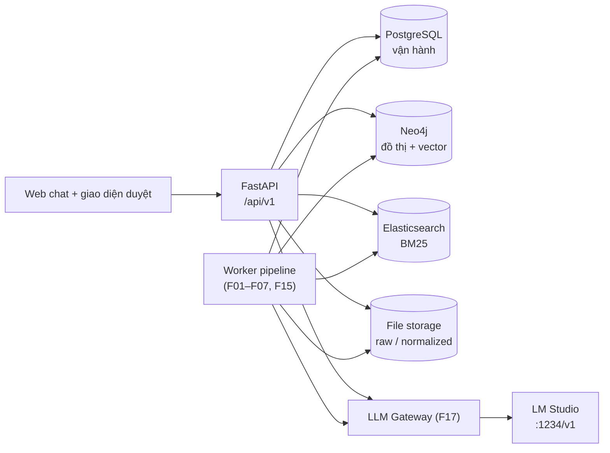
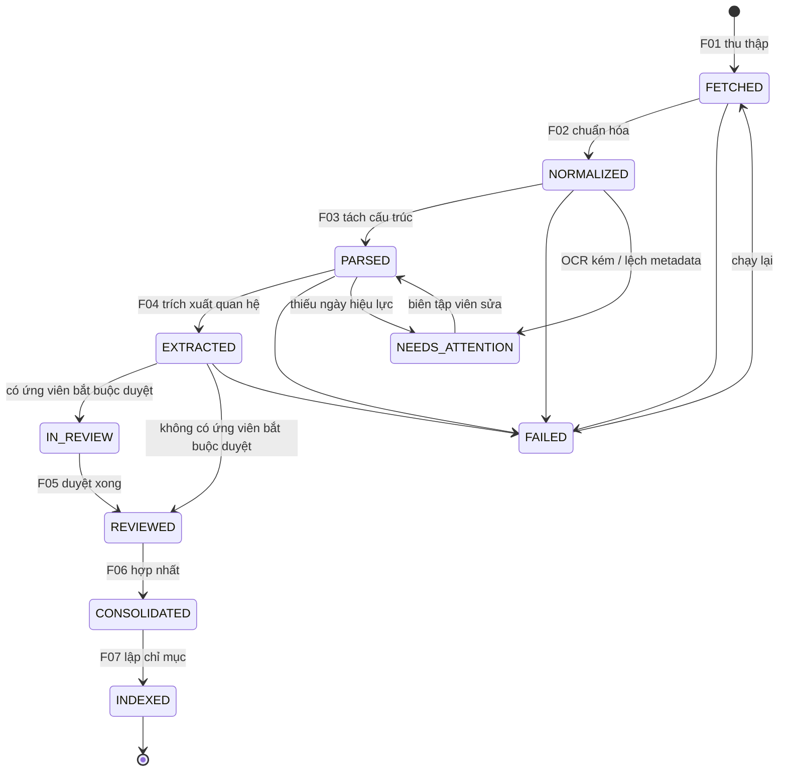

# 00 – Quy ước chung cho mọi feature

Tài liệu này gom các quy ước dùng chung để các file feature (F01–F17) không phải lặp lại. Khi một feature nói "theo quy ước chung" thì tham chiếu về đây.

---

## 1. Kiến trúc lưu trữ

| Kho | Vai trò | Ghi chú |
|---|---|---|
| **Neo4j** | Đồ thị tri thức: cấu trúc văn bản, phiên bản, quan hệ, vector index | Nguồn sự thật cho nội dung pháp lý đã duyệt |
| **PostgreSQL** | Dữ liệu vận hành: job pipeline, ứng viên quan hệ, lịch sử duyệt, hội thoại, đánh giá, log LLM | *Đề xuất bổ sung so với inception* – inception chưa nêu kho dữ liệu vận hành. Bản dev có thể chạy bằng Docker Compose |
| **Elasticsearch** | Chỉ mục BM25 cho nội dung phiên bản | Đồng bộ từ Neo4j (F07) |
| **File storage** | Bản gốc bất biến (PDF/DOCX/ảnh) và bản văn bản đã chuẩn hóa | Thư mục local cho bản dev; đường dẫn theo hash |
| **LM Studio** | Qwen3.5 9B (chat / trích xuất / tóm tắt) và model embedding | Chỉ truy cập qua LLM Gateway (F17) |



---

## 2. Quy ước định danh (ID)

| Đối tượng | Định dạng | Ví dụ |
|---|---|---|
| Văn bản (`VanBan.so_hieu`) | Số hiệu chính thức, Unicode NFC | `123/2020/NĐ-CP` |
| Văn bản (`VanBan.slug`) | Số hiệu viết thường, bỏ dấu, `/` → `-` – dùng trong URL | `123-2020-nd-cp` |
| Chương | `<so_hieu>:C<số La Mã>` | `123/2020/NĐ-CP:CII` |
| Điều | `<so_hieu>:Đ<số>` (cho phép hậu tố chữ cho điều bổ sung) | `123/2020/NĐ-CP:Đ9a` |
| Khoản | `<id điều>:K<số>` | `123/2020/NĐ-CP:Đ3:K10` |
| Điểm | `<id khoản>:<chữ cái>` | `123/2020/NĐ-CP:Đ9:K4:a` |
| Phiên bản | `<id khoản hoặc điều>@<hieu_luc_tu ISO>` | `123/2020/NĐ-CP:Đ19:K1@2025-06-01` |

Quy tắc:

- ID **xác định (deterministic)**: cùng một văn bản tách lại phải ra cùng ID → mọi thao tác ghi đồ thị dùng `MERGE`, chạy lại không sinh trùng.
- ID của điều khoản **không bao giờ đổi** khi điều khoản bị sửa đổi; chỉ phiên bản (`PhienBan`) mới thay đổi.
- Trong API, ID điều khoản truyền qua **query string hoặc body** (vì chứa `/` và `:`), còn văn bản dùng `slug` trong path.

---

## 3. Quy ước thời gian và hiệu lực

- Kiểu dữ liệu: `date` (không có giờ). "Hôm nay" tính theo múi giờ `Asia/Ho_Chi_Minh`.
- Khoảng hiệu lực là **nửa mở** `[hieu_luc_tu, hieu_luc_den)`. `hieu_luc_den = NULL` nghĩa là chưa hết hiệu lực.
- Một phiên bản **có hiệu lực tại ngày `d`** khi và chỉ khi:
  `pb.hieu_luc_tu <= d AND (pb.hieu_luc_den IS NULL OR pb.hieu_luc_den > d)` **và** văn bản chứa nó cũng có hiệu lực tại `d` (chi tiết ở F13).
- Các phiên bản của cùng một điều khoản **không được chồng lấn** thời gian.
- `ngay_ap_dung` mặc định = hôm nay; người dùng có thể chỉ định trong câu hỏi hoặc trên giao diện.

---

## 4. Schema đồ thị (Neo4j) – bản chi tiết

Mở rộng mục 4.2–4.3 của inception. Các bổ sung so với inception được đánh dấu *(mới)*.

### 4.1. Node

| Label | Thuộc tính | Ghi chú |
|---|---|---|
| `VanBan` | `so_hieu` (unique), `slug`, `loai`, `trich_yeu`, `co_quan`, `ngay_ban_hanh`, `hieu_luc_tu`, `hieu_luc_den`, `trang_thai`, `alias[]` *(mới)*, `url_nguon`, `source_document_id` *(mới)* | `trang_thai` tính cho hôm nay, làm mới hằng ngày (F15). `alias` = cách viết tắt: `NĐ 123/2020`, `Nghị định 123`… |
| `Chuong` | `id`, `so`, `tieu_de`, `thu_tu` | |
| `Dieu` | `id`, `so`, `tieu_de`, `thu_tu`, `cum_id` *(mới)* | `cum_id` do F07 gán |
| `Khoan` | `id`, `so`, `thu_tu` | |
| `Diem` | `id`, `so`, `thu_tu` | Không có phiên bản riêng – xem quy tắc 4.4 |
| `PhienBan` | `id`, `noi_dung`, `hieu_luc_tu`, `hieu_luc_den`, `nguon_sua_doi`, `loai_thay_doi` *(mới)*, `diem[]` *(mới)*, `content_hash` *(mới)*, `embedding`, `embedding_stale` *(mới)* | `loai_thay_doi` ∈ `GOC`, `SUA_DOI`, `BO_SUNG` |
| `CoQuan` | `ten` | |
| `DoiTuong` | `ma`, `ten`, `tu_khoa[]` | Danh mục có kiểm soát |
| `ChuDe` | `ma`, `ten`, `tu_khoa[]` | Danh mục có kiểm soát (hóa đơn điện tử, thuế hộ kinh doanh…) |
| `Cum` *(mới)* | `id`, `cap`, `tom_tat`, `tom_tat_embedding`, `ngay_tom_tat`, `dirty` | Cộng đồng Leiden phục vụ Global Search (F07, F12) |

### 4.2. Quan hệ

| Quan hệ | Từ → Đến | Thuộc tính |
|---|---|---|
| `CO` | VanBan → Chuong → Dieu → Khoan → Diem (Chương có thể vắng mặt) | `thu_tu` |
| `CO_PHIEN_BAN` | Khoan / Dieu → PhienBan | – |
| `SUA_DOI` | Khoan/Dieu/Diem (mới) → Khoan/Dieu/Diem (cũ) | `tu_ngay`, `kieu` (`SUA_DOI`/`BO_SUNG`), `candidate_id` |
| `BAI_BO` | Khoan/Dieu (mới) → Khoan/Dieu/Diem (cũ) | `tu_ngay`, `candidate_id` |
| `THAY_THE` | VanBan → VanBan | `tu_ngay`, `candidate_id` |
| `HUONG_DAN` | VanBan → VanBan / Dieu | `candidate_id` |
| `VIEN_DAN` | Dieu → Dieu / Khoan | – |
| `BAN_HANH_BOI` | VanBan → CoQuan | – |
| `AP_DUNG_CHO` | Dieu / VanBan → DoiTuong | `nguon` (`rule`/`llm`/`bien_tap`) |
| `THUOC_CHU_DE` | Dieu / VanBan → ChuDe | `nguon` |
| `THUOC_CUM` *(mới)* | Dieu → Cum | – |
| `CUM_CHA` *(mới)* | Cum → Cum | Phân cấp cụm |

> Chỉ các cạnh `SUA_DOI`, `BAI_BO`, `THAY_THE` **đã được duyệt** (F05) mới được ghi vào đồ thị. Ứng viên chưa duyệt nằm ở PostgreSQL.

### 4.3. Ràng buộc và chỉ mục

```cypher
CREATE CONSTRAINT vanban_so_hieu IF NOT EXISTS FOR (v:VanBan)  REQUIRE v.so_hieu IS UNIQUE;
CREATE CONSTRAINT vanban_slug    IF NOT EXISTS FOR (v:VanBan)  REQUIRE v.slug IS UNIQUE;
CREATE CONSTRAINT chuong_id      IF NOT EXISTS FOR (n:Chuong)  REQUIRE n.id IS UNIQUE;
CREATE CONSTRAINT dieu_id        IF NOT EXISTS FOR (n:Dieu)    REQUIRE n.id IS UNIQUE;
CREATE CONSTRAINT khoan_id       IF NOT EXISTS FOR (n:Khoan)   REQUIRE n.id IS UNIQUE;
CREATE CONSTRAINT diem_id        IF NOT EXISTS FOR (n:Diem)    REQUIRE n.id IS UNIQUE;
CREATE CONSTRAINT phienban_id    IF NOT EXISTS FOR (n:PhienBan) REQUIRE n.id IS UNIQUE;
CREATE CONSTRAINT cum_id         IF NOT EXISTS FOR (n:Cum)     REQUIRE n.id IS UNIQUE;

CREATE INDEX phienban_hieu_luc IF NOT EXISTS FOR (p:PhienBan) ON (p.hieu_luc_tu, p.hieu_luc_den);
CREATE FULLTEXT INDEX vanban_alias IF NOT EXISTS FOR (v:VanBan) ON EACH [v.so_hieu, v.trich_yeu];

-- bge-m3: 1024 chiều
CREATE VECTOR INDEX phienban_embedding IF NOT EXISTS FOR (p:PhienBan) ON p.embedding
OPTIONS {indexConfig: {`vector.dimensions`: 1024, `vector.similarity_function`: 'cosine'}};
CREATE VECTOR INDEX cum_embedding IF NOT EXISTS FOR (c:Cum) ON c.tom_tat_embedding
OPTIONS {indexConfig: {`vector.dimensions`: 1024, `vector.similarity_function`: 'cosine'}};
```

### 4.4. Độ mịn của phiên bản

- Phiên bản gắn ở **Khoản**; với Điều không chia khoản thì gắn ở **Điều**.
- Sửa đổi / bổ sung / bãi bỏ một **Điểm** sẽ tạo **phiên bản mới của Khoản cha**, trong đó nội dung điểm được thay / chèn / xóa. Thuộc tính `PhienBan.diem[]` liệt kê các điểm có mặt trong phiên bản → dùng để kiểm tra trích dẫn cấp điểm.

---

## 5. Trạng thái văn bản trong pipeline

Lưu ở `source_document.status` (PostgreSQL).



Văn bản chỉ được dùng cho hỏi đáp khi ở trạng thái `INDEXED`.

---

## 6. Quy ước API

| Mục | Quy ước |
|---|---|
| Base URL | `/api/v1` |
| Định dạng | JSON UTF-8; ngày dạng `YYYY-MM-DD` |
| Xác thực (bản dev) | Header `X-API-Key`; mỗi key gắn một vai trò |
| Vai trò | `nguoi_dung` (hỏi đáp, tra cứu), `bien_tap_vien` (+ duyệt, sửa metadata), `quan_tri` (+ pipeline, cấu hình, đánh giá) |
| Tác vụ dài | Trả `202 Accepted` + `job_id`; tra trạng thái bằng `GET` |
| Phân trang | `?page=1&page_size=20` → `{items, page, page_size, total}` |
| Streaming | Server-Sent Events (`text/event-stream`) cho chat |

Định dạng lỗi chuẩn:

```json
{
  "error": {
    "code": "UNIT_NOT_FOUND",
    "message": "Không tìm thấy điều khoản 123/2020/NĐ-CP:Đ3:K99",
    "details": {"unit_id": "123/2020/NĐ-CP:Đ3:K99"}
  }
}
```

---

## 7. Model dùng chung (Pydantic)

```python
from datetime import date
from enum import Enum
from pydantic import BaseModel

class TrangThaiHieuLuc(str, Enum):
    CON_HIEU_LUC = "con_hieu_luc"
    HET_HIEU_LUC = "het_hieu_luc"
    CHUA_CO_HIEU_LUC = "chua_co_hieu_luc"
    KHONG_XAC_DINH = "khong_xac_dinh"

class ThayDoi(BaseModel):
    loai: str                 # BAI_BO | SUA_DOI | THAY_THE | VAN_BAN_HET_HIEU_LUC
    boi_unit_id: str | None   # điều khoản / văn bản gây ra thay đổi
    boi_label: str | None     # "khoản 4 Điều 2 NĐ 70/2025/NĐ-CP"
    tu_ngay: date

class Citation(BaseModel):
    ref: str                  # "C1"
    unit_id: str
    label: str                # "khoản 10 Điều 3 Nghị định 123/2020/NĐ-CP"
    so_hieu: str
    phien_ban_id: str | None
    hieu_luc_tu: date | None
    hieu_luc_den: date | None
    trang_thai: TrangThaiHieuLuc
    thay_doi: ThayDoi | None  # có khi điều khoản đã bị sửa / bãi bỏ
    trich_doan: str
    url_nguon: str | None
```
