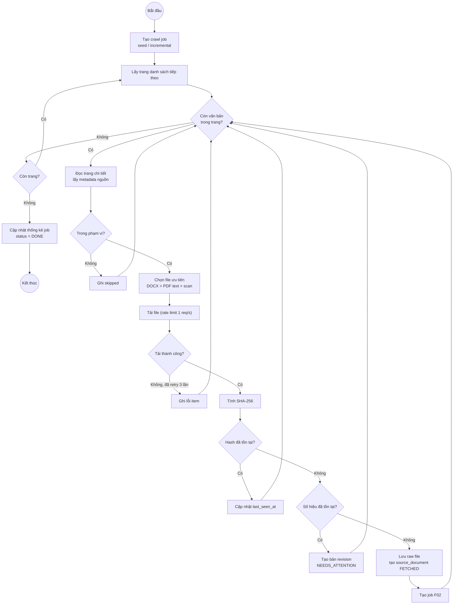
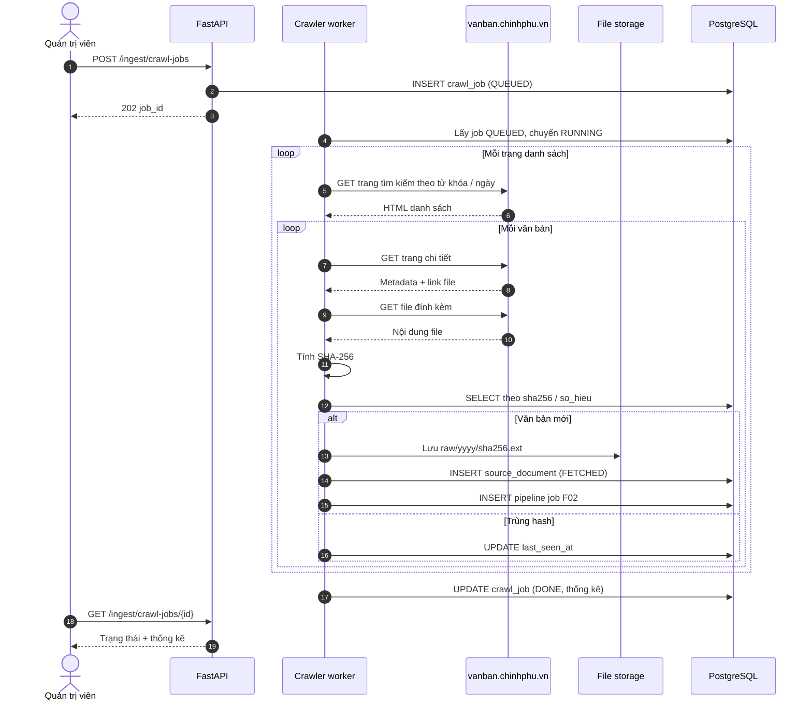

# F01 – Thu thập văn bản

| Mục | Nội dung |
|---|---|
| Epic | A – Xây dựng tri thức (offline) |
| Bước trong inception | 1. Thu thập |
| Ưu tiên | PoC |
| Phụ thuộc | – |
| Kết quả đầu ra | `source_document` ở trạng thái `FETCHED`, bản gốc lưu bất biến |

Lấy văn bản pháp luật từ **vanban.chinhphu.vn** (nguồn chính, được phép crawl tự động) và từ import thủ công, lưu bản gốc kèm hash và metadata nguồn.

---

## 1. Business logic

| Mã | Quy tắc |
|---|---|
| BR-01.1 | Nguồn chính: `vanban.chinhphu.vn`. Nguồn phụ: import thủ công file PDF / DOCX / ảnh scan. |
| BR-01.2 | Phạm vi MVP: **hóa đơn điện tử** và **thuế hộ kinh doanh**. Xác định bằng danh sách số hiệu seed + từ khóa trích yếu (`hóa đơn`, `chứng từ`, `hộ kinh doanh`, `thuế khoán`, `cá nhân kinh doanh`…). |
| BR-01.3 | Loại văn bản nhận: Luật, Nghị quyết của Quốc hội, Nghị định, Thông tư, Quyết định của Thủ tướng. Bỏ qua án lệ, văn bản tư pháp, văn bản tiếng nước ngoài (ngoài phạm vi theo inception 2.3). |
| BR-01.4 | Lịch sự với nguồn: tối đa **1 request/giây**, User-Agent định danh dự án, tôn trọng `robots.txt`, retry tối đa 3 lần với backoff lũy thừa (2s, 4s, 8s). |
| BR-01.5 | Chống trùng bằng **SHA-256 nội dung file**. Trùng hash → không tạo bản ghi mới, chỉ cập nhật `last_seen_at`. |
| BR-01.6 | Cùng số hiệu nhưng hash khác (bản đính chính, bản cập nhật) → tạo `source_document` mới với `revision_of` trỏ về bản cũ, đánh dấu `NEEDS_ATTENTION` để biên tập viên xác nhận. |
| BR-01.7 | Bản gốc **bất biến**, lưu tại `raw/{yyyy}/{sha256}.{ext}`. Không bao giờ ghi đè. |
| BR-01.8 | Metadata lấy từ trang nguồn (số hiệu, loại, cơ quan, ngày ban hành, ngày hiệu lực, tình trạng) lưu vào `metadata_nguon` – **chỉ dùng tham khảo**, F03 sẽ đối chiếu với nội dung văn bản. |
| BR-01.9 | Một trang có nhiều file đính kèm (ví dụ bản DOCX và bản PDF) → ưu tiên DOCX > PDF có text > PDF scan > ảnh; chỉ tải file ưu tiên cao nhất, ghi lại URL các file còn lại. |
| BR-01.10 | Mỗi lần chạy crawl ghi `crawl_job` với thống kê: số trang duyệt, số file mới, số trùng, số lỗi. Thu thập xong thì tự động đẩy văn bản mới sang F02. |

---

## 2. Use case description

### UC-01.1 – Thu thập văn bản từ nguồn chính thức

| Mục | Nội dung |
|---|---|
| Actor chính | Quản trị viên; Scheduler (F15) |
| Mục tiêu | Đưa các văn bản trong phạm vi vào hệ thống |
| Tiền điều kiện | Cấu hình nguồn `crawl_source` đang bật; có mạng ra internet |
| Hậu điều kiện (thành công) | Văn bản mới có `source_document` trạng thái `FETCHED`, file gốc trong storage; job F02 được tạo |
| Kích hoạt | Quản trị viên bấm "Thu thập" hoặc lịch chạy hằng ngày |

**Luồng chính**

1. Actor tạo crawl job với chế độ `seed` (danh sách số hiệu) hoặc `incremental` (từ mốc `from_date`).
2. Hệ thống duyệt trang danh sách / tìm kiếm của nguồn theo từ khóa và mốc ngày.
3. Với mỗi văn bản tìm được, hệ thống đọc trang chi tiết và lấy metadata nguồn.
4. Hệ thống kiểm tra phạm vi (BR-01.2, BR-01.3).
5. Hệ thống chọn file đính kèm ưu tiên (BR-01.9) và tải về.
6. Hệ thống tính SHA-256, kiểm tra trùng (BR-01.5, BR-01.6).
7. Hệ thống lưu file gốc, tạo `source_document` trạng thái `FETCHED`.
8. Hệ thống tạo job chuẩn hóa (F02) cho văn bản mới.
9. Hệ thống cập nhật thống kê và kết thúc job.

**Luồng thay thế / ngoại lệ**

- 4a. Ngoài phạm vi → ghi `skipped` vào log job, sang văn bản kế tiếp.
- 5a. Tải lỗi sau 3 lần retry → ghi lỗi vào `crawl_job_item`, tiếp tục văn bản khác.
- 6a. Trùng hash → chỉ cập nhật `last_seen_at`.
- 6b. Cùng số hiệu, hash khác → tạo bản mới `revision_of`, trạng thái `NEEDS_ATTENTION`.
- 2a. Nguồn trả 429 / 5xx liên tục > 10 lần → tạm dừng job (`PAUSED`), báo quản trị viên.

### UC-01.2 – Import văn bản thủ công

| Mục | Nội dung |
|---|---|
| Actor chính | Biên tập viên, Quản trị viên |
| Mục tiêu | Đưa văn bản không có trên nguồn chính (hoặc bản scan nội bộ) vào hệ thống |
| Tiền điều kiện | Đã đăng nhập với vai trò `bien_tap_vien` trở lên |
| Hậu điều kiện | Như UC-01.1 |

**Luồng chính**: 1) Actor tải file lên kèm metadata tối thiểu (số hiệu, loại). 2) Hệ thống kiểm tra định dạng (PDF/DOCX/PNG/JPG, ≤ 50 MB). 3) Tính hash, kiểm tra trùng. 4) Lưu file, tạo `source_document` với `origin = manual`. 5) Tạo job F02.

**Ngoại lệ**: 2a. Sai định dạng / quá dung lượng → 422. 3a. Trùng → trả `duplicate: true` và ID bản đã có.

---

## 3. Activity diagram



---

## 4. Sequence diagram



---

## 5. API

| Method | Endpoint | Vai trò | Mô tả |
|---|---|---|---|
| POST | `/api/v1/ingest/crawl-jobs` | quan_tri | Tạo job thu thập |
| GET | `/api/v1/ingest/crawl-jobs/{job_id}` | quan_tri | Trạng thái, thống kê, lỗi |
| POST | `/api/v1/ingest/crawl-jobs/{job_id}/cancel` | quan_tri | Hủy job đang chạy |
| POST | `/api/v1/ingest/uploads` | bien_tap_vien | Import file thủ công (multipart) |
| GET | `/api/v1/ingest/source-documents` | bien_tap_vien | Danh sách văn bản nguồn, lọc `status`, `q`, `origin` |
| GET | `/api/v1/ingest/source-documents/{id}` | bien_tap_vien | Chi tiết + lịch sử trạng thái |
| GET | `/api/v1/ingest/source-documents/{id}/raw` | bien_tap_vien | Tải file gốc |

**POST `/ingest/crawl-jobs`**

```json
// Request
{
  "source": "vanban.chinhphu.vn",
  "mode": "seed",
  "seeds": ["123/2020/NĐ-CP", "70/2025/NĐ-CP", "78/2021/TT-BTC", "32/2025/TT-BTC", "198/2025/QH15"],
  "keywords": ["hóa đơn", "hộ kinh doanh"],
  "from_date": null
}
// 202
{"job_id": "c0f1…", "status": "QUEUED"}
```

**GET `/ingest/crawl-jobs/{job_id}`**

```json
{
  "job_id": "c0f1…",
  "status": "DONE",
  "started_at": "2026-11-18T02:00:00+07:00",
  "finished_at": "2026-11-18T02:06:12+07:00",
  "stats": {"pages": 12, "found": 48, "new": 15, "duplicate": 30, "skipped": 2, "failed": 1},
  "errors": [{"url": "https://…", "message": "HTTP 503 sau 3 lần thử"}]
}
```

**POST `/ingest/uploads`** (multipart: `file`, `so_hieu`, `loai`, `url_nguon?`)

```json
// 201
{"source_document_id": "9a2e…", "duplicate": false, "status": "FETCHED"}
```

---

## 6. Schema (PostgreSQL)

```sql
CREATE TABLE crawl_source (
    id            TEXT PRIMARY KEY,            -- 'vanban.chinhphu.vn'
    base_url      TEXT NOT NULL,
    enabled       BOOLEAN NOT NULL DEFAULT TRUE,
    rate_limit_ms INT NOT NULL DEFAULT 1000,
    config        JSONB NOT NULL DEFAULT '{}'  -- từ khóa, loại văn bản, selector
);

CREATE TABLE crawl_job (
    id           UUID PRIMARY KEY,
    source_id    TEXT REFERENCES crawl_source(id),
    mode         TEXT NOT NULL CHECK (mode IN ('seed','incremental')),
    params       JSONB NOT NULL,
    status       TEXT NOT NULL CHECK (status IN ('QUEUED','RUNNING','PAUSED','DONE','FAILED','CANCELLED')),
    stats        JSONB NOT NULL DEFAULT '{}',
    created_by   TEXT,
    created_at   TIMESTAMPTZ NOT NULL DEFAULT now(),
    started_at   TIMESTAMPTZ,
    finished_at  TIMESTAMPTZ
);

CREATE TABLE crawl_job_item (
    id           BIGSERIAL PRIMARY KEY,
    job_id       UUID REFERENCES crawl_job(id),
    url          TEXT NOT NULL,
    outcome      TEXT NOT NULL CHECK (outcome IN ('new','duplicate','revision','skipped','failed')),
    message      TEXT,
    source_document_id UUID
);

CREATE TABLE source_document (
    id              UUID PRIMARY KEY,
    origin          TEXT NOT NULL CHECK (origin IN ('crawl','manual')),
    so_hieu_nguon   TEXT,                       -- số hiệu theo metadata nguồn
    url_nguon       TEXT,
    file_path       TEXT NOT NULL,
    file_type       TEXT NOT NULL,              -- docx | pdf | png | jpg
    sha256          CHAR(64) NOT NULL UNIQUE,
    metadata_nguon  JSONB NOT NULL DEFAULT '{}',
    revision_of     UUID REFERENCES source_document(id),
    status          TEXT NOT NULL,              -- xem 00-common mục 5
    status_reason   TEXT,
    published_at    DATE,                       -- ngày nguồn công bố (đo độ trễ cập nhật)
    fetched_at      TIMESTAMPTZ NOT NULL DEFAULT now(),
    last_seen_at    TIMESTAMPTZ NOT NULL DEFAULT now()
);
CREATE INDEX ON source_document (so_hieu_nguon);
CREATE INDEX ON source_document (status);
```

---

## 7. Tiêu chí chấp nhận

- [ ] Chạy seed với 5 số hiệu mẫu ở inception → đủ 5 `source_document` `FETCHED`.
- [ ] Chạy lại cùng job → 0 bản ghi mới, `duplicate` = 5.
- [ ] Rate limit đo được ≤ 1 request/giây.
- [ ] Upload file PDF 60 MB → 422.
