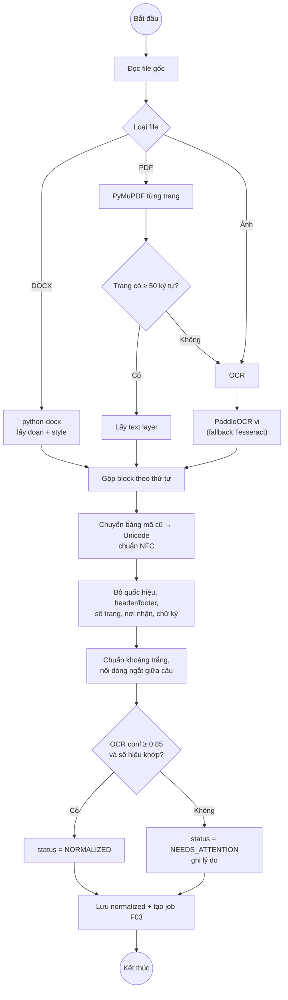
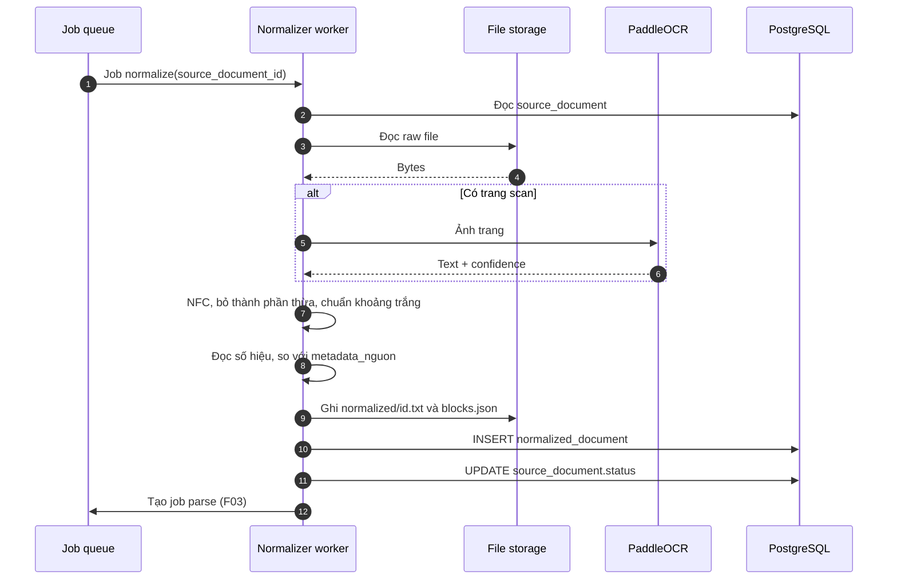

# F02 – Chuyển đổi và chuẩn hóa văn bản (kèm OCR)

| Mục | Nội dung |
|---|---|
| Epic | A – Xây dựng tri thức (offline) |
| Bước trong inception | 2. Chuyển đổi & chuẩn hóa |
| Ưu tiên | PoC (chưa cần OCR); MVP (có OCR) |
| Phụ thuộc | F01 |
| Kết quả đầu ra | Văn bản thuần đã chuẩn hóa + danh sách block có vị trí; trạng thái `NORMALIZED` |

Chuyển file gốc thành văn bản thuần sạch, chuẩn Unicode, đã bỏ phần không mang nội dung pháp lý, sẵn sàng cho bộ tách cấu trúc (F03).

---

## 1. Business logic

| Mã | Quy tắc |
|---|---|
| BR-02.1 | Chọn bộ trích xuất theo loại file: DOCX → `python-docx`; PDF → `PyMuPDF`; nếu trang PDF có **< 50 ký tự text** thì coi là trang scan và OCR; ảnh → OCR. |
| BR-02.2 | OCR: PaddleOCR (model tiếng Việt) là mặc định, Tesseract `vie` là phương án dự phòng. Ghi điểm tin cậy trung bình mỗi trang. |
| BR-02.3 | Chuẩn **Unicode NFC**. Phát hiện bảng mã cũ (TCVN3, VNI) qua tập ký tự đặc trưng và chuyển sang Unicode. |
| BR-02.4 | Chuẩn khoảng trắng: gộp nhiều dấu cách, bỏ dấu cách cuối dòng, nối dòng bị ngắt giữa câu (dòng không kết thúc bằng `.`, `:`, `;` và dòng sau bắt đầu chữ thường). |
| BR-02.5 | **Giữ nguyên dấu ngoặc kép “ ”** và dấu xuống dòng đầu Điều / Khoản / Điểm – F03 cần để phân biệt nội dung trích dẫn của văn bản sửa đổi. |
| BR-02.6 | Loại bỏ: quốc hiệu, tiêu ngữ, header/footer lặp lại mỗi trang, số trang, khối "Nơi nhận", khối chữ ký (chức danh + họ tên cuối văn bản), dấu "đã ký". Ghi lại vị trí phần đã loại để có thể kiểm tra lại. |
| BR-02.7 | **Giữ**: tiêu đề số hiệu, ngày ban hành, trích yếu, phần "Căn cứ…", toàn bộ thân văn bản, phụ lục (đánh dấu `is_phu_luc`). |
| BR-02.8 | Kiểm tra chất lượng: OCR tin cậy trung bình < **0.85** hoặc số hiệu đọc được từ nội dung khác `metadata_nguon.so_hieu` → trạng thái `NEEDS_ATTENTION`, không chặn các bước sau nhưng hiển thị cảnh báo cho biên tập viên. |
| BR-02.9 | Kết quả chuẩn hóa là **xác định**: chạy lại trên cùng file ra cùng văn bản (để F03 sinh ID ổn định). Lưu kèm `normalizer_version`. |

---

## 2. Use case description

### UC-02.1 – Chuẩn hóa văn bản nguồn

| Mục | Nội dung |
|---|---|
| Actor chính | Pipeline worker (tự động); Biên tập viên (chạy lại thủ công) |
| Mục tiêu | Có văn bản thuần sạch cho F03 |
| Tiền điều kiện | `source_document` ở trạng thái `FETCHED` (hoặc `NEEDS_ATTENTION` khi chạy lại) |
| Hậu điều kiện | Bản ghi `normalized_document`, file `normalized/{id}.txt`, trạng thái `NORMALIZED` hoặc `NEEDS_ATTENTION`; job F03 được tạo |

**Luồng chính**

1. Worker lấy file gốc theo `file_path`.
2. Hệ thống xác định loại file và từng trang cần OCR (BR-02.1).
3. Hệ thống trích text / OCR, gắn số trang và điểm tin cậy cho từng block.
4. Hệ thống chuẩn bảng mã và Unicode NFC (BR-02.3).
5. Hệ thống loại bỏ thành phần không mang nội dung (BR-02.6) và chuẩn khoảng trắng (BR-02.4).
6. Hệ thống đọc số hiệu từ nội dung, so với metadata nguồn (BR-02.8).
7. Hệ thống lưu kết quả, cập nhật trạng thái, tạo job F03.

**Ngoại lệ**

- 1a. File hỏng / không mở được → `FAILED`, lý do `CORRUPT_FILE`.
- 3a. OCR lỗi toàn bộ → `FAILED`, lý do `OCR_FAILED`.
- 6a. Lệch số hiệu hoặc OCR kém → `NEEDS_ATTENTION` (vẫn tạo job F03).

---

## 3. Activity diagram



---

## 4. Sequence diagram



---

## 5. API

| Method | Endpoint | Vai trò | Mô tả |
|---|---|---|---|
| POST | `/api/v1/ingest/source-documents/{id}/normalize` | bien_tap_vien | Chạy lại chuẩn hóa (ví dụ sau khi nâng cấp OCR) |
| GET | `/api/v1/ingest/source-documents/{id}/normalized` | bien_tap_vien | Xem văn bản đã chuẩn hóa + cảnh báo |

**GET `/normalized`**

```json
{
  "source_document_id": "9a2e…",
  "normalizer_version": "0.3.0",
  "text_url": "/api/v1/ingest/source-documents/9a2e…/normalized.txt",
  "pages": 42,
  "ocr_pages": [17, 18],
  "ocr_confidence_avg": 0.91,
  "so_hieu_doc_duoc": "70/2025/NĐ-CP",
  "warnings": [],
  "removed_sections": [{"type": "noi_nhan", "page": 42, "chars": 512}]
}
```

---

## 6. Schema

```sql
CREATE TABLE normalized_document (
    source_document_id  UUID PRIMARY KEY REFERENCES source_document(id),
    normalizer_version  TEXT NOT NULL,
    text_path           TEXT NOT NULL,
    blocks_path         TEXT NOT NULL,
    pages               INT NOT NULL,
    ocr_pages           INT[] NOT NULL DEFAULT '{}',
    ocr_confidence_avg  REAL,
    so_hieu_doc_duoc    TEXT,
    warnings            JSONB NOT NULL DEFAULT '[]',
    created_at          TIMESTAMPTZ NOT NULL DEFAULT now()
);
```

File `blocks.json` (dùng để truy ngược vị trí trang khi hiển thị trích dẫn):

```json
[
  {"seq": 1, "page": 1, "text": "NGHỊ ĐỊNH", "is_ocr": false, "conf": null},
  {"seq": 2, "page": 1, "text": "Sửa đổi, bổ sung một số điều của Nghị định số 123/2020/NĐ-CP…", "is_ocr": false, "conf": null}
]
```

---

## 7. Tiêu chí chấp nhận

- [ ] DOCX và PDF có text của NĐ 123/2020, NĐ 70/2025 → không còn quốc hiệu, nơi nhận, chữ ký.
- [ ] Toàn bộ văn bản đầu ra ở dạng NFC (kiểm tra `unicodedata.is_normalized('NFC', text)`).
- [ ] Một PDF scan mẫu → có OCR, `ocr_confidence_avg` được ghi.
- [ ] Chạy lại 2 lần trên cùng file → văn bản đầu ra giống hệt nhau.
