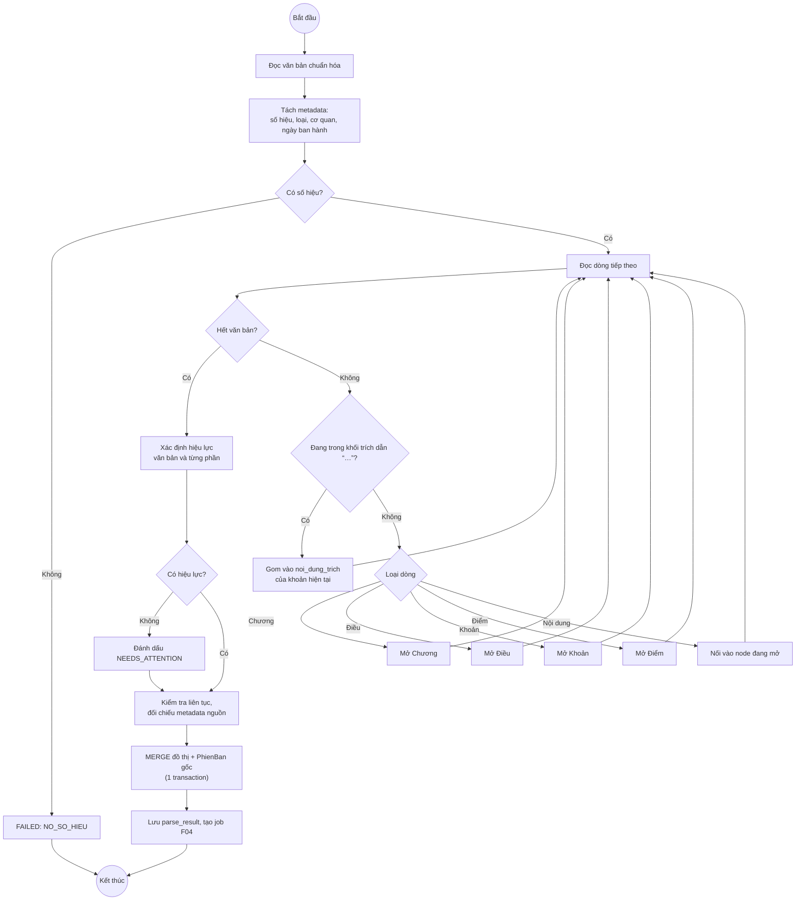
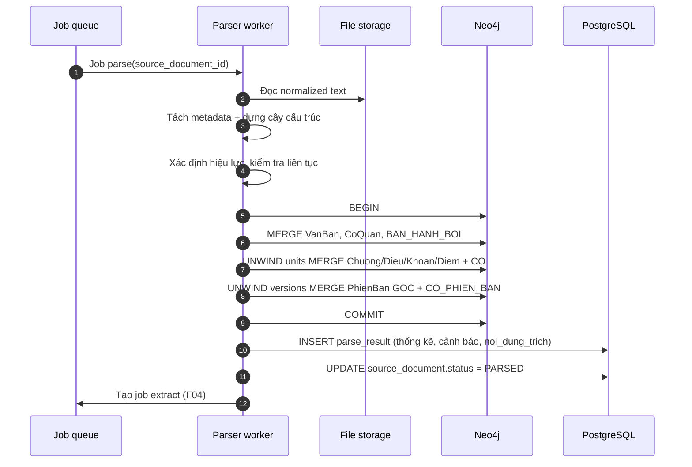

# F03 – Tách cấu trúc văn bản

| Mục | Nội dung |
|---|---|
| Epic | A – Xây dựng tri thức (offline) |
| Bước trong inception | 3. Tách cấu trúc |
| Ưu tiên | PoC |
| Phụ thuộc | F02 |
| Kết quả đầu ra | Node `VanBan`, `Chuong`, `Dieu`, `Khoan`, `Diem`, `PhienBan` (bản gốc) trong Neo4j; trạng thái `PARSED` |

Tách metadata và cây Chương / Điều / Khoản / Điểm bằng **regex / parser, không dùng LLM**, gán ID cố định và tạo phiên bản gốc cho mỗi khoản.

---

## 1. Business logic

### 1.1. Metadata

| Mã | Quy tắc |
|---|---|
| BR-03.1 | Số hiệu: regex `Số:\s*(\d+/\d{4}/[A-ZĐ0-9\-]+)` ở phần đầu văn bản. Với Luật / Nghị quyết QH: `(\d+/\d{4}/QH\d+)`. |
| BR-03.2 | Loại văn bản suy từ hậu tố số hiệu + dòng tiêu đề: `NĐ-CP` → Nghị định; `TT-<Bộ>` → Thông tư; `QH<khóa>` → Luật hoặc Nghị quyết theo tiêu đề; `QĐ-TTg` → Quyết định. |
| BR-03.3 | Cơ quan ban hành suy từ hậu tố: `CP` → Chính phủ; `BTC` → Bộ Tài chính; `QH` → Quốc hội; `TTg` → Thủ tướng Chính phủ. Tạo / nối `BAN_HANH_BOI`. |
| BR-03.4 | Ngày ban hành: regex `ngày\s+(\d{1,2})\s+tháng\s+(\d{1,2})\s+năm\s+(\d{4})` ở dòng địa danh – ngày. |
| BR-03.5 | Ngày hiệu lực: tìm trong Điều có tiêu đề chứa "Hiệu lực" (thường là điều cuối). Hỗ trợ các mẫu: "có hiệu lực (thi hành) (kể) từ ngày dd tháng mm năm yyyy" / "… từ ngày dd/mm/yyyy"; "… kể từ ngày ký" → `= ngay_ban_hanh`; "… sau N ngày kể từ ngày ký" → `ngay_ban_hanh + N`. |
| BR-03.6 | Hiệu lực riêng từng phần (ví dụ "Khoản 3 Điều 5 có hiệu lực từ 01/01/2026") → ghi đè `hieu_luc_tu` cho phiên bản gốc của các điều khoản được nêu. |
| BR-03.7 | Không xác định được ngày hiệu lực → `hieu_luc_tu = NULL`, trạng thái `NEEDS_ATTENTION`. Văn bản **không được dùng cho hỏi đáp** cho đến khi biên tập viên điền (API PATCH metadata). |
| BR-03.8 | Đối chiếu metadata tách được với `metadata_nguon` (F01). Lệch số hiệu / ngày → cảnh báo; **giá trị tách từ nội dung được ưu tiên**. |

### 1.2. Cấu trúc

| Mã | Quy tắc |
|---|---|
| BR-03.9 | Nhận diện theo đầu dòng: Chương `^Chương\s+([IVXLC]+)`; Mục `^Mục\s+(\d+)` (gộp vào Chương, không tạo node); Điều `^Điều\s+(\d+[a-z]?)\.\s*(.*)`; Khoản `^(\d+[a-z]?)\.\s+`; Điểm `^([a-zđ]\d?)\)\s+`. |
| BR-03.10 | Khoản / điểm chỉ được nhận khi nằm **trong** một Điều; dòng đánh số ở phần "Căn cứ" hoặc phụ lục không tạo khoản. |
| BR-03.11 | **Nội dung trích dẫn của văn bản sửa đổi**: phần nằm giữa `“` và `”` sau cụm "như sau:" là nội dung mới cho văn bản khác → **không** tách thành Khoản / Điểm của văn bản hiện tại. Lưu nguyên khối vào `noi_dung_trich[]` của khoản chứa nó (đầu vào cho F04). |
| BR-03.12 | Điều không chia khoản → tạo `PhienBan` gắn trực tiếp ở `Dieu`. |
| BR-03.13 | ID theo quy ước chung mục 2; ghi đồ thị bằng `MERGE` → chạy lại không sinh trùng. |
| BR-03.14 | Kiểm tra tính liên tục: số Điều tăng dần không nhảy cóc (cho phép hậu tố `a`), số khoản trong Điều liên tục, chữ cái điểm liên tục. Vi phạm → cảnh báo (không chặn). |
| BR-03.15 | Tạo **phiên bản gốc** cho mỗi Khoản (hoặc Điều không khoản): `hieu_luc_tu` = hiệu lực văn bản (hoặc ghi đè BR-03.6), `hieu_luc_den = NULL`, `loai_thay_doi = GOC`, `diem[]` = danh sách điểm, `embedding_stale = true`. |
| BR-03.16 | Nội dung `PhienBan.noi_dung` của khoản bao gồm cả câu dẫn khoản và toàn bộ điểm của nó (để một phiên bản đọc độc lập được). |
| BR-03.17 | Sinh `alias[]` cho `VanBan`: `NĐ 123/2020`, `Nghị định 123/2020`, `Nghị định số 123/2020/NĐ-CP`, `NĐ 123`… dùng cho F09. |

---

## 2. Use case description

### UC-03.1 – Tách cấu trúc văn bản đã chuẩn hóa

| Mục | Nội dung |
|---|---|
| Actor chính | Pipeline worker |
| Tiền điều kiện | `normalized_document` tồn tại; trạng thái `NORMALIZED` / `NEEDS_ATTENTION` |
| Hậu điều kiện | Cây cấu trúc + phiên bản gốc trong Neo4j; `parse_result` trong PostgreSQL; trạng thái `PARSED`; job F04 được tạo |

**Luồng chính**

1. Worker đọc văn bản chuẩn hóa.
2. Hệ thống tách metadata (BR-03.1 → BR-03.4).
3. Hệ thống quét từng dòng bằng máy trạng thái, dựng cây Chương / Điều / Khoản / Điểm (BR-03.9 → BR-03.12).
4. Hệ thống xác định ngày hiệu lực văn bản và từng phần (BR-03.5, BR-03.6).
5. Hệ thống kiểm tra liên tục (BR-03.14) và đối chiếu metadata (BR-03.8).
6. Hệ thống ghi đồ thị trong một transaction (MERGE node, cạnh `CO`, `PhienBan` gốc).
7. Hệ thống lưu `parse_result`, cập nhật trạng thái, tạo job F04.

**Ngoại lệ**

- 2a. Không tìm thấy số hiệu → `FAILED` (`NO_SO_HIEU`).
- 3a. Không tìm thấy Điều nào → `FAILED` (`NO_STRUCTURE`).
- 4a. Không có ngày hiệu lực → `NEEDS_ATTENTION` (BR-03.7), vẫn ghi đồ thị nhưng `hieu_luc_tu = NULL`.

### UC-03.2 – Biên tập viên sửa metadata văn bản

| Mục | Nội dung |
|---|---|
| Actor chính | Biên tập viên |
| Tiền điều kiện | Văn bản ở `NEEDS_ATTENTION` hoặc metadata sai |
| Hậu điều kiện | Metadata cập nhật; phiên bản gốc cập nhật `hieu_luc_tu`; nếu đã qua hợp nhất thì chạy lại F06 cho văn bản |

**Luồng chính**: 1) Mở trang văn bản, xem cảnh báo. 2) Sửa ngày hiệu lực / số hiệu / loại. 3) Hệ thống kiểm tra hợp lệ (`hieu_luc_tu >= ngay_ban_hanh`, trừ khi tích "hiệu lực hồi tố"). 4) Lưu, ghi audit log. 5) Trạng thái quay lại `PARSED` và pipeline tiếp tục.

---

## 3. Activity diagram



---

## 4. Sequence diagram



---

## 5. API

| Method | Endpoint | Vai trò | Mô tả |
|---|---|---|---|
| POST | `/api/v1/ingest/source-documents/{id}/parse` | bien_tap_vien | Chạy lại tách cấu trúc |
| GET | `/api/v1/documents` | nguoi_dung | Danh sách văn bản (lọc `loai`, `co_quan`, `trang_thai`, `chu_de`, `q`) |
| GET | `/api/v1/documents/{slug}/structure` | nguoi_dung | Cây cấu trúc văn bản |
| GET | `/api/v1/documents/{slug}/parse-report` | bien_tap_vien | Thống kê và cảnh báo khi tách |
| PATCH | `/api/v1/documents/{slug}/metadata` | bien_tap_vien | Sửa metadata (UC-03.2) |

**GET `/documents/{slug}/structure`**

```json
{
  "so_hieu": "123/2020/NĐ-CP",
  "loai": "Nghị định",
  "trich_yeu": "Quy định về hóa đơn, chứng từ",
  "ngay_ban_hanh": "2020-10-19",
  "hieu_luc_tu": "2022-07-01",
  "children": [
    {"id": "123/2020/NĐ-CP:CI", "type": "Chuong", "so": "I", "tieu_de": "Quy định chung",
     "children": [
       {"id": "123/2020/NĐ-CP:Đ3", "type": "Dieu", "so": "3", "tieu_de": "Giải thích từ ngữ",
        "children": [{"id": "123/2020/NĐ-CP:Đ3:K10", "type": "Khoan", "so": "10"}]}
     ]}
  ]
}
```

**PATCH `/documents/{slug}/metadata`**

```json
// Request
{"hieu_luc_tu": "2025-06-01", "hieu_luc_hoi_to": false, "ly_do": "Điều 3 ghi hiệu lực từ 01/6/2025"}
// 200
{"so_hieu": "70/2025/NĐ-CP", "hieu_luc_tu": "2025-06-01", "status": "PARSED", "reconsolidate": true}
```

---

## 6. Schema

### 6.1. Neo4j – ghi cấu trúc (rút gọn)

```cypher
MERGE (v:VanBan {so_hieu: $so_hieu})
SET v += $metadata
MERGE (cq:CoQuan {ten: $co_quan})
MERGE (v)-[:BAN_HANH_BOI]->(cq)
WITH v
UNWIND $units AS u
CALL apoc.merge.node([u.label], {id: u.id}, u.props) YIELD node
WITH v, u, node
MATCH (p {id: u.parent_id})
MERGE (p)-[:CO {thu_tu: u.thu_tu}]->(node);

UNWIND $versions AS pb
MATCH (owner {id: pb.owner_id})
MERGE (p:PhienBan {id: pb.id})
SET p.noi_dung = pb.noi_dung, p.hieu_luc_tu = date(pb.hieu_luc_tu),
    p.hieu_luc_den = NULL, p.loai_thay_doi = 'GOC', p.diem = pb.diem,
    p.content_hash = pb.content_hash, p.embedding_stale = true
MERGE (owner)-[:CO_PHIEN_BAN]->(p);
```

### 6.2. PostgreSQL

```sql
CREATE TABLE parse_result (
    source_document_id UUID PRIMARY KEY REFERENCES source_document(id),
    so_hieu            TEXT NOT NULL,
    parser_version     TEXT NOT NULL,
    stats              JSONB NOT NULL,   -- {"chuong":5,"dieu":60,"khoan":210,"diem":340}
    warnings           JSONB NOT NULL DEFAULT '[]',
    quoted_blocks      JSONB NOT NULL DEFAULT '[]', -- [{"unit_id":..., "text":...}] cho F04
    hieu_luc_rieng     JSONB NOT NULL DEFAULT '[]', -- [{"unit_ids":[...], "tu_ngay":...}]
    created_at         TIMESTAMPTZ NOT NULL DEFAULT now()
);

CREATE TABLE metadata_audit (
    id         BIGSERIAL PRIMARY KEY,
    so_hieu    TEXT NOT NULL,
    field      TEXT NOT NULL,
    old_value  TEXT,
    new_value  TEXT,
    ly_do      TEXT,
    changed_by TEXT NOT NULL,
    changed_at TIMESTAMPTZ NOT NULL DEFAULT now()
);
```

---

## 7. Tiêu chí chấp nhận

- [ ] NĐ 123/2020 tách ra node `123/2020/NĐ-CP:Đ3:K10` với nội dung đúng.
- [ ] NĐ 70/2025: nội dung trong “…” **không** sinh khoản / điểm của NĐ 70; được lưu trong `quoted_blocks`.
- [ ] Tách lại cùng văn bản → số node Neo4j không đổi.
- [ ] `hieu_luc_tu` của NĐ 70/2025 = `2025-06-01`; của NQ 198/2025 phần thuế khoán = `2026-01-01`.
