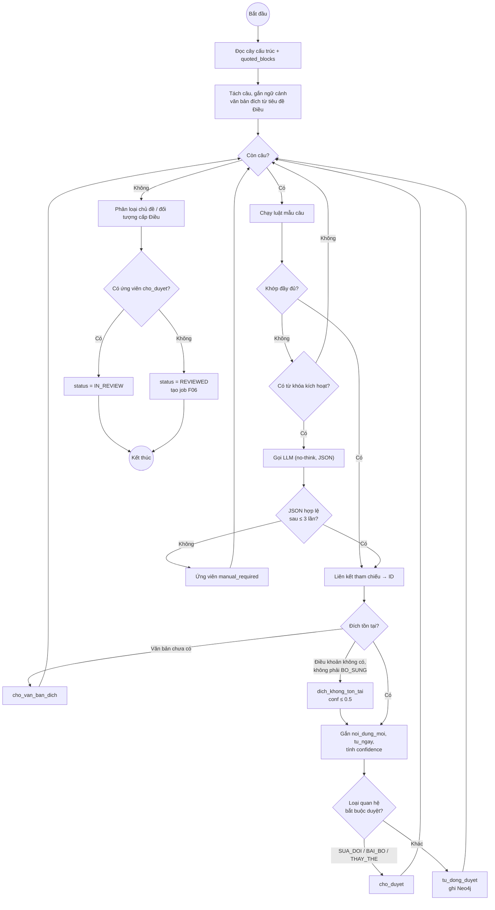
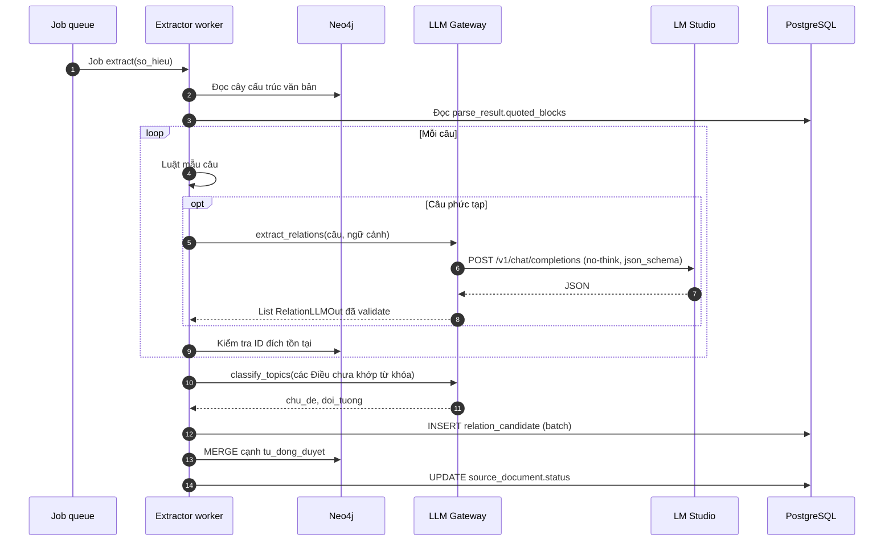

# F04 – Trích xuất quan hệ giữa văn bản

| Mục | Nội dung |
|---|---|
| Epic | A – Xây dựng tri thức (offline) |
| Bước trong inception | 4. Trích xuất quan hệ |
| Ưu tiên | PoC (luật mẫu câu); MVP (bổ sung LLM, phân loại chủ đề / đối tượng) |
| Phụ thuộc | F03, F17 |
| Kết quả đầu ra | Bảng `relation_candidate` (PostgreSQL); cạnh rủi ro thấp được ghi thẳng vào đồ thị |

Phát hiện các quan hệ `SUA_DOI`, `BAI_BO`, `THAY_THE`, `HUONG_DAN`, `VIEN_DAN`, `AP_DUNG_CHO`, `THUOC_CHU_DE` và liên kết tham chiếu về đúng ID điều khoản. **Luật mẫu câu chạy trước, LLM chỉ xử lý câu phức tạp.**

---

## 1. Business logic

### 1.1. Phân tầng xử lý

| Mã | Quy tắc |
|---|---|
| BR-04.1 | Tầng 1 – **luật mẫu câu** (regex) chạy trên mọi câu. |
| BR-04.2 | Tầng 2 – **LLM** (Qwen3.5 9B, tắt thinking, temperature 0.1, JSON schema) chỉ chạy cho câu **có từ khóa kích hoạt** (`sửa đổi`, `bổ sung`, `bãi bỏ`, `thay thế`, `hướng dẫn`, `hết hiệu lực`, `không áp dụng`) mà tầng 1 không khớp hoặc khớp không đầy đủ. |
| BR-04.3 | Kết quả LLM phải qua Pydantic; JSON lỗi → gọi lại tối đa 3 lần (F17); vẫn lỗi → tạo ứng viên `phuong_phap = manual_required` để biên tập viên nhập tay. |

### 1.2. Mẫu câu chính (tầng 1)

| Mã luật | Mẫu (rút gọn) | Quan hệ |
|---|---|---|
| R-SD-01 | `Sửa đổi, bổ sung (điểm X)? (khoản Y)? Điều Z (của …)? như sau:` | `SUA_DOI` (`kieu=SUA_DOI`) |
| R-SD-02 | `Bổ sung (điểm X / khoản Y / Điều Z) vào (sau) …` | `SUA_DOI` (`kieu=BO_SUNG`) |
| R-BB-01 | `Bãi bỏ (điểm …)? (khoản …)? Điều … (của …)?` | `BAI_BO` |
| R-BB-02 | `… hết hiệu lực (thi hành) kể từ ngày …` (nói về văn bản khác) | `BAI_BO` / `THAY_THE` tùy có văn bản thay thế |
| R-TT-01 | `… thay thế (Nghị định / Thông tư) số …` | `THAY_THE` |
| R-HD-01 | `(Thông tư này) hướng dẫn (thi hành)? … (Nghị định / Luật) số …` | `HUONG_DAN` |
| R-VD-01 | `theo quy định tại (điểm …)? (khoản …)? Điều … (của …)?` | `VIEN_DAN` |

### 1.3. Liên kết tham chiếu (reference resolution)

| Mã | Quy tắc |
|---|---|
| BR-04.4 | **Kế thừa ngữ cảnh văn bản đích**: tiêu đề Điều dạng "Sửa đổi, bổ sung một số điều của Nghị định số 123/2020/NĐ-CP" đặt văn bản đích mặc định cho mọi khoản bên trong; khoản "1. Sửa đổi khoản 4 Điều 9 như sau:" hiểu là `123/2020/NĐ-CP:Đ9:K4`. |
| BR-04.5 | "Điều này", "Nghị định này", "Thông tư này" → văn bản hiện tại. |
| BR-04.6 | Liệt kê nhiều đích: "Bãi bỏ khoản 10 Điều 3, khoản 2 Điều 5" → 2 ứng viên. Khoảng: "từ Điều 5 đến Điều 7", "các Điều 5, 6 và 7" → khai triển. |
| BR-04.7 | Đích phải tồn tại trong đồ thị. Văn bản đích chưa có trong hệ thống → ứng viên `cho_van_ban_dich`, tự liên kết lại khi văn bản đó được nạp (F15). Văn bản có nhưng điều khoản không có → `dich_khong_ton_tai`, chuyển duyệt. |
| BR-04.8 | Với `kieu=BO_SUNG`, đích là ID **chưa tồn tại** (ví dụ `…:Đ9:K4:đ` hoặc `…:Đ9a`) – hợp lệ, F06 sẽ tạo node mới. |
| BR-04.9 | `noi_dung_moi` của ứng viên `SUA_DOI` lấy từ `quoted_blocks` (F03) liền sau câu dẫn. Thiếu nội dung trích → ứng viên vẫn tạo nhưng `canh_bao = THIEU_NOI_DUNG`. |
| BR-04.10 | `tu_ngay` mặc định = ngày hiệu lực của **văn bản nguồn**; có ghi đè từng phần (F03 BR-03.6) thì dùng ngày ghi đè. |

### 1.4. Độ tin cậy và mức bắt buộc duyệt

| Mã | Quy tắc |
|---|---|
| BR-04.11 | Độ tin cậy: luật mẫu khớp đủ, đích tường minh = **0.95**; luật mẫu khớp, đích kế thừa ngữ cảnh = **0.85**; LLM = min(điểm tự đánh giá, **0.8**); đích không tồn tại = tối đa **0.5**. |
| BR-04.12 | `SUA_DOI`, `BAI_BO`, `THAY_THE` → **luôn** trạng thái `cho_duyet`; không ghi vào đồ thị trước khi duyệt (F05). |
| BR-04.13 | `HUONG_DAN`, `VIEN_DAN`, `AP_DUNG_CHO`, `THUOC_CHU_DE` (rủi ro thấp) → `tu_dong_duyet`, ghi ngay vào đồ thị; vẫn hiển thị trong giao diện duyệt để biên tập viên rà soát nếu muốn. |

### 1.5. Chủ đề và đối tượng

| Mã | Quy tắc |
|---|---|
| BR-04.14 | `ChuDe`, `DoiTuong` là **danh mục có kiểm soát** (seed MVP: chủ đề `hoa_don_dien_tu`, `thue_ho_kinh_doanh`, `chung_tu`, `quan_ly_thue`; đối tượng `ho_kinh_doanh`, `ca_nhan_kinh_doanh`, `doanh_nghiep`, `to_chuc_kinh_te`, `co_quan_thue`). LLM chỉ được chọn trong danh mục. |
| BR-04.15 | Gán ở cấp **Điều**: khớp từ khóa trước; không khớp → LLM phân loại. Văn bản nhận hợp các chủ đề của các Điều có tần suất ≥ 20%. |

---

## 2. Use case description

### UC-04.1 – Trích xuất quan hệ của một văn bản

| Mục | Nội dung |
|---|---|
| Actor chính | Pipeline worker |
| Tiền điều kiện | Văn bản `PARSED` |
| Hậu điều kiện | Ứng viên quan hệ lưu PostgreSQL; cạnh rủi ro thấp trong Neo4j; trạng thái `IN_REVIEW` (nếu có ứng viên bắt buộc duyệt) hoặc `REVIEWED` |

**Luồng chính**

1. Worker đọc cây cấu trúc và `quoted_blocks` của văn bản.
2. Hệ thống tách câu theo Điều / Khoản, mang theo ngữ cảnh tiêu đề Điều (BR-04.4).
3. Với mỗi câu, chạy luật mẫu (BR-04.1).
4. Câu có từ khóa kích hoạt nhưng chưa khớp đủ → gọi LLM (BR-04.2).
5. Liên kết tham chiếu về ID (BR-04.4 → BR-04.8), gắn `noi_dung_moi`, `tu_ngay`.
6. Tính độ tin cậy, gán trạng thái (BR-04.11 → BR-04.13).
7. Phân loại chủ đề / đối tượng cho từng Điều (BR-04.14, BR-04.15).
8. Lưu ứng viên; ghi cạnh tự động duyệt vào Neo4j.
9. Cập nhật trạng thái văn bản; nếu không có ứng viên bắt buộc duyệt → tạo job F06.

**Ngoại lệ**

- 4a. LM Studio không phản hồi → job tạm hoãn, retry sau 10 phút (F17 circuit breaker); các ứng viên tầng 1 vẫn được lưu.
- 5a. Văn bản đích chưa có → `cho_van_ban_dich` (BR-04.7).

---

## 3. Activity diagram



---

## 4. Sequence diagram



---

## 5. API

| Method | Endpoint | Vai trò | Mô tả |
|---|---|---|---|
| POST | `/api/v1/ingest/documents/{slug}/extract-relations` | bien_tap_vien | Chạy lại trích xuất (giữ nguyên ứng viên đã duyệt) |
| GET | `/api/v1/relation-candidates` | bien_tap_vien | Lọc `document`, `loai`, `trang_thai`, `phuong_phap`, `min_conf`, `max_conf` |
| GET | `/api/v1/relation-candidates/{id}` | bien_tap_vien | Chi tiết ứng viên |
| GET | `/api/v1/taxonomy/chu-de` · `/doi-tuong` | nguoi_dung | Danh mục có kiểm soát |
| POST | `/api/v1/taxonomy/chu-de` · `/doi-tuong` | quan_tri | Thêm mục danh mục |

**GET `/relation-candidates/{id}`**

```json
{
  "id": 1042,
  "loai": "BAI_BO",
  "kieu": null,
  "nguon_unit_id": "70/2025/NĐ-CP:Đ2:K4",
  "dich_unit_id": "123/2020/NĐ-CP:Đ3:K10",
  "dich_so_hieu": "123/2020/NĐ-CP",
  "tu_ngay": "2025-06-01",
  "noi_dung_moi": null,
  "cau_goc": "Bãi bỏ khoản 10 Điều 3 Nghị định số 123/2020/NĐ-CP.",
  "phuong_phap": "rule",
  "rule_id": "R-BB-01",
  "confidence": 0.95,
  "canh_bao": [],
  "trang_thai": "cho_duyet"
}
```

---

## 6. Schema

### 6.1. PostgreSQL

```sql
CREATE TABLE relation_candidate (
    id                 BIGSERIAL PRIMARY KEY,
    source_document_id UUID NOT NULL REFERENCES source_document(id),
    loai               TEXT NOT NULL CHECK (loai IN
                       ('SUA_DOI','BAI_BO','THAY_THE','HUONG_DAN','VIEN_DAN','AP_DUNG_CHO','THUOC_CHU_DE')),
    kieu               TEXT CHECK (kieu IN ('SUA_DOI','BO_SUNG')),
    nguon_unit_id      TEXT NOT NULL,
    dich_unit_id       TEXT,              -- NULL khi chưa liên kết được
    dich_so_hieu       TEXT,
    tu_ngay            DATE,
    noi_dung_moi       TEXT,
    cau_goc            TEXT NOT NULL,
    phuong_phap        TEXT NOT NULL CHECK (phuong_phap IN ('rule','llm','manual','manual_required')),
    rule_id            TEXT,
    confidence         REAL NOT NULL,
    canh_bao           TEXT[] NOT NULL DEFAULT '{}',
    trang_thai         TEXT NOT NULL CHECK (trang_thai IN
                       ('cho_duyet','da_duyet','tu_choi','tu_dong_duyet','cho_van_ban_dich','dich_khong_ton_tai')),
    thu_tu_trong_nguon INT NOT NULL,      -- thứ tự xuất hiện, dùng khi nhiều sửa đổi cùng ngày (F06)
    llm_call_id        BIGINT,
    created_at         TIMESTAMPTZ NOT NULL DEFAULT now(),
    updated_at         TIMESTAMPTZ NOT NULL DEFAULT now()
);
CREATE INDEX ON relation_candidate (trang_thai, confidence);
CREATE INDEX ON relation_candidate (dich_so_hieu) WHERE trang_thai = 'cho_van_ban_dich';
```

### 6.2. Output LLM (Pydantic)

```python
class RelationLLMOut(BaseModel):
    loai: Literal["SUA_DOI", "BAI_BO", "THAY_THE", "HUONG_DAN"]
    kieu: Literal["SUA_DOI", "BO_SUNG"] | None = None
    dieu_khoan_nguon: str          # tham chiếu dạng chữ, ví dụ "khoản 4 Điều 2"
    dieu_khoan_dich: list[str]     # ["khoản 10 Điều 3"]
    van_ban_dich: str | None       # "123/2020/NĐ-CP"
    tu_ngay: date | None
    do_tin_cay: float = Field(ge=0, le=1)

class RelationLLMResponse(BaseModel):
    quan_he: list[RelationLLMOut]
```

> Hệ thống tự chuyển tham chiếu dạng chữ (`khoản 10 Điều 3`) sang ID (`…:Đ3:K10`) bằng parser của F03 – **không** để LLM sinh ID.

---

## 7. Tiêu chí chấp nhận

- [ ] Câu "Bãi bỏ khoản 10 Điều 3 Nghị định số 123/2020/NĐ-CP." → 1 ứng viên `BAI_BO`, đích `123/2020/NĐ-CP:Đ3:K10`, conf 0.95, `tu_ngay = 2025-06-01`.
- [ ] Khoản trong Điều "Sửa đổi, bổ sung một số điều của NĐ 123" chỉ ghi "Sửa đổi khoản 4 Điều 9" → đích kế thừa đúng `123/2020/NĐ-CP:Đ9:K4`.
- [ ] TT 32/2025 → ứng viên `THAY_THE` → TT 78/2021 và `HUONG_DAN` → NĐ 123, NĐ 70.
- [ ] Tỷ lệ câu phải gọi LLM trên bộ PoC ≤ 20%.
