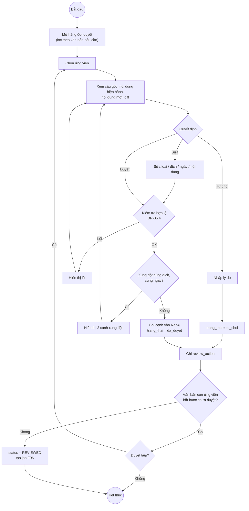
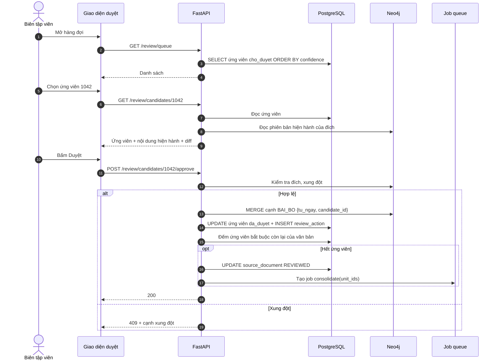

# F05 – Duyệt quan hệ sửa đổi / bãi bỏ / thay thế

| Mục | Nội dung |
|---|---|
| Epic | A – Xây dựng tri thức (offline) |
| Bước trong inception | 5. Chuyên gia duyệt |
| Ưu tiên | PoC (API + giao diện tối giản); MVP (giao diện đầy đủ, thống kê) |
| Phụ thuộc | F04 |
| Người dùng | Biên tập viên dữ liệu / chuyên gia pháp lý |
| Ràng buộc nguồn lực | Demo: chuyên gia tối đa **2 giờ / tuần**, trong khoảng 0.5 tuần (inception mục 10) |

Biên tập viên duyệt mọi cạnh `SUA_DOI`, `BAI_BO`, `THAY_THE` trước khi chúng ảnh hưởng tới câu trả lời. Đây là chốt chặn chất lượng cho KPI "độ chính xác cạnh sửa đổi / bãi bỏ ≥ 99%".

---

## 1. Business logic

| Mã | Quy tắc |
|---|---|
| BR-05.1 | Chỉ ứng viên `da_duyet` mới được ghi vào đồ thị và đưa vào hợp nhất phiên bản (F06). |
| BR-05.2 | Hàng đợi sắp theo: (1) **độ tin cậy tăng dần**, (2) văn bản nguồn có hiệu lực sớm nhất, (3) thứ tự trong văn bản. Có thể lọc theo văn bản để duyệt trọn một văn bản. |
| BR-05.3 | Hành động: **Duyệt**, **Từ chối** (bắt buộc lý do), **Sửa rồi duyệt** (được sửa `loai`, `kieu`, `dich_unit_id`, `tu_ngay`, `noi_dung_moi`), **Thêm thủ công** (cạnh hệ thống bỏ sót). |
| BR-05.4 | Kiểm tra khi duyệt: (a) `dich_unit_id` tồn tại, trừ `kieu = BO_SUNG`; (b) `tu_ngay` không rỗng; (c) `SUA_DOI` phải có `noi_dung_moi`; (d) `tu_ngay < ngay_ban_hanh` của văn bản nguồn → cảnh báo hồi tố, yêu cầu xác nhận. |
| BR-05.5 | **Xung đột**: đã có cạnh `da_duyet` khác cùng đích, cùng `tu_ngay` nhưng từ văn bản nguồn khác → chặn, hiển thị cả hai để biên tập viên quyết định. |
| BR-05.6 | **Duyệt hàng loạt** chỉ áp dụng cho ứng viên `phuong_phap = rule` và `confidence ≥ 0.95`, biên tập viên phải xem danh sách và bấm xác nhận – vẫn thỏa yêu cầu "duyệt mọi cạnh" của inception mà vừa ngân sách 2 giờ / tuần. |
| BR-05.7 | Mọi hành động ghi `review_action` (ai, lúc nào, trước / sau, thời gian thao tác) → audit và đo thời gian duyệt. |
| BR-05.8 | Khi mọi ứng viên bắt buộc của một văn bản đã ở `da_duyet` / `tu_choi` → văn bản chuyển `REVIEWED`, tạo job F06 cho **các điều khoản đích bị ảnh hưởng**. |
| BR-05.9 | **Thu hồi** một cạnh đã duyệt (đã hợp nhất) → xóa cạnh trong đồ thị, ứng viên về `cho_duyet`, chạy lại F06 cho điều khoản đích. |
| BR-05.10 | Màn hình duyệt hiển thị: câu gốc (tô sáng phần khớp), nội dung **phiên bản hiện hành** của đích, `noi_dung_moi`, **diff** giữa hai nội dung, link văn bản gốc. |

---

## 2. Use case description

### UC-05.1 – Duyệt một ứng viên quan hệ

| Mục | Nội dung |
|---|---|
| Actor chính | Biên tập viên |
| Tiền điều kiện | Có ứng viên `cho_duyet` |
| Hậu điều kiện | Ứng viên `da_duyet` (cạnh ghi Neo4j) hoặc `tu_choi`; `review_action` được ghi |

**Luồng chính**

1. Biên tập viên mở hàng đợi duyệt.
2. Hệ thống trả danh sách ứng viên theo thứ tự BR-05.2.
3. Biên tập viên chọn một ứng viên; hệ thống hiển thị thông tin BR-05.10.
4. Biên tập viên chọn **Duyệt**.
5. Hệ thống kiểm tra BR-05.4 và BR-05.5.
6. Hệ thống ghi cạnh vào Neo4j với `candidate_id`, cập nhật ứng viên `da_duyet`, ghi `review_action`.
7. Hệ thống kiểm tra BR-05.8; nếu văn bản đã duyệt xong thì tạo job F06.

**Luồng thay thế**

- 4a. **Sửa rồi duyệt**: biên tập viên sửa trường, hệ thống lưu `before/after`, tiếp bước 5.
- 4b. **Từ chối**: nhập lý do, ứng viên `tu_choi`, ghi `review_action`, sang bước 7.
- 5a. Vi phạm kiểm tra → trả lỗi 422 kèm lý do, giữ nguyên trạng thái.
- 5b. Xung đột → 409 kèm cạnh xung đột.

### UC-05.2 – Duyệt hàng loạt ứng viên tin cậy cao

Biên tập viên lọc `phuong_phap = rule`, `confidence ≥ 0.95` theo một văn bản → xem danh sách → bấm "Duyệt tất cả". Hệ thống chạy kiểm tra BR-04/BR-05 cho từng ứng viên; ứng viên lỗi bị loại khỏi lô và trả về danh sách lỗi.

### UC-05.3 – Thêm quan hệ thủ công

Biên tập viên nhập `loai`, nguồn, đích, `tu_ngay`, `noi_dung_moi`. Hệ thống tạo ứng viên `phuong_phap = manual`, `confidence = 1.0` và duyệt ngay (cùng kiểm tra BR-05.4, BR-05.5).

### UC-05.4 – Thu hồi quan hệ đã duyệt

Biên tập viên chọn cạnh đã duyệt → "Thu hồi" + lý do → hệ thống áp dụng BR-05.9.

---

## 3. Activity diagram



---

## 4. Sequence diagram



---

## 5. API

| Method | Endpoint | Vai trò | Mô tả |
|---|---|---|---|
| GET | `/api/v1/review/queue` | bien_tap_vien | Hàng đợi (lọc `document`, `loai`, `max_conf`) |
| GET | `/api/v1/review/candidates/{id}` | bien_tap_vien | Chi tiết + nội dung hiện hành + diff |
| POST | `/api/v1/review/candidates/{id}/approve` | bien_tap_vien | Duyệt (body có thể kèm trường sửa) |
| POST | `/api/v1/review/candidates/{id}/reject` | bien_tap_vien | Từ chối |
| POST | `/api/v1/review/candidates/bulk-approve` | bien_tap_vien | Duyệt hàng loạt (BR-05.6) |
| POST | `/api/v1/review/candidates` | bien_tap_vien | Thêm thủ công |
| POST | `/api/v1/review/candidates/{id}/revoke` | bien_tap_vien | Thu hồi |
| GET | `/api/v1/review/stats` | bien_tap_vien | Số đã duyệt / còn lại, thời gian duyệt trung bình, tỷ lệ sửa / từ chối theo `rule_id` |

**GET `/review/candidates/{id}`**

```json
{
  "candidate": { "id": 1042, "loai": "SUA_DOI", "kieu": "SUA_DOI",
                 "nguon_unit_id": "70/2025/NĐ-CP:Đ1:K12",
                 "dich_unit_id": "123/2020/NĐ-CP:Đ19:K1",
                 "tu_ngay": "2025-06-01", "confidence": 0.85, "rule_id": "R-SD-01",
                 "cau_goc": "12. Sửa đổi, bổ sung khoản 1 Điều 19 như sau:" },
  "dich_hien_hanh": {"phien_ban_id": "123/2020/NĐ-CP:Đ19:K1@2022-07-01", "noi_dung": "1. Trường hợp …"},
  "noi_dung_moi": "1. Trường hợp người bán phát hiện …",
  "diff": [{"op": "equal", "text": "1. Trường hợp "}, {"op": "delete", "text": "…"}, {"op": "insert", "text": "…"}],
  "source_url": "https://vanban.chinhphu.vn/…"
}
```

**POST `/review/candidates/{id}/approve`**

```json
// Request (trường sửa là tùy chọn)
{"changes": {"tu_ngay": "2025-06-01"}, "confirm_retroactive": false, "elapsed_ms": 45000}
// 200
{"id": 1042, "trang_thai": "da_duyet", "document_reviewed": false}
// 409
{"error": {"code": "EDGE_CONFLICT", "message": "Đã có sửa đổi khác cho cùng khoản, cùng ngày",
           "details": {"conflict_candidate_id": 998}}}
```

**POST `/review/candidates/bulk-approve`**

```json
// Request
{"candidate_ids": [1001, 1002, 1003]}
// 200
{"approved": [1001, 1003], "failed": [{"id": 1002, "code": "TARGET_NOT_FOUND"}]}
```

---

## 6. Schema

```sql
CREATE TABLE review_action (
    id            BIGSERIAL PRIMARY KEY,
    candidate_id  BIGINT NOT NULL REFERENCES relation_candidate(id),
    action        TEXT NOT NULL CHECK (action IN ('approve','edit_approve','reject','bulk_approve','manual_add','revoke')),
    before        JSONB,
    after         JSONB,
    ly_do         TEXT,
    elapsed_ms    INT,                -- thời gian thao tác, đo ngân sách 2h/tuần
    actor         TEXT NOT NULL,
    created_at    TIMESTAMPTZ NOT NULL DEFAULT now()
);
CREATE INDEX ON review_action (actor, created_at);
```

Cạnh trong Neo4j lưu `candidate_id` để truy ngược:

```cypher
MATCH (n {id: $nguon}), (d {id: $dich})
MERGE (n)-[r:BAI_BO {candidate_id: $candidate_id}]->(d)
SET r.tu_ngay = date($tu_ngay);
```

### Phác thảo giao diện duyệt

```
┌─ Hàng đợi (32 còn lại) ─────┐┌─ Ứng viên #1042 · SUA_DOI · conf 0.85 · R-SD-01 ─────────────┐
│ ● 0.50 NĐ70 Đ1 K7  → ?      ││ Nguồn : khoản 12 Điều 1 NĐ 70/2025/NĐ-CP                     │
│ ● 0.80 NĐ70 Đ1 K9  → Đ15    ││ Đích  : khoản 1 Điều 19 NĐ 123/2020/NĐ-CP                    │
│ ▶ 0.85 NĐ70 Đ1 K12 → Đ19 K1 ││ Từ ngày: 01/06/2025                                         │
│ ● 0.95 NĐ70 Đ2 K4  → Đ3 K10 ││ ┌ Hiện hành ───────────────┐ ┌ Nội dung mới ──────────────┐ │
│ …                           ││ │ 1. Trường hợp … [-xóa-]  │ │ 1. Trường hợp … [+thêm+]   │ │
└─────────────────────────────┘│ └──────────────────────────┘ └────────────────────────────┘ │
                               │ [Duyệt]  [Sửa]  [Từ chối]                                    │
                               └──────────────────────────────────────────────────────────────┘
```

---

## 7. Tiêu chí chấp nhận

- [ ] Ứng viên chưa duyệt không xuất hiện trong đồ thị và không ảnh hưởng câu trả lời.
- [ ] Duyệt xong toàn bộ ứng viên NĐ 70/2025 → tự tạo job F06.
- [ ] Xung đột cùng đích, cùng ngày → 409.
- [ ] `/review/stats` báo tổng thời gian duyệt theo tuần.
