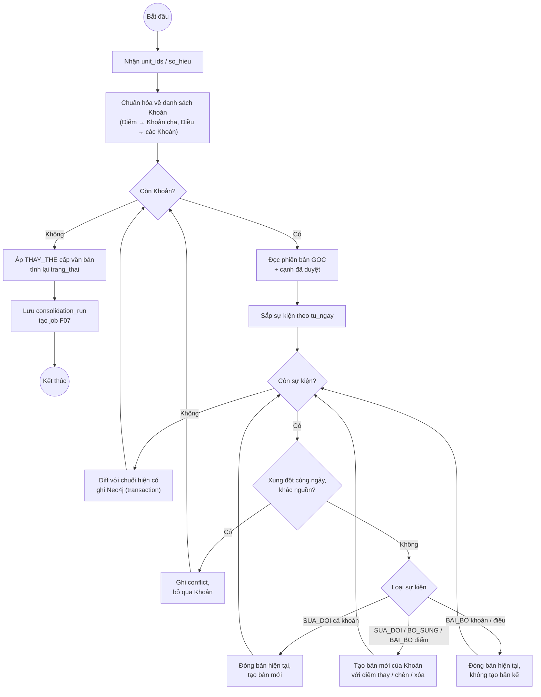
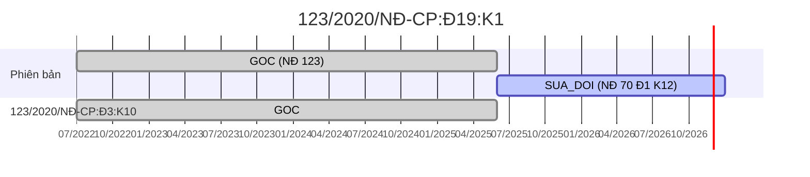
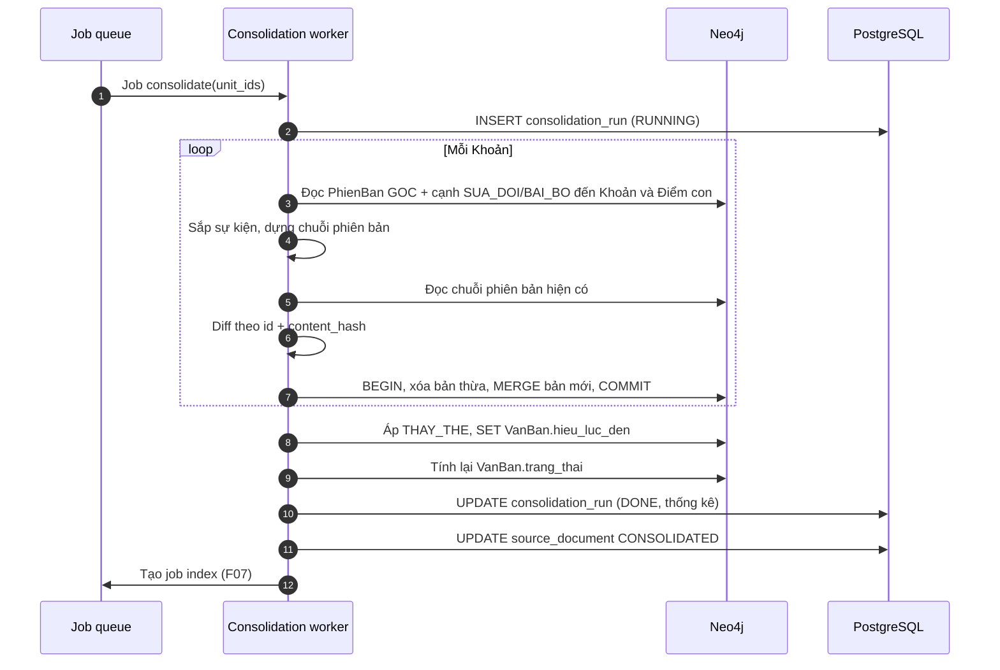

# F06 – Hợp nhất phiên bản (consolidation)

| Mục | Nội dung |
|---|---|
| Epic | A – Xây dựng tri thức (offline) |
| Bước trong inception | 6. Hợp nhất phiên bản |
| Ưu tiên | PoC (bãi bỏ, sửa đổi cả khoản); MVP (sửa / bổ sung cấp điểm, thay thế văn bản) |
| Phụ thuộc | F03, F05 |
| Kết quả đầu ra | Chuỗi `PhienBan` không chồng lấn cho mỗi điều khoản; `VanBan.hieu_luc_den`, `trang_thai` cập nhật; trạng thái `CONSOLIDATED` |

Áp các quan hệ đã duyệt theo thứ tự thời gian để mỗi Khoản có đầy đủ các phiên bản kèm khoảng hiệu lực – nền tảng cho tra cứu theo thời điểm (Q1, Q4).

---

## 1. Business logic

### 1.1. Nguyên tắc

| Mã | Quy tắc |
|---|---|
| BR-06.1 | Chỉ dùng cạnh `SUA_DOI`, `BAI_BO`, `THAY_THE` **đã duyệt**. |
| BR-06.2 | **Dựng lại từ đầu** (rebuild) cho mỗi điều khoản bị ảnh hưởng: bắt đầu từ phiên bản `GOC`, áp lần lượt các sự kiện theo `tu_ngay`. Kết quả xác định → chạy lại bao nhiêu lần cũng như nhau. |
| BR-06.3 | Các phiên bản của một điều khoản **liên tiếp và không chồng lấn**: `pb[i].hieu_luc_den = pb[i+1].hieu_luc_tu`. Ngoại lệ duy nhất: bãi bỏ → phiên bản cuối đóng, không có phiên bản kế. |
| BR-06.4 | Giữ embedding cũ khi `content_hash` phiên bản không đổi; phiên bản mới / đổi nội dung → `embedding_stale = true` (F07 xử lý). |
| BR-06.5 | Cho phép `tu_ngay` trong **tương lai** (văn bản đã ban hành, chưa có hiệu lực) → tạo phiên bản "sắp có hiệu lực". Cho phép **hồi tố** nếu đã được xác nhận ở F05. |

### 1.2. Áp từng loại sự kiện tại ngày `d`

| Sự kiện | Cách áp |
|---|---|
| `SUA_DOI` cả Khoản / Điều | Đóng phiên bản hiện tại (`hieu_luc_den = d`); tạo phiên bản mới `noi_dung = noi_dung_moi`, `nguon_sua_doi = <nguon_unit_id>`, `loai_thay_doi = SUA_DOI` |
| `SUA_DOI` một Điểm | Phiên bản mới của Khoản cha: thay đoạn của điểm đó bằng `noi_dung_moi` |
| `BO_SUNG` Điểm / Khoản / Điều | Điểm: phiên bản mới của Khoản cha với điểm chèn đúng vị trí, cập nhật `diem[]`. Khoản / Điều: tạo node mới (`MERGE`) + `CO` từ cha, phiên bản đầu tiên `hieu_luc_tu = d`, `loai_thay_doi = BO_SUNG` |
| `BAI_BO` Khoản | Đóng phiên bản hiện tại tại `d`, không tạo phiên bản kế |
| `BAI_BO` Điểm | Phiên bản mới của Khoản cha đã xóa điểm, cập nhật `diem[]` |
| `BAI_BO` Điều | Đóng phiên bản hiện tại của mọi Khoản thuộc Điều tại `d` |
| `THAY_THE` Văn bản | `VanBan(cũ).hieu_luc_den = d`; đóng mọi phiên bản đang mở của văn bản cũ tại `d` |

### 1.3. Thứ tự và xung đột

| Mã | Quy tắc |
|---|---|
| BR-06.6 | Sắp sự kiện theo `(tu_ngay, ngày ban hành văn bản nguồn, thu_tu_trong_nguon)`. |
| BR-06.7 | Hai sự kiện cùng ngày từ **cùng** văn bản nguồn → áp theo thứ tự trong văn bản. Từ **khác** văn bản nguồn → đã bị chặn ở F05 (BR-05.5); nếu vẫn gặp → dừng điều khoản đó, ghi `conflict`, báo biên tập viên. |
| BR-06.8 | Sự kiện tác động lên điều khoản đã bị bãi bỏ trước đó → bỏ qua sự kiện, ghi cảnh báo `TARGET_ALREADY_REPEALED`. |
| BR-06.9 | Thay đoạn cấp điểm không tìm thấy điểm trong phiên bản hiện tại → ghi cảnh báo `DIEM_NOT_FOUND`, không tạo phiên bản. |

### 1.4. Trạng thái văn bản

| Mã | Quy tắc |
|---|---|
| BR-06.10 | `VanBan.trang_thai` (tính cho hôm nay): `het_hieu_luc` nếu `hieu_luc_den <= hôm nay`; `chua_co_hieu_luc` nếu `hieu_luc_tu > hôm nay`; `het_hieu_luc_mot_phan` nếu có ít nhất một điều khoản không còn phiên bản hiệu lực; còn lại `con_hieu_luc`. |
| BR-06.11 | Trạng thái cho ngày khác hôm nay **không lưu**, tính tại thời điểm truy vấn (F13). |

---

## 2. Use case description

### UC-06.1 – Hợp nhất phiên bản cho các điều khoản bị ảnh hưởng

| Mục | Nội dung |
|---|---|
| Actor chính | Pipeline worker (kích hoạt bởi F05 hoặc F15); Quản trị viên (chạy thủ công) |
| Tiền điều kiện | Có cạnh đã duyệt mới / bị thu hồi; danh sách `unit_ids` đích hoặc `so_hieu` văn bản |
| Hậu điều kiện | Chuỗi phiên bản đúng cho các điều khoản; trạng thái văn bản cập nhật; các văn bản liên quan `CONSOLIDATED`; job F07 cho phiên bản `embedding_stale` |

**Luồng chính**

1. Worker nhận danh sách điều khoản đích (mở rộng: đích là Điểm → lấy Khoản cha; đích là Điều → mọi Khoản).
2. Với mỗi điều khoản: đọc phiên bản `GOC` và mọi cạnh đã duyệt nhắm vào nó hoặc các điểm con.
3. Sắp sự kiện (BR-06.6) và áp lần lượt (mục 1.2).
4. So sánh chuỗi phiên bản mới với chuỗi hiện có: giữ nguyên phiên bản trùng `id` + `content_hash`, xóa phiên bản thừa, tạo phiên bản mới.
5. Ghi Neo4j trong transaction theo từng điều khoản.
6. Áp `THAY_THE` cấp văn bản; tính lại `trang_thai` văn bản (BR-06.10).
7. Lưu `consolidation_run` (số phiên bản tạo / xóa, cảnh báo, xung đột); tạo job F07.

**Ngoại lệ**: 3a. Xung đột → bỏ qua điều khoản đó, ghi `conflict` (BR-06.7). 3b. Cảnh báo BR-06.8 / BR-06.9 → vẫn tiếp tục.

---

## 3. Activity diagram



### Ví dụ dòng thời gian (Điều 19 khoản 1 NĐ 123)



---

## 4. Sequence diagram



---

## 5. API

| Method | Endpoint | Vai trò | Mô tả |
|---|---|---|---|
| POST | `/api/v1/consolidation/runs` | quan_tri | Chạy hợp nhất cho `so_hieu` hoặc `unit_ids` (hoặc toàn bộ với `all: true`) |
| GET | `/api/v1/consolidation/runs/{id}` | bien_tap_vien | Kết quả, cảnh báo, xung đột |
| GET | `/api/v1/units/versions?unit_id=` | nguoi_dung | Dòng thời gian phiên bản của một điều khoản (dùng chung với F10) |

**POST `/consolidation/runs`**

```json
// Request
{"unit_ids": ["123/2020/NĐ-CP:Đ3:K10", "123/2020/NĐ-CP:Đ19:K1"]}
// 202
{"run_id": "5d1c…", "status": "QUEUED"}
```

**GET `/consolidation/runs/{id}`**

```json
{
  "run_id": "5d1c…",
  "status": "DONE",
  "stats": {"units": 2, "versions_created": 1, "versions_deleted": 0, "versions_closed": 2},
  "warnings": [],
  "conflicts": []
}
```

**GET `/units/versions?unit_id=123/2020/NĐ-CP:Đ3:K10`**

```json
{
  "unit_id": "123/2020/NĐ-CP:Đ3:K10",
  "label": "khoản 10 Điều 3 Nghị định 123/2020/NĐ-CP",
  "versions": [
    {"id": "123/2020/NĐ-CP:Đ3:K10@2022-07-01", "hieu_luc_tu": "2022-07-01", "hieu_luc_den": "2025-06-01",
     "loai_thay_doi": "GOC", "nguon_sua_doi": null, "noi_dung": "10. Hủy hóa đơn …"}
  ],
  "events": [
    {"loai": "BAI_BO", "tu_ngay": "2025-06-01", "boi_unit_id": "70/2025/NĐ-CP:Đ2:K4",
     "boi_label": "khoản 4 Điều 2 Nghị định 70/2025/NĐ-CP"}
  ]
}
```

---

## 6. Schema

### 6.1. Neo4j – đọc sự kiện của một Khoản

```cypher
MATCH (k:Khoan {id: $khoan_id})
OPTIONAL MATCH (k)-[:CO*0..1]->(target)
OPTIONAL MATCH (src)-[r:SUA_DOI|BAI_BO]->(target)
WITH k, target, src, r WHERE r IS NOT NULL
MATCH (vb:VanBan)-[:CO*]->(src)
RETURN target.id AS target_id, labels(target)[0] AS target_label,
       type(r) AS loai, r.kieu AS kieu, r.tu_ngay AS tu_ngay, r.candidate_id AS candidate_id,
       src.id AS nguon_id, vb.ngay_ban_hanh AS nguon_ban_hanh
ORDER BY tu_ngay, nguon_ban_hanh;
```

> `noi_dung_moi` và `thu_tu_trong_nguon` đọc từ `relation_candidate` theo `candidate_id`.

### 6.2. PostgreSQL

```sql
CREATE TABLE consolidation_run (
    id          UUID PRIMARY KEY,
    trigger     TEXT NOT NULL CHECK (trigger IN ('review','revoke','manual','incremental')),
    scope       JSONB NOT NULL,          -- {"unit_ids":[...]} | {"so_hieu":"..."} | {"all":true}
    status      TEXT NOT NULL CHECK (status IN ('QUEUED','RUNNING','DONE','FAILED')),
    stats       JSONB NOT NULL DEFAULT '{}',
    warnings    JSONB NOT NULL DEFAULT '[]',
    conflicts   JSONB NOT NULL DEFAULT '[]',
    created_at  TIMESTAMPTZ NOT NULL DEFAULT now(),
    finished_at TIMESTAMPTZ
);
```

### 6.3. Thuật toán (giả mã)

```python
def rebuild_versions(khoan, events) -> list[Version]:
    goc = khoan.version_goc
    versions = [Version(content=goc.noi_dung, tu=goc.hieu_luc_tu, den=None, loai="GOC")]
    for ev in sorted(events, key=lambda e: (e.tu_ngay, e.nguon_ban_hanh, e.thu_tu)):
        cur = versions[-1]
        if cur.den is not None:                      # đã bị bãi bỏ
            warn("TARGET_ALREADY_REPEALED", ev); continue
        if ev.loai == "BAI_BO" and ev.target_is(khoan):
            cur.den = ev.tu_ngay; continue
        new_content = apply_event(cur.content, ev)   # thay cả khoản / thay-chèn-xóa điểm
        if new_content is None:
            warn("DIEM_NOT_FOUND", ev); continue
        cur.den = ev.tu_ngay
        versions.append(Version(content=new_content, tu=ev.tu_ngay, den=None,
                                loai=ev.kieu or "SUA_DOI", nguon=ev.nguon_id))
    return versions
```

---

## 7. Tiêu chí chấp nhận

- [ ] `123/2020/NĐ-CP:Đ3:K10` có đúng 1 phiên bản `[2022-07-01, 2025-06-01)`.
- [ ] Không điều khoản nào có hai phiên bản chồng lấn (kiểm tra bằng truy vấn tự động).
- [ ] TT 78/2021 có `hieu_luc_den = 2025-06-01`, `trang_thai = het_hieu_luc`.
- [ ] Chạy hợp nhất 2 lần liên tiếp → lần 2 `versions_created = 0`, `versions_deleted = 0`.
