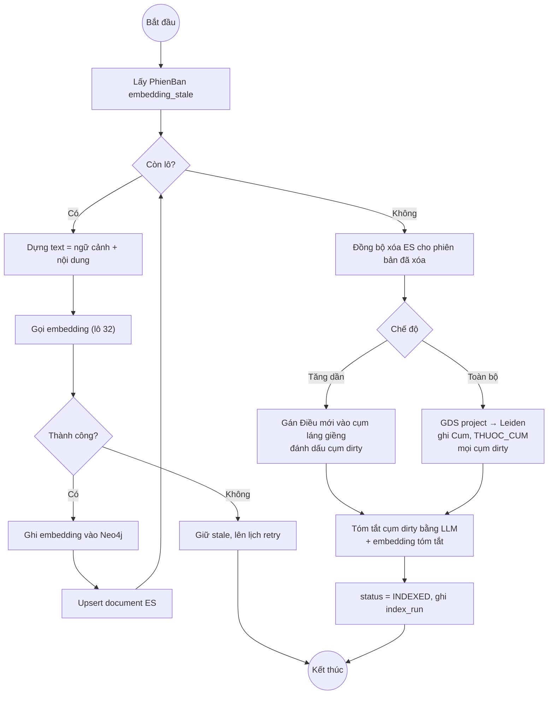
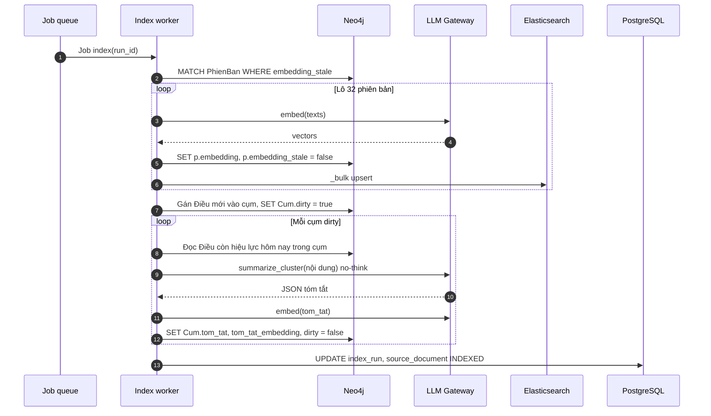

# F07 – Lập chỉ mục và tóm tắt cụm chủ đề

| Mục | Nội dung |
|---|---|
| Epic | A – Xây dựng tri thức (offline) |
| Bước trong inception | 7. Lưu trữ & chỉ mục |
| Ưu tiên | PoC (BM25); MVP (vector, Leiden, tóm tắt) |
| Phụ thuộc | F06, F17 |
| Kết quả đầu ra | Embedding trên `PhienBan`, chỉ mục BM25 Elasticsearch, node `Cum` có tóm tắt; trạng thái `INDEXED` |

Tạo ba loại chỉ mục phục vụ ba kiểu truy vấn: **vector** + **BM25** cho Local Search, **tóm tắt cụm** cho Global Search.

---

## 1. Business logic

### 1.1. Embedding

| Mã | Quy tắc |
|---|---|
| BR-07.1 | Chỉ tạo embedding cho `PhienBan` có `embedding_stale = true` (mới hoặc đổi nội dung). |
| BR-07.2 | Văn bản đưa vào embedding = **tiêu đề ngữ cảnh** + nội dung: `"{loai} {so_hieu} – {trich_yeu}\nĐiều {so}. {tieu_de_dieu}\nKhoản {so}: {noi_dung}"`. Giúp các khoản ngắn ("Bãi bỏ khoản 10…") vẫn mang ngữ cảnh. |
| BR-07.3 | Model embedding đa ngôn ngữ trên LM Studio (mặc định bge-m3, 1024 chiều); gọi theo lô 32; nội dung > 8 000 token → cắt theo đoạn, embedding là trung bình các đoạn. |
| BR-07.4 | Đổi model embedding → đánh dấu **toàn bộ** `embedding_stale = true` và tạo lại vector index nếu số chiều thay đổi. |

### 1.2. BM25

| Mã | Quy tắc |
|---|---|
| BR-07.5 | Một document ES cho mỗi `PhienBan`, khóa `_id = phien_ban.id`. Upsert khi phiên bản tạo / đổi; xóa khi phiên bản bị xóa. |
| BR-07.6 | Trường `noi_dung` có 2 analyzer: `vi_standard` (ICU tokenizer + lowercase) và `vi_folded` (thêm asciifolding) để tìm được cả khi người dùng gõ không dấu. `so_hieu`, `unit_id` là `keyword` để khớp chính xác. |
| BR-07.7 | Lưu `hieu_luc_tu`, `hieu_luc_den` (null → `9999-12-31`) để lọc hiệu lực bằng range query ngay trong ES. |

### 1.3. Phân cụm và tóm tắt (Global Search)

| Mã | Quy tắc |
|---|---|
| BR-07.8 | Đồ thị chiếu (GDS projection) gồm node `Dieu`, `ChuDe`, `DoiTuong` và cạnh `THUOC_CHU_DE`, `AP_DUNG_CHO`, `VIEN_DAN`, `HUONG_DAN` (quy về cấp Điều), `SUA_DOI` (quy về cấp Điều); vô hướng, trọng số mặc định 1, `SUA_DOI` trọng số 2. |
| BR-07.9 | Chạy **Leiden** (Neo4j GDS) với `includeIntermediateCommunities = true`, tối đa 2 cấp. Cụm < 3 Điều gộp vào cụm láng giềng lớn nhất. |
| BR-07.10 | Tóm tắt mỗi cụm bằng Qwen3.5 9B (tắt thinking): đầu vào là các Điều trong cụm **còn hiệu lực hôm nay** (label + nội dung rút gọn ≤ 300 ký tự/Điều, tổng ≤ 6 000 token); đầu ra JSON `{tieu_de, tom_tat, van_ban_chinh[], doi_tuong[], chu_de[]}`. |
| BR-07.11 | Tóm tắt chỉ dùng để **chọn cụm** và định hướng; câu trả lời cuối luôn dựng từ nội dung phiên bản tại ngày áp dụng (F12, F13) – tránh tóm tắt lỗi thời làm sai câu trả lời theo thời điểm. |
| BR-07.12 | Cụm `dirty = true` khi một Điều trong cụm có phiên bản mới / bị đóng → chỉ tóm tắt lại cụm dirty (cập nhật tăng dần). Leiden chạy lại toàn bộ mỗi tuần (F15) hoặc khi thủ công. |
| BR-07.13 | Embedding `tom_tat` lưu vào `Cum.tom_tat_embedding` cho vector index `cum_embedding`. |

---

## 2. Use case description

### UC-07.1 – Lập chỉ mục tăng dần sau hợp nhất

| Mục | Nội dung |
|---|---|
| Actor chính | Pipeline worker |
| Tiền điều kiện | `consolidation_run` xong; có phiên bản `embedding_stale` |
| Hậu điều kiện | Vector, BM25, tóm tắt cụm đã cập nhật; văn bản liên quan `INDEXED` |

**Luồng chính**

1. Worker lấy danh sách phiên bản `embedding_stale = true`.
2. Dựng văn bản embedding (BR-07.2), gọi LLM Gateway theo lô, ghi `embedding`, `embedding_stale = false`.
3. Upsert / xóa document ES tương ứng (BR-07.5).
4. Gán Điều mới vào cụm láng giềng có nhiều liên kết nhất (chưa chạy Leiden lại); đánh dấu cụm bị ảnh hưởng `dirty`.
5. Tóm tắt lại các cụm `dirty`, tạo embedding tóm tắt.
6. Cập nhật trạng thái văn bản `INDEXED`, ghi `index_run`.

**Ngoại lệ**: 2a. LM Studio lỗi → giữ `embedding_stale = true`, job retry; văn bản chưa `INDEXED`. 3a. ES lỗi → retry 3 lần, sau đó `FAILED`.

### UC-07.2 – Phân cụm lại toàn bộ

Quản trị viên (hoặc lịch hằng tuần) chạy: chiếu đồ thị → Leiden → ghi `Cum`, `THUOC_CUM`, `CUM_CHA` → xóa cụm cũ → đánh dấu mọi cụm `dirty` → tóm tắt lại.

---

## 3. Activity diagram



---

## 4. Sequence diagram



---

## 5. API

| Method | Endpoint | Vai trò | Mô tả |
|---|---|---|---|
| POST | `/api/v1/index/runs` | quan_tri | Chạy chỉ mục `{"mode": "incremental" \| "full", "parts": ["embedding","bm25","communities"]}` |
| GET | `/api/v1/index/runs/{id}` | quan_tri | Trạng thái |
| GET | `/api/v1/index/status` | quan_tri | Số phiên bản stale, số document ES, số cụm dirty, model embedding hiện tại |
| GET | `/api/v1/topics` | nguoi_dung | Danh sách cụm (tiêu đề, tóm tắt, văn bản chính) |
| GET | `/api/v1/topics/{cum_id}` | nguoi_dung | Chi tiết cụm + các Điều thuộc cụm |

**GET `/index/status`**

```json
{
  "embedding_model": "bge-m3",
  "phien_ban_total": 2140,
  "phien_ban_stale": 0,
  "es_documents": 2140,
  "clusters": 38,
  "clusters_dirty": 0,
  "last_full_clustering": "2026-11-16T03:00:00+07:00"
}
```

---

## 6. Schema

### 6.1. Elasticsearch mapping (index `phien_ban`)

```json
{
  "settings": {
    "analysis": {
      "analyzer": {
        "vi_standard": {"tokenizer": "icu_tokenizer", "filter": ["lowercase"]},
        "vi_folded":   {"tokenizer": "icu_tokenizer", "filter": ["lowercase", "asciifolding"]}
      }
    }
  },
  "mappings": {
    "properties": {
      "phien_ban_id": {"type": "keyword"},
      "unit_id":      {"type": "keyword"},
      "so_hieu":      {"type": "keyword"},
      "loai_van_ban": {"type": "keyword"},
      "label":        {"type": "text", "analyzer": "vi_standard"},
      "noi_dung":     {"type": "text", "analyzer": "vi_standard",
                       "fields": {"folded": {"type": "text", "analyzer": "vi_folded"}}},
      "hieu_luc_tu":  {"type": "date"},
      "hieu_luc_den": {"type": "date"},
      "chu_de":       {"type": "keyword"},
      "doi_tuong":    {"type": "keyword"},
      "cum_id":       {"type": "keyword"}
    }
  }
}
```

### 6.2. Neo4j GDS – Leiden

```cypher
CALL gds.graph.project.cypher('legal_dieu',
  'MATCH (n) WHERE n:Dieu OR n:ChuDe OR n:DoiTuong RETURN id(n) AS id',
  'MATCH (a:Dieu)-[r:THUOC_CHU_DE|AP_DUNG_CHO|VIEN_DAN]->(b) RETURN id(a) AS source, id(b) AS target, 1.0 AS weight
   UNION ALL
   MATCH (a:Dieu)-[:CO*0..2]->()-[:SUA_DOI]->()<-[:CO*0..2]-(b:Dieu) RETURN id(a) AS source, id(b) AS target, 2.0 AS weight'
);

CALL gds.leiden.write('legal_dieu', {
  writeProperty: 'cum_ids', relationshipWeightProperty: 'weight',
  includeIntermediateCommunities: true, maxLevels: 2, randomSeed: 42
});
```

### 6.3. PostgreSQL

```sql
CREATE TABLE index_run (
    id           UUID PRIMARY KEY,
    mode         TEXT NOT NULL CHECK (mode IN ('incremental','full')),
    parts        TEXT[] NOT NULL,
    status       TEXT NOT NULL CHECK (status IN ('QUEUED','RUNNING','DONE','FAILED')),
    stats        JSONB NOT NULL DEFAULT '{}',   -- embedded, es_upserted, clusters_summarized
    error        TEXT,
    created_at   TIMESTAMPTZ NOT NULL DEFAULT now(),
    finished_at  TIMESTAMPTZ
);
```

### 6.4. Output tóm tắt cụm (Pydantic)

```python
class ClusterSummary(BaseModel):
    tieu_de: str
    tom_tat: str = Field(max_length=1500)
    van_ban_chinh: list[str]     # số hiệu
    doi_tuong: list[str]         # mã trong danh mục
    chu_de: list[str]
```

---

## 7. Tiêu chí chấp nhận

- [ ] Sau F06 trên bộ PoC, `phien_ban_stale = 0` và số document ES = số `PhienBan`.
- [ ] Tìm "huy hoa don" (không dấu) qua ES trả về khoản 10 Điều 3 NĐ 123.
- [ ] Mỗi cụm có tóm tắt, `van_ban_chinh` chỉ chứa số hiệu có trong đồ thị.
- [ ] Sửa một khoản → chỉ cụm chứa Điều đó được tóm tắt lại.
