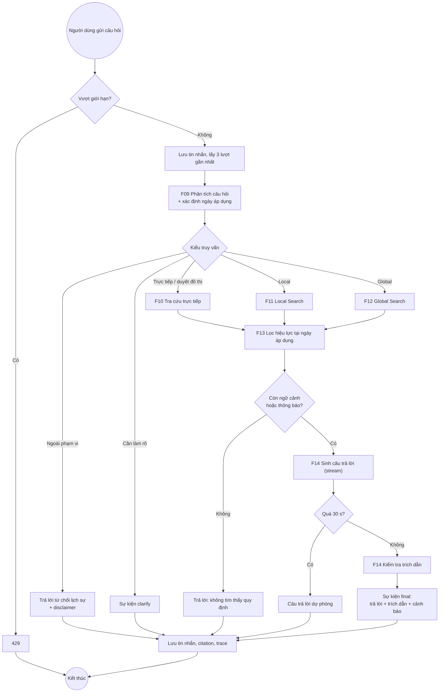
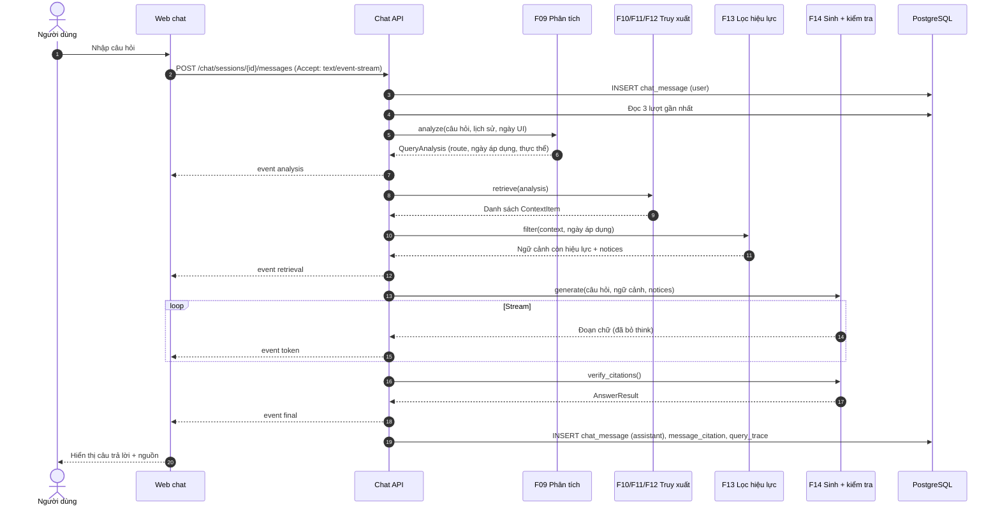

# F08 – Hỏi đáp qua chat (điều phối)

| Mục | Nội dung |
|---|---|
| Epic | B – Hỏi đáp (online) |
| Bước trong inception | Toàn bộ giai đoạn 2 (8 → 12) – feature điều phối |
| Ưu tiên | PoC (không streaming, chỉ tra cứu trực tiếp); MVP (đầy đủ) |
| Phụ thuộc | F09, F10, F11, F12, F13, F14, F17 |
| Người dùng | Kế toán, chủ hộ kinh doanh, chuyên viên pháp chế |

Nhận câu hỏi, điều phối pipeline **phân tích → truy xuất → lọc hiệu lực → sinh câu trả lời → kiểm tra trích dẫn**, quản lý phiên hội thoại và trả kết quả dạng streaming.

---

## 1. Business logic

| Mã | Quy tắc |
|---|---|
| BR-08.1 | Pipeline cố định: F09 → (F10 \| F11 \| F12) → F13 → F14. Không bước nào được bỏ qua F13. |
| BR-08.2 | **Ngày áp dụng**: ưu tiên (1) ngày người dùng chọn trên giao diện, (2) ngày trích từ câu hỏi (F09), (3) hôm nay. Ngày áp dụng luôn hiển thị trong câu trả lời. |
| BR-08.3 | **Hội thoại nhiều lượt**: gửi tối đa 3 lượt gần nhất (câu hỏi + tóm tắt trả lời + danh sách điều khoản đã trích) cho F09 để viết lại câu hỏi nối tiếp ("còn khoản 2 thì sao?") thành câu hỏi độc lập. Ngày áp dụng của lượt trước được kế thừa nếu lượt mới không nêu. |
| BR-08.4 | **Ngân sách thời gian** (mục tiêu P95 ≤ 10 giây): phân tích ≤ 1.5 s, truy xuất + lọc ≤ 1.5 s, sinh ≤ 6 s, kiểm tra ≤ 1 s. Global Search được phép tới 20 s và hiển thị tiến trình. |
| BR-08.5 | **Hết thời gian cứng 30 s** ở bước sinh → trả "câu trả lời dự phòng": danh sách điều khoản liên quan còn hiệu lực kèm trích đoạn, không có diễn giải của LLM. |
| BR-08.6 | **Ngoài phạm vi** (F09 trả `ngoai_pham_vi`): yêu cầu tư vấn cá nhân ("tôi có nên…", "có bị phạt không nếu…" kèm tình tiết riêng) → trả lời lịch sự rằng hệ thống chỉ tra cứu quy định, gợi ý tham vấn chuyên gia, có thể kèm quy định liên quan. Lĩnh vực chưa có dữ liệu → nói rõ "chưa có dữ liệu về lĩnh vực này". |
| BR-08.7 | Mọi câu trả lời kèm **disclaimer** cố định và danh sách nguồn (`Citation`), mỗi nguồn có ngày hiệu lực và trạng thái. |
| BR-08.8 | Thinking của Qwen bật cho bước sinh (cấu hình `CHAT_THINKING=true`), luôn bị loại khỏi nội dung gửi người dùng (F17); phần suy nghĩ chỉ lưu vào `query_trace` khi bật `TRACE_THINKING`. |
| BR-08.9 | Lưu mỗi lượt: câu hỏi, phân tích, kiểu truy xuất, ngữ cảnh, câu trả lời, trích dẫn, độ trễ từng bước → phục vụ đánh giá (F16) và gỡ lỗi. |
| BR-08.10 | Giới hạn: câu hỏi ≤ 1 000 ký tự; mỗi API key ≤ 20 câu hỏi/phút; mỗi phiên tối đa 1 câu hỏi đang xử lý (LLM local chỉ phục vụ tốt một luồng). |

---

## 2. Use case description

### UC-08.1 – Đặt câu hỏi và nhận câu trả lời

| Mục | Nội dung |
|---|---|
| Actor chính | Người dùng (kế toán, chủ hộ kinh doanh, pháp chế) |
| Tiền điều kiện | Có phiên chat; dữ liệu ít nhất một văn bản `INDEXED` |
| Hậu điều kiện | Câu trả lời có trích dẫn đã kiểm tra hiển thị cho người dùng; lượt hỏi đáp được lưu |
| Kích hoạt | Người dùng gửi câu hỏi |

**Luồng chính**

1. Người dùng nhập câu hỏi (tùy chọn chọn ngày áp dụng) và gửi.
2. Hệ thống kiểm tra giới hạn (BR-08.10), lưu tin nhắn người dùng.
3. Hệ thống gọi F09 phân tích câu hỏi kèm lịch sử (BR-08.3); gửi sự kiện `analysis` cho giao diện.
4. Hệ thống chạy cách truy xuất mà F09 chọn (F10 / F11 / F12); gửi sự kiện `retrieval`.
5. Hệ thống lọc hiệu lực tại ngày áp dụng (F13).
6. Hệ thống sinh câu trả lời (F14), stream từng đoạn chữ qua sự kiện `token`.
7. Hệ thống kiểm tra trích dẫn (F14); gửi sự kiện `final` gồm câu trả lời chính thức, trích dẫn, cảnh báo, disclaimer.
8. Hệ thống lưu tin nhắn trợ lý, trích dẫn, trace.

**Luồng thay thế / ngoại lệ**

- 3a. Ngoài phạm vi → trả lời theo BR-08.6, kết thúc.
- 3b. Câu hỏi mơ hồ (F09 trả `can_lam_ro`, ví dụ "NĐ 123" khớp nhiều năm) → trả sự kiện `clarify` kèm lựa chọn, kết thúc lượt.
- 4a. Truy xuất không có kết quả → trả lời "Không tìm thấy quy định phù hợp trong dữ liệu hiện có", kèm gợi ý.
- 6a. Quá 30 s → câu trả lời dự phòng (BR-08.5).
- 7a. Kiểm tra trích dẫn thất bại và sinh lại vẫn thất bại → sự kiện `final` với `do_tin_cay = thap` và cảnh báo (F14).
- *a. LM Studio không truy cập được → 503 `LLM_UNAVAILABLE`; nếu đã có kết quả truy xuất thì trả câu trả lời dự phòng.

### UC-08.2 – Quản lý phiên hội thoại

Người dùng tạo phiên mới, xem danh sách phiên, mở lại phiên cũ, đổi tên, xóa phiên. Xóa phiên → xóa mềm (`deleted_at`), dữ liệu đánh giá giữ ẩn danh.

---

## 3. Activity diagram



---

## 4. Sequence diagram



---

## 5. API

| Method | Endpoint | Vai trò | Mô tả |
|---|---|---|---|
| POST | `/api/v1/chat/sessions` | nguoi_dung | Tạo phiên |
| GET | `/api/v1/chat/sessions` | nguoi_dung | Danh sách phiên của key |
| GET | `/api/v1/chat/sessions/{id}` | nguoi_dung | Phiên + các tin nhắn |
| PATCH | `/api/v1/chat/sessions/{id}` | nguoi_dung | Đổi tên, đặt ngày áp dụng mặc định |
| DELETE | `/api/v1/chat/sessions/{id}` | nguoi_dung | Xóa mềm |
| POST | `/api/v1/chat/sessions/{id}/messages` | nguoi_dung | Gửi câu hỏi (SSE hoặc JSON nếu `stream=false`) |
| GET | `/api/v1/chat/messages/{id}/trace` | bien_tap_vien | Trace đầy đủ của một lượt (gỡ lỗi) |

**POST `/chat/sessions/{id}/messages`**

```json
// Request
{"content": "Khoản 10 Điều 3 Nghị định 123/2020 hiện còn hiệu lực không?", "ngay_ap_dung": null, "stream": true}
```

Các sự kiện SSE:

```text
event: analysis
data: {"route": "DIRECT", "ngay_ap_dung": "2026-11-18", "nguon_ngay": "mac_dinh",
       "van_ban": ["123/2020/NĐ-CP"], "dieu_khoan": ["123/2020/NĐ-CP:Đ3:K10"]}

event: retrieval
data: {"contexts": 3, "notices": 1}

event: token
data: {"text": "Khoản 10 Điều 3 Nghị định 123/2020/NĐ-CP **đã bị bãi bỏ** từ 01/6/2025 "}

event: final
data: { ...AnswerResponse... }
```

`AnswerResponse` (cũng là body khi `stream=false`):

```json
{
  "message_id": "b7e2…",
  "route": "DIRECT",
  "ngay_ap_dung": "2026-11-18",
  "answer": "Khoản 10 Điều 3 Nghị định 123/2020/NĐ-CP **đã bị bãi bỏ** từ 01/6/2025 theo khoản 4 Điều 2 Nghị định 70/2025/NĐ-CP [C1]. Hiện nay hóa đơn có sai sót được xử lý theo Điều 19 Nghị định 123/2020/NĐ-CP (đã được sửa đổi) [C2]…",
  "citations": [
    {"ref": "C1", "unit_id": "123/2020/NĐ-CP:Đ3:K10", "label": "khoản 10 Điều 3 Nghị định 123/2020/NĐ-CP",
     "so_hieu": "123/2020/NĐ-CP", "phien_ban_id": "123/2020/NĐ-CP:Đ3:K10@2022-07-01",
     "hieu_luc_tu": "2022-07-01", "hieu_luc_den": "2025-06-01", "trang_thai": "het_hieu_luc",
     "thay_doi": {"loai": "BAI_BO", "boi_unit_id": "70/2025/NĐ-CP:Đ2:K4",
                  "boi_label": "khoản 4 Điều 2 Nghị định 70/2025/NĐ-CP", "tu_ngay": "2025-06-01"},
     "trich_doan": "10. Hủy hóa đơn …", "url_nguon": "https://vanban.chinhphu.vn/…"},
    {"ref": "C2", "unit_id": "123/2020/NĐ-CP:Đ19:K1", "label": "khoản 1 Điều 19 Nghị định 123/2020/NĐ-CP",
     "trang_thai": "con_hieu_luc", "hieu_luc_tu": "2025-06-01", "hieu_luc_den": null, "...": "..."}
  ],
  "warnings": [],
  "do_tin_cay": "cao",
  "disclaimer": "Thông tin chỉ nhằm mục đích tra cứu, không phải tư vấn pháp lý. Vui lòng tham vấn chuyên gia trước khi áp dụng.",
  "latency_ms": {"analysis": 820, "retrieval": 310, "generation": 4100, "verification": 150, "total": 5380}
}
```

---

## 6. Schema (PostgreSQL)

```sql
CREATE TABLE chat_session (
    id                   UUID PRIMARY KEY,
    api_key_id           TEXT NOT NULL,
    title                TEXT,
    ngay_ap_dung_mac_dinh DATE,
    created_at           TIMESTAMPTZ NOT NULL DEFAULT now(),
    updated_at           TIMESTAMPTZ NOT NULL DEFAULT now(),
    deleted_at           TIMESTAMPTZ
);

CREATE TABLE chat_message (
    id            UUID PRIMARY KEY,
    session_id    UUID NOT NULL REFERENCES chat_session(id),
    role          TEXT NOT NULL CHECK (role IN ('user','assistant')),
    content       TEXT NOT NULL,
    route         TEXT,                      -- DIRECT | GRAPH | LOCAL | GLOBAL | REFUSE | CLARIFY
    ngay_ap_dung  DATE,
    do_tin_cay    TEXT CHECK (do_tin_cay IN ('cao','thap')),
    warnings      JSONB NOT NULL DEFAULT '[]',
    latency_ms    JSONB,
    created_at    TIMESTAMPTZ NOT NULL DEFAULT now()
);
CREATE INDEX ON chat_message (session_id, created_at);

CREATE TABLE message_citation (
    message_id    UUID NOT NULL REFERENCES chat_message(id),
    ref           TEXT NOT NULL,
    unit_id       TEXT NOT NULL,
    phien_ban_id  TEXT,
    trang_thai    TEXT NOT NULL,
    payload       JSONB NOT NULL,            -- Citation đầy đủ tại thời điểm trả lời
    PRIMARY KEY (message_id, ref)
);

CREATE TABLE query_trace (
    message_id    UUID PRIMARY KEY REFERENCES chat_message(id),
    analysis      JSONB NOT NULL,
    contexts      JSONB NOT NULL,            -- ngữ cảnh trước và sau lọc hiệu lực
    notices       JSONB NOT NULL DEFAULT '[]',
    prompt        TEXT,
    raw_output    TEXT,                      -- chỉ lưu khi TRACE_THINKING
    verification  JSONB,
    attempts      INT NOT NULL DEFAULT 1
);
```

---

## 7. Tiêu chí chấp nhận

- [ ] Q1–Q5 của inception đều trả lời được qua `POST /messages`, mỗi câu có ≥ 1 trích dẫn.
- [ ] Hỏi tiếp "còn khoản 2 thì sao?" sau Q1 → được hiểu là khoản 2 Điều 3 NĐ 123.
- [ ] P95 ≤ 10 s trên bộ câu hỏi đánh giá (trừ Global Search).
- [ ] Tắt LM Studio giữa chừng → người dùng nhận câu trả lời dự phòng hoặc lỗi 503 rõ ràng, không treo.
