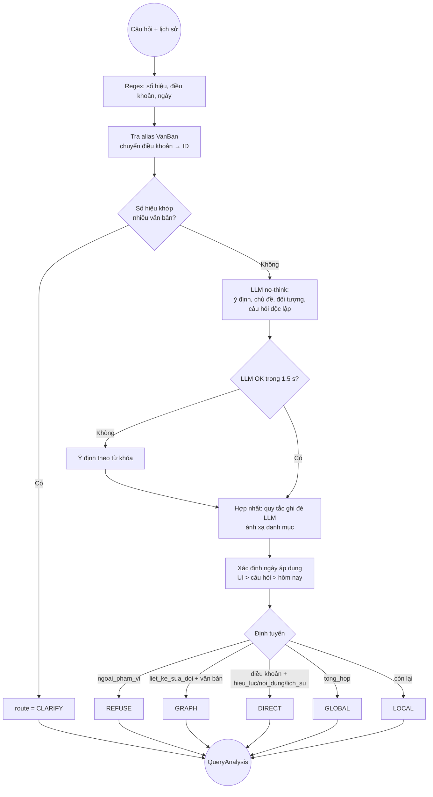
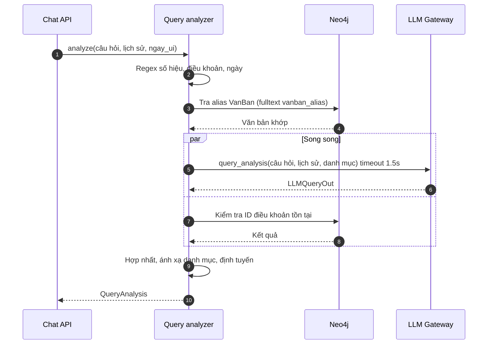

# F09 – Phân tích câu hỏi và định tuyến truy xuất

| Mục | Nội dung |
|---|---|
| Epic | B – Hỏi đáp (online) |
| Bước trong inception | 8. Phân tích câu hỏi · 9. Chọn cách truy xuất |
| Ưu tiên | PoC (regex số hiệu / điều khoản); MVP (LLM, hội thoại nhiều lượt) |
| Phụ thuộc | F03 (alias văn bản), F04 (danh mục chủ đề / đối tượng), F17 |
| Kết quả đầu ra | `QueryAnalysis`: thực thể, ngày áp dụng, ý định, kiểu truy xuất |

---

## 1. Business logic

### 1.1. Trích xuất bằng quy tắc (chạy trước, ưu tiên cao nhất)

| Mã | Quy tắc |
|---|---|
| BR-09.1 | **Số hiệu đầy đủ**: `\d+/\d{4}/[A-ZĐ0-9\-]+` → khớp trực tiếp `VanBan.so_hieu`. |
| BR-09.2 | **Số hiệu rút gọn**: "Nghị định 123", "NĐ 123/2020", "Thông tư 32", "NQ 198" → tra `VanBan.alias`. Nhiều kết quả (ví dụ NĐ 123 của nhiều năm) → ưu tiên văn bản thuộc phạm vi dữ liệu; vẫn > 1 → `can_lam_ro = true`, trả các lựa chọn. |
| BR-09.3 | **Điều khoản**: `(điểm\s+([a-zđ]))?\s*(khoản\s+(\d+[a-z]?))?\s*Điều\s+(\d+[a-z]?)`, gắn với văn bản gần nhất trong câu → chuyển sang ID (quy ước chung mục 2). Có điều khoản mà không có văn bản → lấy văn bản từ lịch sử hội thoại; không có → `can_lam_ro`. |
| BR-09.4 | **Ngày áp dụng**: "ngày 15/3/2025", "15-03-2025", "ngày 15 tháng 3 năm 2025" → ngày cụ thể. "tháng 3/2025" → ngày 01 của tháng, `ngay_mo_ho = true`. "năm 2024" → 01/01/2024, `ngay_mo_ho = true`. "hiện nay", "hiện hành", không nêu → hôm nay. Ngày mơ hồ được nêu rõ trong câu trả lời để người dùng chỉnh. |
| BR-09.5 | Kết quả quy tắc **ghi đè** kết quả LLM cho số hiệu, điều khoản, ngày (chống LLM bịa số hiệu). LLM chỉ bổ sung khi quy tắc không tìm thấy. |

### 1.2. Phân tích bằng LLM

| Mã | Quy tắc |
|---|---|
| BR-09.6 | Gọi Qwen3.5 9B tắt thinking, temperature 0, JSON schema `LLMQueryOut`; đầu vào: câu hỏi, 3 lượt gần nhất (F08 BR-08.3), danh mục chủ đề / đối tượng. |
| BR-09.7 | LLM trả: `y_dinh`, `chu_de[]`, `doi_tuong[]`, `cau_hoi_doc_lap` (câu hỏi viết lại không cần lịch sử), `tu_khoa[]`. |
| BR-09.8 | `chu_de`, `doi_tuong` không có trong danh mục → ánh xạ mờ theo `tu_khoa` (ngưỡng tương đồng 0.8); không ánh xạ được → bỏ. |
| BR-09.9 | LLM lỗi / quá 1.5 s → dùng kết quả quy tắc + `y_dinh` suy từ từ khóa (bảng 1.3), không chặn luồng. |

### 1.3. Ý định và định tuyến

| `y_dinh` | Dấu hiệu | Ví dụ |
|---|---|---|
| `hieu_luc` | "còn hiệu lực", "hết hiệu lực", "còn áp dụng" | Q1 |
| `noi_dung` | "quy định gì", "nội dung", "là gì" + có điều khoản | Q4 |
| `lich_su` | "đã sửa đổi bao nhiêu lần", "trước đây quy định" | – |
| `liet_ke_sua_doi` | "đã sửa (những) điều nào", "bãi bỏ những khoản nào" + 1–2 văn bản | Q5 |
| `tong_hop` | "tất cả", "những văn bản nào", "liệt kê quy định", "tổng hợp" | Q3 |
| `tinh_huong` | Mô tả tình huống / nghĩa vụ, không có số hiệu điều khoản | Q2 |
| `ngoai_pham_vi` | Xin tư vấn cá nhân, lĩnh vực ngoài dữ liệu | – |

| Mã | Quy tắc định tuyến (xét theo thứ tự) |
|---|---|
| BR-09.10 | `ngoai_pham_vi` → `REFUSE`. `can_lam_ro` → `CLARIFY`. |
| BR-09.11 | `liet_ke_sua_doi` và có ≥ 1 văn bản → `GRAPH` (duyệt đồ thị, F10). |
| BR-09.12 | Có điều khoản cụ thể và `y_dinh ∈ {hieu_luc, noi_dung, lich_su}` → `DIRECT` (F10). |
| BR-09.13 | `tong_hop` → `GLOBAL` (F12). |
| BR-09.14 | Còn lại → `LOCAL` (F11); nếu có văn bản mà không có điều khoản → `LOCAL` với bộ lọc `so_hieu`. |
| BR-09.15 | **Dự phòng**: `DIRECT` / `GRAPH` không ra kết quả → F08 chuyển sang `LOCAL` với cùng câu hỏi (ghi `fallback_from`). |

---

## 2. Use case description

### UC-09.1 – Phân tích một câu hỏi

| Mục | Nội dung |
|---|---|
| Actor chính | Chat API (F08) – hệ thống gọi nội bộ |
| Tiền điều kiện | Câu hỏi đã qua kiểm tra giới hạn |
| Hậu điều kiện | Trả `QueryAnalysis` hợp lệ trong ≤ 1.5 s |

**Luồng chính**

1. Nhận câu hỏi, lịch sử, ngày áp dụng từ giao diện (nếu có).
2. Chạy quy tắc trích số hiệu, điều khoản, ngày (BR-09.1 → BR-09.4).
3. Tra alias văn bản trong Neo4j, chuyển tham chiếu điều khoản thành ID.
4. Gọi LLM lấy ý định, chủ đề, đối tượng, câu hỏi độc lập (BR-09.6, BR-09.7).
5. Hợp nhất kết quả (BR-09.5), ánh xạ danh mục (BR-09.8).
6. Xác định ngày áp dụng theo thứ tự ưu tiên F08 BR-08.2.
7. Định tuyến (BR-09.10 → BR-09.14), trả `QueryAnalysis`.

**Ngoại lệ**: 3a. Số hiệu không có trong hệ thống → ghi `van_ban_khong_co`, route `LOCAL`, F14 sẽ nói rõ văn bản chưa có trong dữ liệu. 4a. LLM lỗi → BR-09.9.

---

## 3. Activity diagram



---

## 4. Sequence diagram



---

## 5. API

| Method | Endpoint | Vai trò | Mô tả |
|---|---|---|---|
| POST | `/api/v1/query/analyze` | bien_tap_vien | Chạy riêng bước phân tích (gỡ lỗi, đánh giá định tuyến) |
| GET | `/api/v1/documents/resolve?q=` | nguoi_dung | Giải số hiệu rút gọn → văn bản (dùng chung cho gợi ý nhập liệu) |

**POST `/query/analyze`**

```json
// Request
{"question": "Tại ngày 15/3/2025, quy định về ủy nhiệm lập hóa đơn là gì?", "history": [], "ngay_ap_dung": null}
// 200
{
  "cau_hoi_goc": "Tại ngày 15/3/2025, quy định về ủy nhiệm lập hóa đơn là gì?",
  "cau_hoi_doc_lap": "Quy định về ủy nhiệm lập hóa đơn tại ngày 15/3/2025 là gì?",
  "van_ban": [],
  "dieu_khoan": [],
  "ngay_ap_dung": "2025-03-15",
  "nguon_ngay": "cau_hoi",
  "ngay_mo_ho": false,
  "y_dinh": "noi_dung",
  "chu_de": ["hoa_don_dien_tu"],
  "doi_tuong": [],
  "tu_khoa": ["ủy nhiệm lập hóa đơn"],
  "route": "LOCAL",
  "can_lam_ro": false,
  "lua_chon_lam_ro": [],
  "llm_used": true
}
```

**GET `/documents/resolve?q=NĐ 123`**

```json
{"items": [{"so_hieu": "123/2020/NĐ-CP", "slug": "123-2020-nd-cp", "trich_yeu": "Quy định về hóa đơn, chứng từ", "score": 0.98}]}
```

---

## 6. Schema (Pydantic)

```python
class Route(str, Enum):
    DIRECT = "DIRECT"; GRAPH = "GRAPH"; LOCAL = "LOCAL"
    GLOBAL = "GLOBAL"; REFUSE = "REFUSE"; CLARIFY = "CLARIFY"

class YDinh(str, Enum):
    hieu_luc = "hieu_luc"; noi_dung = "noi_dung"; lich_su = "lich_su"
    liet_ke_sua_doi = "liet_ke_sua_doi"; tong_hop = "tong_hop"
    tinh_huong = "tinh_huong"; ngoai_pham_vi = "ngoai_pham_vi"

class LLMQueryOut(BaseModel):            # output bắt buộc của LLM
    y_dinh: YDinh
    chu_de: list[str]
    doi_tuong: list[str]
    cau_hoi_doc_lap: str
    tu_khoa: list[str]

class QueryAnalysis(BaseModel):
    cau_hoi_goc: str
    cau_hoi_doc_lap: str
    van_ban: list[str]                   # số hiệu
    van_ban_khong_co: list[str] = []
    dieu_khoan: list[str]                # unit_id
    ngay_ap_dung: date
    nguon_ngay: Literal["ui", "cau_hoi", "lich_su", "mac_dinh"]
    ngay_mo_ho: bool = False
    y_dinh: YDinh
    chu_de: list[str]
    doi_tuong: list[str]
    tu_khoa: list[str]
    route: Route
    fallback_from: Route | None = None
    can_lam_ro: bool = False
    lua_chon_lam_ro: list[dict] = []
    llm_used: bool
```

---

## 7. Tiêu chí chấp nhận

| Câu hỏi | `route` mong đợi | Thực thể mong đợi |
|---|---|---|
| Q1 | `DIRECT` | `123/2020/NĐ-CP:Đ3:K10`, ngày = hôm nay |
| Q2 | `LOCAL` | đối tượng `ho_kinh_doanh`, chủ đề `hoa_don_dien_tu` |
| Q3 | `GLOBAL` | đối tượng `ho_kinh_doanh`, chủ đề `hoa_don_dien_tu` |
| Q4 | `LOCAL` | ngày `2025-03-15` |
| Q5 | `GRAPH` | `70/2025/NĐ-CP`, `123/2020/NĐ-CP` |

- [ ] Độ chính xác định tuyến ≥ 90% trên bộ câu hỏi đánh giá (F16).
- [ ] Không bao giờ trả số hiệu không có trong câu hỏi hoặc lịch sử.
