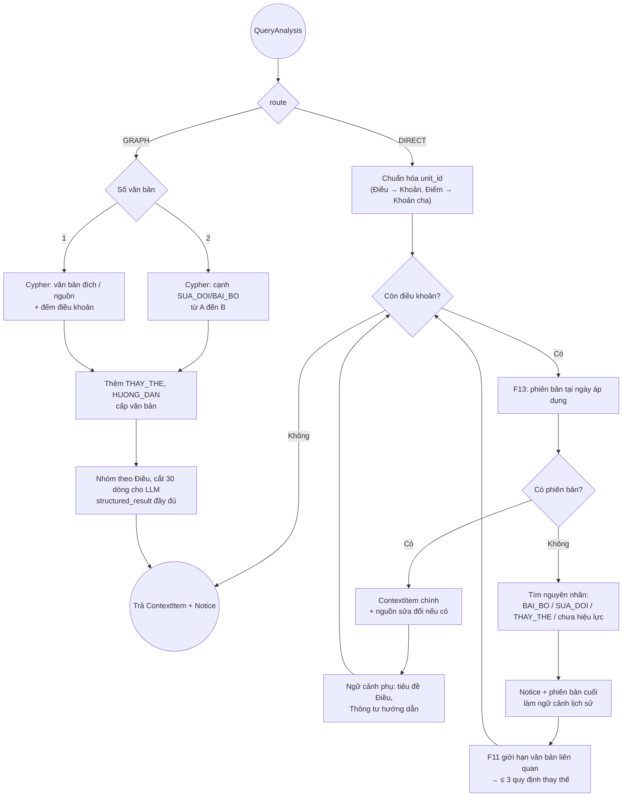
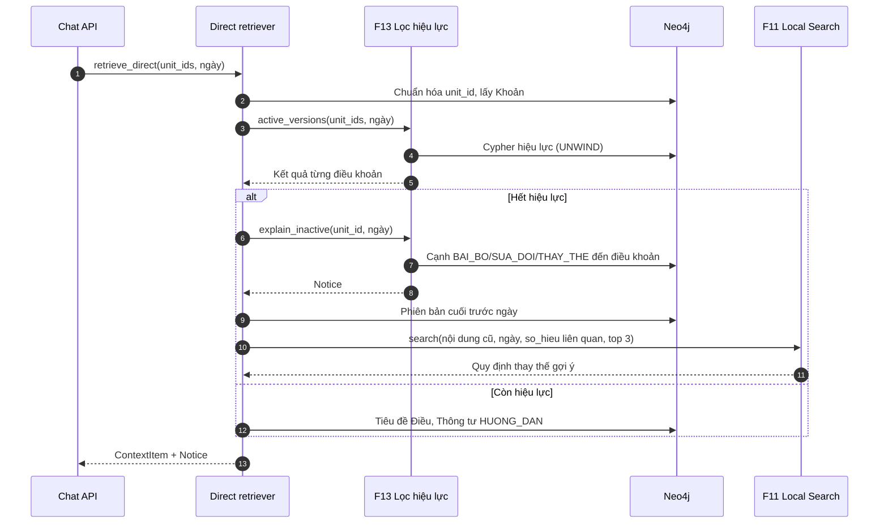

# F10 – Tra cứu trực tiếp và duyệt đồ thị văn bản

| Mục | Nội dung |
|---|---|
| Epic | B – Hỏi đáp (online) |
| Bước trong inception | 9. Tra cứu trực tiếp (Cypher theo ID) |
| Ưu tiên | **PoC** (demo Q1, Q5) |
| Phụ thuộc | F06, F13 |
| Câu hỏi mẫu | Q1 (hiệu lực khoản), Q5 (NĐ 70 sửa những điều nào của NĐ 123), câu hỏi lịch sử điều khoản |

Hai chế độ: **DIRECT** – tra một hoặc vài điều khoản theo ID tại ngày áp dụng; **GRAPH** – duyệt quan hệ giữa các văn bản. Đồng thời cung cấp API tra cứu cho giao diện (xem văn bản, dòng thời gian).

---

## 1. Business logic

### 1.1. DIRECT

| Mã | Quy tắc |
|---|---|
| BR-10.1 | Với mỗi `unit_id` từ F09: nếu là Điều có khoản → lấy mọi Khoản; nếu là Điểm → lấy Khoản cha và kiểm tra điểm có trong `diem[]` của phiên bản. |
| BR-10.2 | Lấy phiên bản có hiệu lực tại `ngay_ap_dung` qua F13. Có → ngữ cảnh `ContextItem(vai_tro = chinh)`. |
| BR-10.3 | **Không có phiên bản hiệu lực** → tạo `Notice` kèm nguyên nhân (cạnh `BAI_BO` / `SUA_DOI` / `THAY_THE`, hoặc chưa có hiệu lực) và **phiên bản cuối cùng trước đó** làm ngữ cảnh lịch sử (`vai_tro = lich_su`). |
| BR-10.4 | **Mở rộng sau bãi bỏ / thay thế** (ví dụ inception 5.3 bước 4): dùng nội dung phiên bản đã hết hiệu lực làm truy vấn, gọi F11 Local Search giới hạn trong các văn bản liên quan (văn bản gây bãi bỏ, văn bản gốc, văn bản hướng dẫn), lấy tối đa 3 điều khoản **còn hiệu lực** làm `vai_tro = thay_the_goi_y`. |
| BR-10.5 | Điều khoản đã bị sửa đổi (phiên bản hiện hành `loai_thay_doi = SUA_DOI`) → kèm `nguon_sua_doi` để câu trả lời nêu "đã được sửa đổi bởi …". |
| BR-10.6 | `y_dinh = lich_su` → trả toàn bộ chuỗi phiên bản + sự kiện (dùng `/units/versions`). |
| BR-10.7 | Kèm ngữ cảnh phụ: tiêu đề Điều cha; Thông tư `HUONG_DAN` còn hiệu lực trỏ tới Điều / văn bản (tối đa 2). |

### 1.2. GRAPH

| Mã | Quy tắc |
|---|---|
| BR-10.8 | Hai văn bản A, B → liệt kê mọi cạnh `SUA_DOI` / `BAI_BO` từ điều khoản của A tới điều khoản của B (truy vấn inception 5.4), nhóm theo Điều của B, sắp theo ID. |
| BR-10.9 | Một văn bản A, câu hỏi "A sửa đổi những văn bản nào" → liệt kê văn bản đích và số điều khoản bị tác động; "A bị sửa đổi bởi những văn bản nào" → chiều ngược lại. |
| BR-10.10 | Kèm quan hệ cấp văn bản: `THAY_THE`, `HUONG_DAN` giữa A và B. |
| BR-10.11 | Danh sách dài > 30 dòng → ngữ cảnh cho LLM chỉ gồm thống kê + 30 dòng đầu; giao diện hiển thị đầy đủ dạng bảng (`structured_result`). |

---

## 2. Use case description

### UC-10.1 – Kiểm tra hiệu lực / nội dung một điều khoản (DIRECT)

| Mục | Nội dung |
|---|---|
| Actor chính | Người dùng (qua F08) |
| Tiền điều kiện | F09 trả `route = DIRECT` với ≥ 1 `unit_id` |
| Hậu điều kiện | Danh sách `ContextItem` + `Notice` cho F13 / F14 |

**Luồng chính** (ví dụ Q1)

1. Nhận `123/2020/NĐ-CP:Đ3:K10`, ngày `2026-11-18`.
2. Truy vấn phiên bản có hiệu lực → không có.
3. Tìm nguyên nhân: cạnh `BAI_BO` từ `70/2025/NĐ-CP:Đ2:K4`, `tu_ngay = 2025-06-01` → tạo `Notice`.
4. Lấy phiên bản cuối `@2022-07-01` làm ngữ cảnh lịch sử.
5. Mở rộng (BR-10.4) → tìm được khoản 1 Điều 19 NĐ 123 (phiên bản sửa đổi bởi NĐ 70) làm `thay_the_goi_y`.
6. Trả ngữ cảnh.

**Luồng thay thế**: 2a. Có phiên bản hiệu lực → ngữ cảnh `chinh`, bỏ qua bước 3–5. 1a. ID không tồn tại → trả rỗng, F08 chuyển `LOCAL` (F09 BR-09.15).

### UC-10.2 – Liệt kê sửa đổi giữa hai văn bản (GRAPH)

Ví dụ Q5: chạy truy vấn BR-10.8 cho A = NĐ 70/2025, B = NĐ 123/2020 → bảng các điều khoản bị sửa / bãi bỏ kèm ngày → ngữ cảnh + `structured_result`.

### UC-10.3 – Xem văn bản và dòng thời gian điều khoản (giao diện)

Người dùng bấm vào một trích dẫn → mở trang văn bản tại ngày áp dụng: cây cấu trúc, điều khoản tô màu theo trạng thái, quan hệ đi / đến, dòng thời gian phiên bản của điều khoản được chọn.

---

## 3. Activity diagram



---

## 4. Sequence diagram



---

## 5. API

| Method | Endpoint | Vai trò | Mô tả |
|---|---|---|---|
| GET | `/api/v1/units/lookup?unit_id=&ngay=` | nguoi_dung | Nội dung + trạng thái điều khoản tại ngày |
| GET | `/api/v1/units/versions?unit_id=` | nguoi_dung | Dòng thời gian phiên bản (định nghĩa ở F06) |
| GET | `/api/v1/documents/{slug}?ngay=` | nguoi_dung | Thông tin văn bản + trạng thái tại ngày |
| GET | `/api/v1/documents/{slug}/relations?direction=in\|out&loai=` | nguoi_dung | Quan hệ đi / đến của văn bản |
| GET | `/api/v1/documents/{slug}/amendments?target=` | nguoi_dung | Điều khoản của `target` bị `slug` sửa / bãi bỏ (Q5) |

**GET `/units/lookup?unit_id=123/2020/NĐ-CP:Đ3:K10&ngay=2026-11-18`**

```json
{
  "unit_id": "123/2020/NĐ-CP:Đ3:K10",
  "label": "khoản 10 Điều 3 Nghị định 123/2020/NĐ-CP",
  "ngay": "2026-11-18",
  "trang_thai": "het_hieu_luc",
  "phien_ban": null,
  "phien_ban_cuoi": {"id": "123/2020/NĐ-CP:Đ3:K10@2022-07-01", "hieu_luc_tu": "2022-07-01",
                     "hieu_luc_den": "2025-06-01", "noi_dung": "10. Hủy hóa đơn …"},
  "thay_doi": {"loai": "BAI_BO", "boi_unit_id": "70/2025/NĐ-CP:Đ2:K4",
               "boi_label": "khoản 4 Điều 2 Nghị định 70/2025/NĐ-CP", "tu_ngay": "2025-06-01"}
}
```

**GET `/documents/70-2025-nd-cp/amendments?target=123-2020-nd-cp`**

```json
{
  "nguon": "70/2025/NĐ-CP",
  "dich": "123/2020/NĐ-CP",
  "tong": {"SUA_DOI": 24, "BAI_BO": 3},
  "items": [
    {"dieu_khoan_cu": "123/2020/NĐ-CP:Đ3:K10", "loai": "BAI_BO",
     "dieu_khoan_moi": "70/2025/NĐ-CP:Đ2:K4", "tu_ngay": "2025-06-01"},
    {"dieu_khoan_cu": "123/2020/NĐ-CP:Đ19:K1", "loai": "SUA_DOI",
     "dieu_khoan_moi": "70/2025/NĐ-CP:Đ1:K12", "tu_ngay": "2025-06-01"}
  ],
  "quan_he_van_ban": []
}
```

---

## 6. Schema

### 6.1. Cypher

Phiên bản cuối trước ngày (khi không còn hiệu lực):

```cypher
MATCH (k {id: $unit_id})-[:CO_PHIEN_BAN]->(pb:PhienBan)
WHERE pb.hieu_luc_tu <= date($ngay)
RETURN pb ORDER BY pb.hieu_luc_tu DESC LIMIT 1;
```

Quan hệ cấp văn bản giữa A và B:

```cypher
MATCH (a:VanBan {so_hieu: $a}), (b:VanBan {so_hieu: $b})
OPTIONAL MATCH (a)-[r:THAY_THE|HUONG_DAN]->(b)
RETURN type(r) AS loai, r.tu_ngay AS tu_ngay;
```

Thông tư hướng dẫn còn hiệu lực cho một Điều:

```cypher
MATCH (d:Dieu {id: $dieu_id})<-[:CO*]-(vb:VanBan)
MATCH (tt:VanBan)-[:HUONG_DAN]->(x) WHERE (x = d OR x = vb)
  AND tt.hieu_luc_tu <= date($ngay) AND (tt.hieu_luc_den IS NULL OR tt.hieu_luc_den > date($ngay))
RETURN tt.so_hieu, tt.trich_yeu LIMIT 2;
```

### 6.2. Pydantic dùng chung cho F10 / F11 / F12 / F13

```python
class VaiTro(str, Enum):
    chinh = "chinh"; lich_su = "lich_su"; thay_the_goi_y = "thay_the_goi_y"
    phu = "phu"; tong_hop = "tong_hop"

class ContextItem(BaseModel):
    unit_id: str
    label: str
    so_hieu: str
    phien_ban_id: str | None
    noi_dung: str
    hieu_luc_tu: date | None
    hieu_luc_den: date | None
    vai_tro: VaiTro
    score: float = 1.0
    nguon_truy_xuat: Literal["direct", "graph", "vector", "bm25", "expand", "global"]
    nguon_sua_doi: str | None = None

class Notice(BaseModel):
    unit_id: str
    label: str
    thay_doi: ThayDoi            # xem 00-common mục 7
    trang_thai: TrangThaiHieuLuc

class RetrievalResult(BaseModel):
    contexts: list[ContextItem]
    notices: list[Notice] = []
    structured_result: dict | None = None   # bảng cho GRAPH / GLOBAL
```

---

## 7. Tiêu chí chấp nhận

- [ ] Q1 → `Notice` `BAI_BO` bởi `70/2025/NĐ-CP:Đ2:K4` từ `2025-06-01` và ≥ 1 quy định thay thế gợi ý còn hiệu lực.
- [ ] Cùng Q1 nhưng ngày `2025-03-15` → khoản 10 Điều 3 **còn hiệu lực**, ngữ cảnh `chinh`.
- [ ] Q5 → danh sách khớp 100% với cạnh đã duyệt trong đồ thị.
- [ ] `/units/lookup` p95 ≤ 200 ms.
