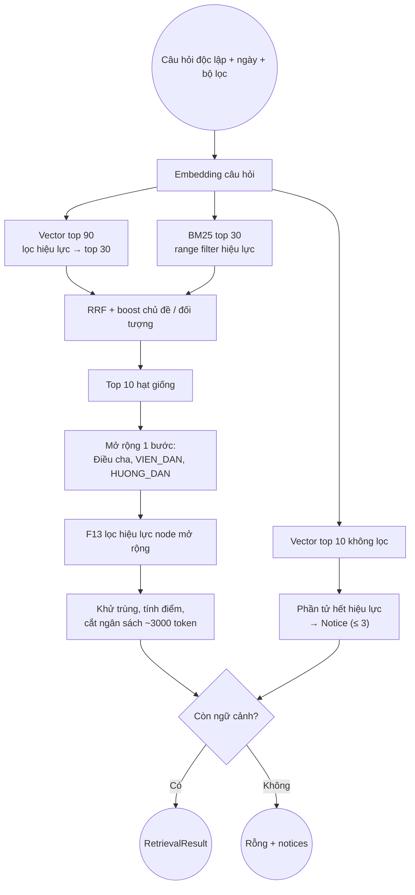
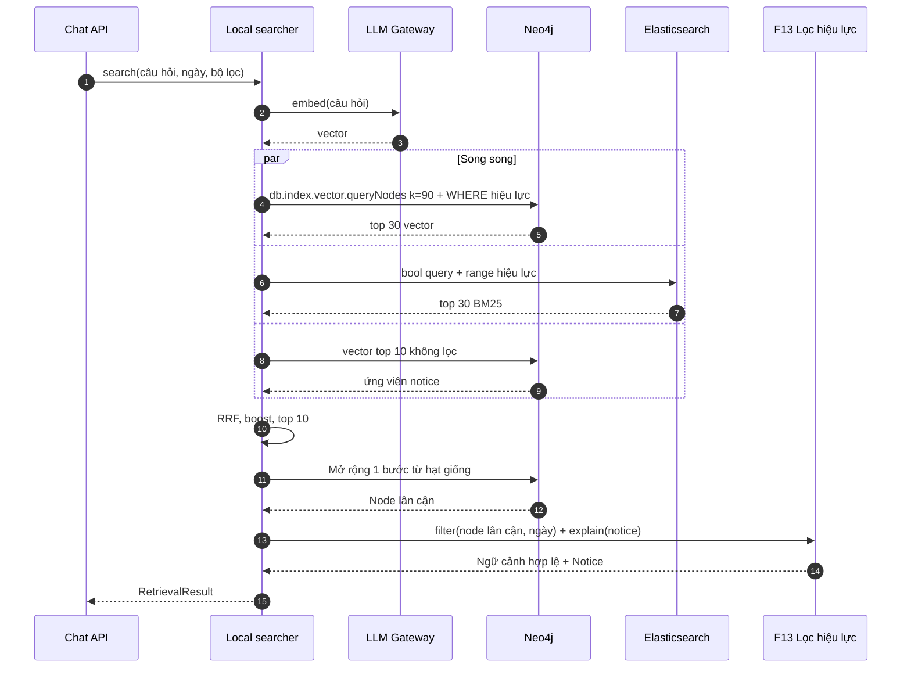

# F11 – Local Search (tìm kiếm lai + mở rộng đồ thị)

| Mục | Nội dung |
|---|---|
| Epic | B – Hỏi đáp (online) |
| Bước trong inception | 9. Local Search – vector + mở rộng đồ thị |
| Ưu tiên | MVP |
| Phụ thuộc | F07, F13 |
| Câu hỏi mẫu | Q2 (hộ kinh doanh có bắt buộc dùng HĐĐT từ máy tính tiền?), Q4 (ủy nhiệm lập hóa đơn tại 15/3/2025) |

Tìm các điều khoản liên quan đến **tình huống cụ thể** khi người dùng không nêu số hiệu: kết hợp tìm ngữ nghĩa (vector) và từ khóa (BM25), **lọc hiệu lực ngay khi truy xuất**, rồi mở rộng sang node lân cận trong đồ thị.

---

## 1. Business logic

### 1.1. Truy xuất lai

| Mã | Quy tắc |
|---|---|
| BR-11.1 | Truy vấn = `cau_hoi_doc_lap` (F09). BM25 dùng thêm `tu_khoa[]` với boost 2. |
| BR-11.2 | **Vector**: top 30 trên index `phienban_embedding`, lấy dư 3 lần (k = 90) rồi lọc hiệu lực tại `ngay_ap_dung` (Neo4j lọc sau truy vấn vector). |
| BR-11.3 | **BM25**: top 30 trên ES, lọc hiệu lực bằng range query (`hieu_luc_tu <= d < hieu_luc_den`), tìm trên cả `noi_dung` và `noi_dung.folded`. |
| BR-11.4 | Bộ lọc tùy chọn: `so_hieu[]` (khi F09 có văn bản nhưng không có điều khoản), `chu_de[]`, `doi_tuong[]` – chủ đề / đối tượng là **boost** (+0.1 điểm), không phải lọc cứng, để không bỏ sót điều khoản chưa được gán nhãn. |
| BR-11.5 | Hợp nhất bằng **Reciprocal Rank Fusion** `score = Σ 1/(60 + rank)`; lấy top 10 làm hạt giống. |
| BR-11.6 | **Thu thập notice**: các kết quả vector / BM25 có điểm cao (thuộc top 10 nếu không lọc hiệu lực) nhưng **bị loại vì hết hiệu lực** → chuyển thành `Notice` (tối đa 3). Đây chính là các đoạn mà RAG truyền thống sẽ trích nhầm; câu trả lời dùng chúng để cảnh báo. |

### 1.2. Mở rộng đồ thị (1 bước, tối đa 20 node)

| Hướng mở rộng | Điều kiện | Vai trò |
|---|---|---|
| Điều cha của Khoản hạt giống | Luôn lấy tiêu đề Điều | Ngữ cảnh tiêu đề |
| Khoản anh em trong cùng Điều | Khi hạt giống là câu dẫn ngắn (< 200 ký tự) | `phu` |
| `VIEN_DAN` đi ra từ Điều hạt giống | Đích có hiệu lực tại ngày | `phu` |
| `HUONG_DAN` đi vào (Thông tư hướng dẫn) | Thông tư có hiệu lực tại ngày | `phu` |
| `SUA_DOI` đi vào (văn bản sửa đổi) | Để nêu nguồn sửa đổi | metadata `nguon_sua_doi` |
| `AP_DUNG_CHO` khớp `doi_tuong` câu hỏi | Boost hạt giống | – |

| Mã | Quy tắc |
|---|---|
| BR-11.7 | Node mở rộng cũng phải qua lọc hiệu lực (F13). |
| BR-11.8 | Điểm node mở rộng = 0.5 × điểm hạt giống; khử trùng theo `unit_id`. |
| BR-11.9 | **Ngân sách ngữ cảnh**: tối đa ~3 000 token (khoảng 12 điều khoản) – phù hợp context 8K của Qwen3.5 9B trên LM Studio, chừa chỗ cho prompt và câu trả lời. Ưu tiên theo điểm; nội dung dài cắt tại ranh giới điểm. |
| BR-11.10 | Kết quả rỗng sau lọc → trả rỗng kèm notices (nếu có) để F14 nói "không tìm thấy quy định đang có hiệu lực, nhưng có quy định đã hết hiệu lực …". |

---

## 2. Use case description

### UC-11.1 – Tìm quy định cho một tình huống

| Mục | Nội dung |
|---|---|
| Actor chính | Chat API (F08); F10 gọi khi mở rộng sau bãi bỏ |
| Tiền điều kiện | `QueryAnalysis` với `route = LOCAL`; chỉ mục F07 sẵn sàng |
| Hậu điều kiện | `RetrievalResult` (≤ 12 ngữ cảnh còn hiệu lực, ≤ 3 notice) trong ≤ 1.5 s |

**Luồng chính** (ví dụ Q2)

1. Tạo embedding cho câu hỏi độc lập qua LLM Gateway.
2. Chạy song song vector search và BM25, cả hai lọc hiệu lực tại hôm nay.
3. Hợp nhất RRF, boost theo `doi_tuong = ho_kinh_doanh`, `chu_de = hoa_don_dien_tu`; lấy top 10.
4. Thu thập notice từ kết quả bị loại vì hết hiệu lực (BR-11.6).
5. Mở rộng 1 bước theo bảng 1.2, lọc hiệu lực.
6. Sắp xếp, cắt theo ngân sách token, trả kết quả.

**Ngoại lệ**: 1a. Embedding lỗi → chỉ dùng BM25, ghi `degraded = true`. 2a. ES lỗi → chỉ dùng vector.

---

## 3. Activity diagram



---

## 4. Sequence diagram



---

## 5. API

| Method | Endpoint | Vai trò | Mô tả |
|---|---|---|---|
| POST | `/api/v1/search/local` | nguoi_dung | Tìm kiếm điều khoản (dùng cho ô tìm kiếm trên giao diện và gỡ lỗi) |

**POST `/search/local`**

```json
// Request
{
  "query": "Hộ kinh doanh có bắt buộc dùng hóa đơn điện tử khởi tạo từ máy tính tiền không?",
  "ngay_ap_dung": "2026-11-18",
  "filters": {"so_hieu": [], "chu_de": ["hoa_don_dien_tu"], "doi_tuong": ["ho_kinh_doanh"]},
  "top_k": 12,
  "expand": true
}
// 200
{
  "contexts": [
    {"unit_id": "123/2020/NĐ-CP:Đ11:K1", "label": "khoản 1 Điều 11 Nghị định 123/2020/NĐ-CP",
     "so_hieu": "123/2020/NĐ-CP", "phien_ban_id": "123/2020/NĐ-CP:Đ11:K1@2025-06-01",
     "noi_dung": "…", "hieu_luc_tu": "2025-06-01", "hieu_luc_den": null,
     "vai_tro": "chinh", "score": 0.031, "nguon_truy_xuat": "vector",
     "nguon_sua_doi": "70/2025/NĐ-CP:Đ1:K7"}
  ],
  "notices": [
    {"unit_id": "123/2020/NĐ-CP:Đ11:K1", "label": "khoản 1 Điều 11 Nghị định 123/2020/NĐ-CP (phiên bản trước 01/6/2025)",
     "thay_doi": {"loai": "SUA_DOI", "boi_unit_id": "70/2025/NĐ-CP:Đ1:K7", "tu_ngay": "2025-06-01"},
     "trang_thai": "het_hieu_luc"}
  ],
  "debug": {"vector_hits": 30, "bm25_hits": 30, "filtered_out": 7, "expanded": 6, "tokens": 2850, "degraded": false}
}
```

---

## 6. Schema

### 6.1. Cypher – vector có lọc hiệu lực

```cypher
CALL db.index.vector.queryNodes('phienban_embedding', 90, $qvec) YIELD node AS pb, score
WHERE pb.hieu_luc_tu <= date($ngay) AND (pb.hieu_luc_den IS NULL OR pb.hieu_luc_den > date($ngay))
MATCH (owner)-[:CO_PHIEN_BAN]->(pb)
MATCH (vb:VanBan)-[:CO*]->(owner)
WHERE vb.hieu_luc_tu <= date($ngay) AND (vb.hieu_luc_den IS NULL OR vb.hieu_luc_den > date($ngay))
  AND (size($so_hieu) = 0 OR vb.so_hieu IN $so_hieu)
RETURN owner.id AS unit_id, pb.id AS phien_ban_id, pb.noi_dung AS noi_dung, score
ORDER BY score DESC LIMIT 30;
```

### 6.2. Elasticsearch – BM25 có lọc hiệu lực

```json
{
  "size": 30,
  "query": {
    "bool": {
      "should": [
        {"multi_match": {"query": "<câu hỏi>", "fields": ["noi_dung", "noi_dung.folded", "label^0.5"]}},
        {"terms": {"noi_dung": ["máy tính tiền"], "boost": 2}}
      ],
      "filter": [
        {"range": {"hieu_luc_tu": {"lte": "2026-11-18"}}},
        {"range": {"hieu_luc_den": {"gt": "2026-11-18"}}}
      ]
    }
  }
}
```

### 6.3. Cấu hình

```env
LOCAL_VECTOR_K=30
LOCAL_BM25_K=30
LOCAL_RRF_K=60
LOCAL_SEEDS=10
LOCAL_EXPAND_MAX=20
LOCAL_CONTEXT_TOKENS=3000
LOCAL_MAX_NOTICES=3
```

---

## 7. Tiêu chí chấp nhận

- [ ] Q2: ngữ cảnh có quy định hiện hành về HĐĐT khởi tạo từ máy tính tiền cho hộ kinh doanh (theo NĐ 123 sửa đổi bởi NĐ 70).
- [ ] Q4: với ngày `2025-03-15`, mọi ngữ cảnh có `hieu_luc_tu <= 2025-03-15 < hieu_luc_den`; nội dung TT 78/2021 được dùng, TT 32/2025 thì không.
- [ ] Không ngữ cảnh `chinh` nào hết hiệu lực tại ngày áp dụng (kiểm tra tự động trên bộ đánh giá).
- [ ] p95 ≤ 1.5 s.
