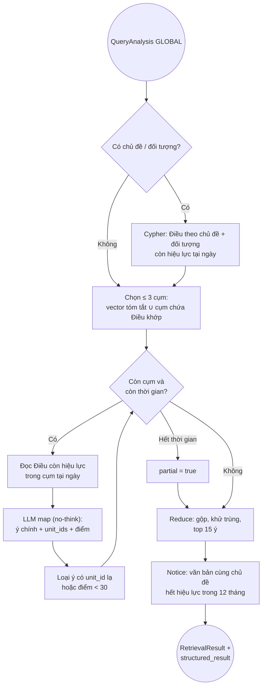
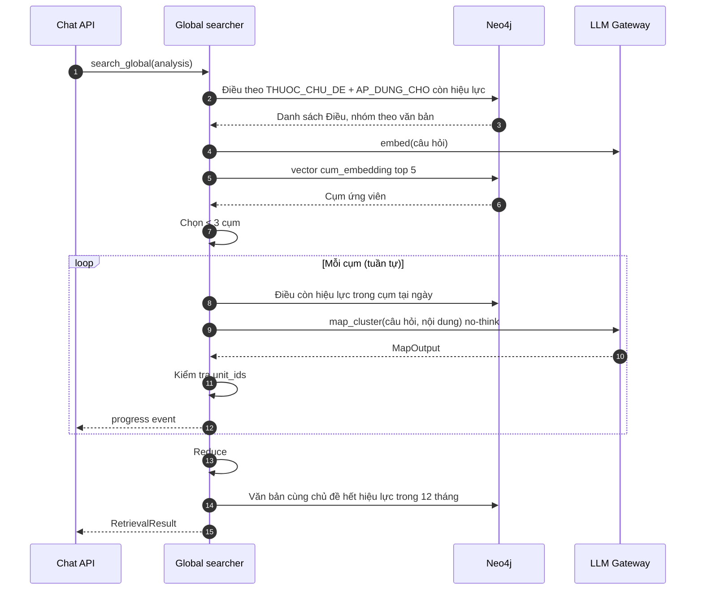

# F12 – Global Search (câu hỏi tổng hợp)

| Mục | Nội dung |
|---|---|
| Epic | B – Hỏi đáp (online) |
| Bước trong inception | 9. Global Search – tóm tắt chủ đề |
| Ưu tiên | MVP |
| Phụ thuộc | F07, F13, F17 |
| Câu hỏi mẫu | Q3 – "Tất cả quy định hiện hành về hóa đơn điện tử cho hộ kinh doanh?" |

Trả lời câu hỏi tổng hợp bằng hai nguồn kết hợp: **(1) danh sách xác định từ đồ thị** (văn bản / điều theo chủ đề + đối tượng, còn hiệu lực) và **(2) map-reduce trên các cụm chủ đề** để có phần diễn giải.

---

## 1. Business logic

| Mã | Quy tắc |
|---|---|
| BR-12.1 | **Lọc đồ thị (xác định)**: lấy mọi `Dieu` có `THUOC_CHU_DE ∈ chu_de` **và** (nếu có) `AP_DUNG_CHO ∈ doi_tuong`, có ít nhất một phiên bản hiệu lực tại `ngay_ap_dung`; nhóm theo văn bản. Đây là nguồn chính cho câu "gồm những văn bản nào" – không phụ thuộc LLM. |
| BR-12.2 | Thiếu `chu_de` và `doi_tuong` → bỏ BR-12.1, chỉ dùng map-reduce. |
| BR-12.3 | **Chọn cụm**: vector similarity giữa câu hỏi và `Cum.tom_tat_embedding` (top 5) hợp với các cụm chứa Điều ở BR-12.1; xếp theo số Điều khớp, lấy tối đa **3 cụm** (giới hạn do LLM local chạy tuần tự). |
| BR-12.4 | **Map**: với mỗi cụm, đầu vào = tóm tắt cụm + danh sách Điều trong cụm **còn hiệu lực tại ngày áp dụng** (label + nội dung rút gọn, ≤ 2 500 token). LLM (tắt thinking) trả các ý chính, mỗi ý kèm `unit_ids` nguồn và điểm liên quan 0–100. |
| BR-12.5 | Ý có `unit_ids` không nằm trong đầu vào map → loại bỏ (chống bịa). Ý điểm < 30 → loại. |
| BR-12.6 | **Reduce**: gộp ý từ các cụm, khử trùng theo `unit_ids`, sắp theo điểm, tối đa 15 ý → chuyển thành `ContextItem(vai_tro = tong_hop)`; kèm danh sách văn bản BR-12.1 làm `structured_result`. F14 sinh câu trả lời cuối. |
| BR-12.7 | Ngày áp dụng khác hôm nay → **không dùng nội dung `tom_tat` làm căn cứ** (tóm tắt tạo theo hôm nay – F07 BR-07.11), chỉ dùng để chọn cụm; map chạy trên nội dung phiên bản tại ngày. |
| BR-12.8 | Ngân sách thời gian 20 s; quá hạn → bỏ các cụm chưa map, trả kết quả từ BR-12.1 + cụm đã map, ghi `partial = true`. Giao diện hiển thị tiến trình "Đang tổng hợp cụm 2/3". |
| BR-12.9 | Kèm notice: văn bản trong phạm vi chủ đề đã **hết hiệu lực gần đây** (trong 12 tháng trước ngày áp dụng, ví dụ TT 78/2021) → `Notice` để câu trả lời lưu ý. |

---

## 2. Use case description

### UC-12.1 – Trả lời câu hỏi tổng hợp

| Mục | Nội dung |
|---|---|
| Actor chính | Chat API (F08) |
| Tiền điều kiện | `route = GLOBAL`; cụm và tóm tắt đã có (F07) |
| Hậu điều kiện | `RetrievalResult` gồm ý tổng hợp, danh sách văn bản, notice |

**Luồng chính** (Q3)

1. Lọc đồ thị: chủ đề `hoa_don_dien_tu`, đối tượng `ho_kinh_doanh`, hôm nay → NĐ 123 (đã sửa), NĐ 70/2025, TT 32/2025, NQ 198/2025… kèm các Điều.
2. Chọn tối đa 3 cụm liên quan.
3. Map từng cụm → các ý chính kèm `unit_ids`.
4. Kiểm tra và loại ý không hợp lệ (BR-12.5).
5. Reduce → ngữ cảnh tổng hợp + `structured_result`.
6. Thêm notice văn bản hết hiệu lực gần đây (TT 78/2021 hết hiệu lực 01/6/2025).

**Ngoại lệ**: 1a. Không Điều nào khớp và không cụm nào đủ tương đồng (< 0.5) → trả rỗng. 3a. Quá 20 s → BR-12.8.

---

## 3. Activity diagram



---

## 4. Sequence diagram



---

## 5. API

| Method | Endpoint | Vai trò | Mô tả |
|---|---|---|---|
| POST | `/api/v1/search/global` | nguoi_dung | Chạy Global Search độc lập (gỡ lỗi / trang tổng hợp chủ đề) |
| GET | `/api/v1/topics/{ma_chu_de}/documents?doi_tuong=&ngay=` | nguoi_dung | Danh sách văn bản / Điều theo chủ đề + đối tượng (BR-12.1) |

**POST `/search/global`**

```json
// Request
{"query": "Tất cả quy định hiện hành về hóa đơn điện tử cho hộ kinh doanh?",
 "ngay_ap_dung": "2026-11-18", "chu_de": ["hoa_don_dien_tu"], "doi_tuong": ["ho_kinh_doanh"]}
// 200
{
  "contexts": [
    {"unit_id": "123/2020/NĐ-CP:Đ11:K1", "label": "khoản 1 Điều 11 Nghị định 123/2020/NĐ-CP",
     "noi_dung": "Ý: Hộ kinh doanh có doanh thu … phải sử dụng hóa đơn điện tử khởi tạo từ máy tính tiền …",
     "vai_tro": "tong_hop", "score": 92, "nguon_truy_xuat": "global"}
  ],
  "notices": [
    {"unit_id": "78/2021/TT-BTC", "label": "Thông tư 78/2021/TT-BTC",
     "thay_doi": {"loai": "THAY_THE", "boi_unit_id": "32/2025/TT-BTC", "tu_ngay": "2025-06-01"},
     "trang_thai": "het_hieu_luc"}
  ],
  "structured_result": {
    "van_ban": [
      {"so_hieu": "123/2020/NĐ-CP", "trang_thai": "het_hieu_luc_mot_phan", "dieu": ["Đ11", "Đ19", "Đ91"]},
      {"so_hieu": "70/2025/NĐ-CP", "trang_thai": "con_hieu_luc", "dieu": ["Đ1", "Đ2"]},
      {"so_hieu": "32/2025/TT-BTC", "trang_thai": "con_hieu_luc", "dieu": ["…"]},
      {"so_hieu": "198/2025/QH15", "trang_thai": "con_hieu_luc", "dieu": ["…"]}
    ]
  },
  "partial": false,
  "debug": {"clusters": ["cum-12", "cum-7", "cum-21"], "map_ms": [4200, 3900, 4100]}
}
```

---

## 6. Schema

### 6.1. Cypher – lọc đồ thị theo chủ đề và đối tượng

```cypher
MATCH (vb:VanBan)-[:CO*]->(d:Dieu)-[:THUOC_CHU_DE]->(cd:ChuDe)
WHERE cd.ma IN $chu_de
  AND (size($doi_tuong) = 0 OR EXISTS {
        MATCH (d)-[:AP_DUNG_CHO]->(dt:DoiTuong) WHERE dt.ma IN $doi_tuong })
  AND EXISTS {
        MATCH (d)-[:CO*0..1]->()-[:CO_PHIEN_BAN]->(pb:PhienBan)
        WHERE pb.hieu_luc_tu <= date($ngay) AND (pb.hieu_luc_den IS NULL OR pb.hieu_luc_den > date($ngay)) }
  AND vb.hieu_luc_tu <= date($ngay) AND (vb.hieu_luc_den IS NULL OR vb.hieu_luc_den > date($ngay))
RETURN vb.so_hieu AS so_hieu, vb.trich_yeu AS trich_yeu, collect(DISTINCT d.id) AS dieu, d.cum_id AS cum_id
ORDER BY vb.ngay_ban_hanh;
```

### 6.2. Output map (Pydantic)

```python
class MapPoint(BaseModel):
    y: str = Field(max_length=500)
    unit_ids: list[str] = Field(min_length=1)
    diem: int = Field(ge=0, le=100)

class MapOutput(BaseModel):
    cum_id: str
    y_chinh: list[MapPoint]
```

### 6.3. Cấu hình

```env
GLOBAL_MAX_CLUSTERS=3
GLOBAL_MAP_TOKENS=2500
GLOBAL_MIN_POINT_SCORE=30
GLOBAL_MAX_POINTS=15
GLOBAL_TIMEOUT_S=20
GLOBAL_RECENT_EXPIRED_MONTHS=12
```

---

## 7. Tiêu chí chấp nhận

- [ ] Q3: `structured_result` chứa NĐ 123 (đã sửa), NĐ 70/2025, TT 32/2025; **không** chứa TT 78/2021 (chỉ nằm ở notice).
- [ ] Mọi `unit_ids` trong ngữ cảnh tổng hợp tồn tại và còn hiệu lực tại ngày áp dụng.
- [ ] Global Search hoàn thành ≤ 20 s trên máy dev, hoặc trả `partial = true`.
