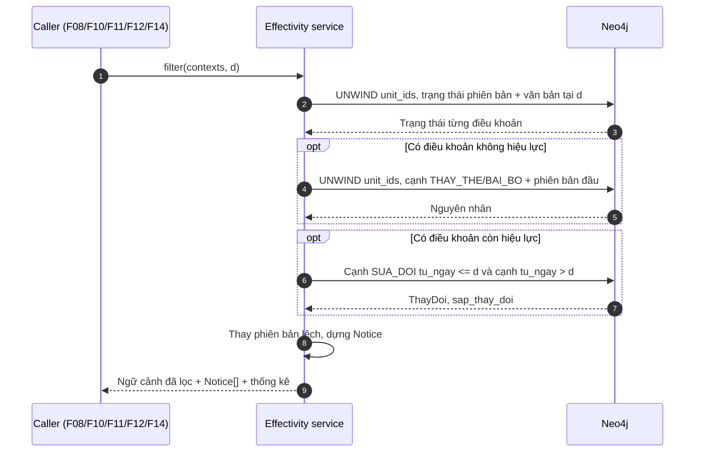

# F13 – Lọc theo hiệu lực tại ngày áp dụng

| Mục | Nội dung |
|---|---|
| Epic | B – Hỏi đáp (online) |
| Bước trong inception | 10. Lọc theo hiệu lực – **chốt chặn chống trích dẫn quy định cũ** |
| Ưu tiên | **PoC** |
| Phụ thuộc | F06 |
| Dùng bởi | F10, F11, F12, F14, F16 |
| KPI liên quan | Tỷ lệ trích dẫn quy định hết hiệu lực ≤ 1% |

Dịch vụ dùng chung xác định một điều khoản / văn bản có hiệu lực tại ngày `d` hay không, **giải thích vì sao** nếu không, và lọc mọi ngữ cảnh trước khi đưa cho LLM.

---

## 1. Business logic

### 1.1. Định nghĩa hiệu lực

| Mã | Quy tắc |
|---|---|
| BR-13.1 | Điều khoản `u` **có hiệu lực tại `d`** khi: (a) tồn tại phiên bản `pb` của `u` với `pb.hieu_luc_tu <= d` và (`pb.hieu_luc_den IS NULL` hoặc `pb.hieu_luc_den > d`); **và** (b) văn bản chứa `u` có `hieu_luc_tu <= d` và (`hieu_luc_den IS NULL` hoặc `hieu_luc_den > d`). |
| BR-13.2 | Điều có khoản: có hiệu lực khi **ít nhất một** Khoản có hiệu lực. Điểm: có hiệu lực khi Khoản cha có hiệu lực **và** chữ cái điểm thuộc `pb.diem[]`. |
| BR-13.3 | Văn bản: `con_hieu_luc` / `het_hieu_luc_mot_phan` / `het_hieu_luc` / `chua_co_hieu_luc` tính tại `d` theo cùng logic F06 BR-06.10. |
| BR-13.4 | Thiếu dữ liệu ngày (`hieu_luc_tu = NULL`) → `khong_xac_dinh`, **coi như không có hiệu lực**, ghi log `DATA_QUALITY` – an toàn hơn trích một quy định chưa rõ hiệu lực. |

### 1.2. Giải thích nguyên nhân (theo thứ tự ưu tiên)

| Thứ tự | Điều kiện | `ThayDoi.loai` |
|---|---|---|
| 1 | Văn bản chứa `u` có `hieu_luc_den <= d` và có cạnh `THAY_THE` đến nó | `THAY_THE` |
| 2 | Văn bản chứa `u` có `hieu_luc_den <= d`, không có `THAY_THE` | `VAN_BAN_HET_HIEU_LUC` |
| 3 | Có cạnh `BAI_BO` đến `u` (hoặc Điều cha / Điểm) với `tu_ngay <= d` | `BAI_BO` |
| 4 | Phiên bản đầu tiên của `u` có `hieu_luc_tu > d` | `CHUA_CO_HIEU_LUC` |
| 5 | Không tìm được nguyên nhân | `KHONG_XAC_DINH` + log |

| Mã | Quy tắc |
|---|---|
| BR-13.5 | Điều khoản **còn hiệu lực nhưng đã bị sửa đổi** trước `d` → trả thêm `ThayDoi(loai = SUA_DOI, tu_ngay = …)` để câu trả lời nêu "(đã được sửa đổi bởi …)". |
| BR-13.6 | Điều khoản **còn hiệu lực tại `d` nhưng sẽ bị sửa / bãi bỏ sau `d`** (đã có cạnh với `tu_ngay > d`) → trả `sap_thay_doi` – hữu ích khi hỏi theo thời điểm quá khứ hoặc khi văn bản mới sắp có hiệu lực. |

### 1.3. Lọc ngữ cảnh

| Mã | Quy tắc |
|---|---|
| BR-13.7 | Mọi `ContextItem` có `vai_tro ∈ {chinh, phu, thay_the_goi_y, tong_hop}` phải có hiệu lực tại `d`; không đạt → **loại khỏi ngữ cảnh** và chuyển thành `Notice`. |
| BR-13.8 | `ContextItem(vai_tro = lich_su)` được giữ nhưng **bắt buộc** đi kèm `Notice` tương ứng – LLM chỉ được nhắc tới nó như quy định đã hết hiệu lực. |
| BR-13.9 | Kiểm tra theo **phiên bản**, không chỉ theo điều khoản: ngữ cảnh mang `phien_ban_id` của phiên bản không còn hiệu lực (dù điều khoản vẫn có phiên bản mới) → thay bằng phiên bản đúng tại `d`. |
| BR-13.10 | Thực hiện theo lô (`UNWIND`) – một truy vấn cho toàn bộ ngữ cảnh; mục tiêu ≤ 100 ms cho 50 điều khoản. |

---

## 2. Use case description

### UC-13.1 – Lọc ngữ cảnh trước khi sinh câu trả lời

| Mục | Nội dung |
|---|---|
| Actor chính | Chat API (F08) |
| Tiền điều kiện | Có `RetrievalResult` và `ngay_ap_dung` |
| Hậu điều kiện | Ngữ cảnh chỉ chứa phiên bản có hiệu lực tại ngày; mọi phần tử bị loại có `Notice` kèm nguyên nhân |

**Luồng chính**

1. Nhận danh sách `ContextItem` và ngày `d`.
2. Truy vấn lô trạng thái hiệu lực của mọi `unit_id` và `phien_ban_id` (BR-13.1 → BR-13.4).
3. Phần tử đạt → giữ; phiên bản lệch → thay phiên bản đúng (BR-13.9); gắn `ThayDoi` sửa đổi nếu có (BR-13.5).
4. Phần tử không đạt → tìm nguyên nhân (mục 1.2), tạo `Notice`, loại khỏi ngữ cảnh (BR-13.7).
5. Phần tử `lich_su` → giữ, bảo đảm có `Notice` (BR-13.8).
6. Trả ngữ cảnh đã lọc + notices, ghi thống kê `filtered_out`.

### UC-13.2 – Kiểm tra hiệu lực theo yêu cầu

F14 (kiểm tra trích dẫn), F16 (đo KPI) hoặc giao diện gọi API kiểm tra một danh sách điều khoản tại một ngày.

---

## 3. Activity diagram

```mermaid
flowchart TD
    S((ContextItem[] + ngày d)) --> A["Truy vấn lô trạng thái<br/>unit_id + phien_ban_id"]
    A --> B{"Còn phần tử?"}
    B -- Không --> Z((Ngữ cảnh đã lọc + Notice[]))
    B -- Có --> C{"vai_tro = lich_su?"}
    C -- Có --> C1["Giữ, bảo đảm có Notice"] --> B
    C -- Không --> D{"Điều khoản có hiệu lực tại d?"}
    D -- Không --> E["Tìm nguyên nhân:<br/>THAY_THE → VB hết HL → BAI_BO<br/>→ chưa có HL → không xác định"]
    E --> F["Tạo Notice, loại khỏi ngữ cảnh"] --> B
    D -- Có --> G{"phien_ban_id đúng<br/>phiên bản tại d?"}
    G -- Không --> G1["Thay bằng phiên bản tại d"] --> H
    G -- Có --> H{"Đã bị sửa đổi trước d<br/>hoặc sắp thay đổi sau d?"}
    H -- Có --> H1["Gắn ThayDoi / sap_thay_doi"] --> I
    H -- Không --> I["Giữ phần tử"] --> B
```

---

## 4. Sequence diagram



---

## 5. API

| Method | Endpoint | Vai trò | Mô tả |
|---|---|---|---|
| POST | `/api/v1/effectivity/check` | nguoi_dung | Kiểm tra hiệu lực một danh sách điều khoản / văn bản tại ngày |

**POST `/effectivity/check`**

```json
// Request
{"ngay": "2026-11-18", "unit_ids": ["123/2020/NĐ-CP:Đ3:K10", "123/2020/NĐ-CP:Đ19:K1", "78/2021/TT-BTC"]}
// 200
{
  "ngay": "2026-11-18",
  "items": [
    {"unit_id": "123/2020/NĐ-CP:Đ3:K10", "trang_thai": "het_hieu_luc", "phien_ban_id": null,
     "thay_doi": {"loai": "BAI_BO", "boi_unit_id": "70/2025/NĐ-CP:Đ2:K4",
                  "boi_label": "khoản 4 Điều 2 Nghị định 70/2025/NĐ-CP", "tu_ngay": "2025-06-01"},
     "sap_thay_doi": null},
    {"unit_id": "123/2020/NĐ-CP:Đ19:K1", "trang_thai": "con_hieu_luc",
     "phien_ban_id": "123/2020/NĐ-CP:Đ19:K1@2025-06-01",
     "thay_doi": {"loai": "SUA_DOI", "boi_unit_id": "70/2025/NĐ-CP:Đ1:K12", "tu_ngay": "2025-06-01"},
     "sap_thay_doi": null},
    {"unit_id": "78/2021/TT-BTC", "trang_thai": "het_hieu_luc", "phien_ban_id": null,
     "thay_doi": {"loai": "THAY_THE", "boi_unit_id": "32/2025/TT-BTC",
                  "boi_label": "Thông tư 32/2025/TT-BTC", "tu_ngay": "2025-06-01"},
     "sap_thay_doi": null}
  ]
}
```

---

## 6. Schema

### 6.1. Cypher – trạng thái theo lô

```cypher
UNWIND $unit_ids AS uid
MATCH (u {id: uid})
OPTIONAL MATCH (vb:VanBan)-[:CO*]->(u)
WITH uid, u, coalesce(vb, u) AS vb             // u có thể chính là VanBan
OPTIONAL MATCH (u)-[:CO*0..1]->(owner)-[:CO_PHIEN_BAN]->(pb:PhienBan)
WHERE pb.hieu_luc_tu <= date($ngay) AND (pb.hieu_luc_den IS NULL OR pb.hieu_luc_den > date($ngay))
WITH uid, vb, collect(pb) AS active
RETURN uid,
       vb.so_hieu AS so_hieu,
       (vb.hieu_luc_tu IS NOT NULL AND vb.hieu_luc_tu <= date($ngay)
        AND (vb.hieu_luc_den IS NULL OR vb.hieu_luc_den > date($ngay))) AS vb_active,
       [p IN active | {id: p.id, diem: p.diem}] AS active_versions;
```

### 6.2. Cypher – nguyên nhân bãi bỏ / sửa đổi

```cypher
UNWIND $unit_ids AS uid
MATCH (u {id: uid})
OPTIONAL MATCH (anc)-[:CO*0..2]->(u)  WHERE anc:Dieu OR anc:Khoan OR anc = u
OPTIONAL MATCH (src)-[r:BAI_BO|SUA_DOI]->(t) WHERE t = u OR t = anc
MATCH (srcvb:VanBan)-[:CO*]->(src)
RETURN uid, type(r) AS loai, r.tu_ngay AS tu_ngay, src.id AS boi_unit_id, srcvb.so_hieu AS boi_so_hieu
ORDER BY uid, tu_ngay;
```

### 6.3. Interface Python

```python
class EffectivityService(Protocol):
    def check(self, unit_ids: list[str], ngay: date) -> list[EffectivityStatus]: ...
    def filter(self, result: RetrievalResult, ngay: date) -> RetrievalResult: ...

class EffectivityStatus(BaseModel):
    unit_id: str
    trang_thai: TrangThaiHieuLuc
    phien_ban_id: str | None
    thay_doi: ThayDoi | None
    sap_thay_doi: ThayDoi | None
```

---

## 7. Tiêu chí chấp nhận

- [ ] Bộ test đơn vị các trường hợp: còn hiệu lực, bãi bỏ, sửa đổi, thay thế văn bản, chưa có hiệu lực, hồi tố, ngày đúng bằng `hieu_luc_den` (phải là **hết** hiệu lực), thiếu ngày.
- [ ] Không `ContextItem` `chinh` nào hết hiệu lực lọt qua (kiểm tra bất biến trên mọi lượt hỏi đáp trong F16).
- [ ] 50 điều khoản ≤ 100 ms.
