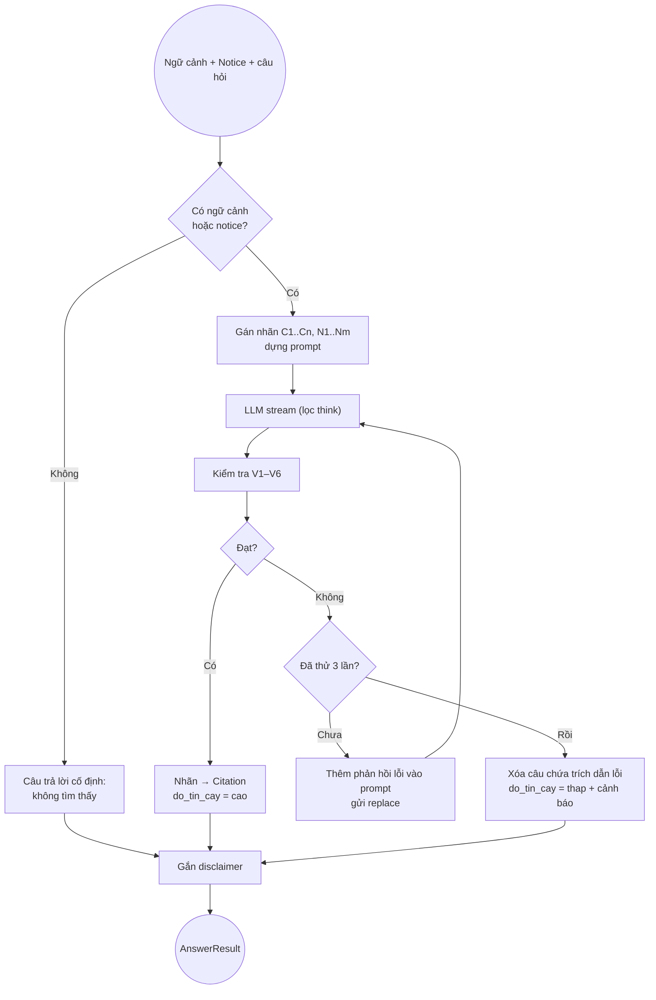
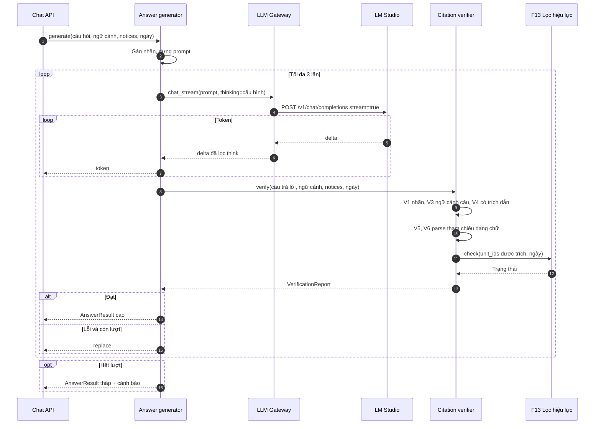

# F14 – Sinh câu trả lời và kiểm tra trích dẫn

| Mục | Nội dung |
|---|---|
| Epic | B – Hỏi đáp (online) |
| Bước trong inception | 11. LLM sinh câu trả lời · 12. Kiểm tra trích dẫn |
| Ưu tiên | PoC (sinh + kiểm tra ref); MVP (kiểm tra tham chiếu dạng chữ, sinh lại) |
| Phụ thuộc | F13, F17 |
| KPI liên quan | Độ chính xác trích dẫn ≥ 95%; tỷ lệ trích dẫn hết hiệu lực ≤ 1% |

Qwen3.5 9B trả lời bằng tiếng Việt dễ hiểu, **chỉ dựa trên ngữ cảnh đã lọc**, mọi khẳng định đều gắn trích dẫn; sau đó hệ thống đối chiếu tự động từng trích dẫn trước khi trả cho người dùng.

---

## 1. Business logic

### 1.1. Dựng prompt

| Mã | Quy tắc |
|---|---|
| BR-14.1 | Mỗi ngữ cảnh được gán nhãn `[C1]…[Cn]` theo thứ tự điểm; mỗi khối ghi: nhãn điều khoản, số hiệu, khoảng hiệu lực, vai trò, nguồn sửa đổi, nội dung. |
| BR-14.2 | Notice được gán nhãn `[N1]…[Nm]`, trình bày "ĐÃ HẾT HIỆU LỰC từ … do … ". |
| BR-14.3 | System prompt bắt buộc: (1) chỉ dùng thông tin trong ngữ cảnh; (2) mỗi câu khẳng định phải có ít nhất một `[Cx]`; (3) nếu câu hỏi nhắc tới điều khoản có trong `[Nx]` thì **phải nói rõ đã hết hiệu lực / bị sửa đổi** và nêu quy định hiện hành nếu có; (4) nêu ngày áp dụng ở câu đầu khi ngày khác hôm nay; (5) không đưa ra tư vấn hay kết luận pháp lý thay luật sư; (6) không đủ thông tin → nói rõ "không tìm thấy quy định trong dữ liệu hiện có"; (7) diễn đạt dễ hiểu cho người không chuyên. |
| BR-14.4 | `structured_result` (F10 GRAPH, F12) được đưa vào prompt dạng bảng rút gọn; giao diện hiển thị bảng đầy đủ bên dưới câu trả lời. |
| BR-14.5 | Tham số: temperature 0.1, `max_tokens` 1 024, thinking theo cấu hình (F08 BR-08.8). |

### 1.2. Kiểm tra trích dẫn

| Mã | Kiểm tra | Lỗi |
|---|---|---|
| V1 | Mọi nhãn `[Cx]` / `[Nx]` trong câu trả lời tồn tại trong danh sách ngữ cảnh | `UNKNOWN_REF` |
| V2 | Mọi `[Cx]` trỏ tới phiên bản **có hiệu lực** tại ngày áp dụng (gọi F13 lần nữa – phòng ngữ cảnh bị lệch) | `EXPIRED_CITATION` |
| V3 | `[Nx]` chỉ xuất hiện trong câu có từ khóa thể hiện hết hiệu lực ("bãi bỏ", "hết hiệu lực", "được thay thế", "trước đây", "đã sửa đổi") | `NOTICE_AS_CURRENT` |
| V4 | Câu trả lời có nội dung pháp lý (không phải câu "không tìm thấy") phải có ≥ 1 `[Cx]` | `NO_CITATION` |
| V5 | Tham chiếu **dạng chữ** trong câu trả lời ("khoản 4 Điều 9 Nghị định 123/2020") được parser F03 chuyển thành ID và phải nằm trong tập ngữ cảnh ∪ notice ∪ `nguon_sua_doi` | `HALLUCINATED_REF` |
| V6 | Số hiệu văn bản nhắc tới trong câu trả lời phải có trong đồ thị | `UNKNOWN_DOCUMENT` |

| Mã | Quy tắc |
|---|---|
| BR-14.6 | Có lỗi V1–V6 → **sinh lại** với phản hồi lỗi cụ thể đưa vào prompt ("Câu trả lời trước trích [C7] không tồn tại …"), tối đa **2 lần**. |
| BR-14.7 | Sau 2 lần vẫn lỗi → trả câu trả lời của lần cuối **đã xóa các câu chứa trích dẫn lỗi**, `do_tin_cay = thap`, kèm cảnh báo "Câu trả lời có thể chưa đầy đủ, vui lòng kiểm tra nguồn" và danh sách nguồn đã xác minh. |
| BR-14.8 | Chuyển nhãn `[Cx]` thành `Citation` đầy đủ (00-common mục 7) – giao diện hiển thị dạng chú thích có thể bấm, mở F10 UC-10.3. |
| BR-14.9 | Luôn đính kèm disclaimer cố định. |

### 1.3. Streaming và sinh lại

| Mã | Quy tắc |
|---|---|
| BR-14.10 | Token được stream ngay cho người dùng với nhãn "Đang kiểm tra nguồn…"; khi kiểm tra xong gửi `final`. Nếu phải sinh lại, gửi sự kiện `replace` để giao diện xóa bản nháp và hiển thị "Đang soạn lại câu trả lời…". |
| BR-14.11 | Phần `<think>…</think>` không bao giờ được stream (F17 BR-17.4). |

---

## 2. Use case description

### UC-14.1 – Sinh và xác minh câu trả lời

| Mục | Nội dung |
|---|---|
| Actor chính | Chat API (F08) |
| Tiền điều kiện | Ngữ cảnh đã qua F13 |
| Hậu điều kiện | `AnswerResult` với trích dẫn đã xác minh hoặc `do_tin_cay = thap` |

**Luồng chính**

1. Gán nhãn ngữ cảnh và notice, dựng prompt (BR-14.1 → BR-14.4).
2. Gọi LLM Gateway chế độ stream; chuyển token đã lọc think cho F08.
3. Khi sinh xong, chạy kiểm tra V1 → V6.
4. Đạt → chuyển nhãn thành `Citation`, gắn disclaimer, trả `AnswerResult(do_tin_cay = cao)`.

**Luồng thay thế**

- 3a. Không đạt, số lần < 3 → dựng prompt kèm phản hồi lỗi, gửi `replace`, quay lại bước 2.
- 3b. Không đạt sau lần thứ 3 → BR-14.7.
- 1a. Ngữ cảnh rỗng, chỉ có notice → vẫn sinh: nêu quy định đã hết hiệu lực và việc không tìm thấy quy định hiện hành.
- 1b. Ngữ cảnh và notice đều rỗng → không gọi LLM, trả câu cố định "Không tìm thấy quy định phù hợp…".

---

## 3. Activity diagram



---

## 4. Sequence diagram



---

## 5. API

Feature này chủ yếu chạy nội bộ trong F08. Endpoint gỡ lỗi:

| Method | Endpoint | Vai trò | Mô tả |
|---|---|---|---|
| POST | `/api/v1/answer/generate` | bien_tap_vien | Sinh câu trả lời từ ngữ cảnh cho trước (không lưu hội thoại) |
| POST | `/api/v1/answer/verify` | bien_tap_vien | Chỉ chạy kiểm tra trích dẫn cho một câu trả lời có sẵn |

**POST `/answer/verify`**

```json
// Request
{
  "answer": "Hủy hóa đơn được thực hiện theo khoản 10 Điều 3 Nghị định 123/2020/NĐ-CP [C1].",
  "ngay_ap_dung": "2026-11-18",
  "contexts": [{"ref": "C1", "unit_id": "123/2020/NĐ-CP:Đ19:K1", "phien_ban_id": "123/2020/NĐ-CP:Đ19:K1@2025-06-01"}],
  "notices": [{"ref": "N1", "unit_id": "123/2020/NĐ-CP:Đ3:K10"}]
}
// 200
{
  "passed": false,
  "errors": [
    {"code": "HALLUCINATED_REF", "sentence": 0, "detail": "khoản 10 Điều 3 Nghị định 123/2020/NĐ-CP được nêu như quy định hiện hành nhưng chỉ có trong N1 (đã bãi bỏ)"}
  ]
}
```

---

## 6. Schema

### 6.1. Pydantic

```python
class VerificationError(BaseModel):
    code: Literal["UNKNOWN_REF", "EXPIRED_CITATION", "NOTICE_AS_CURRENT",
                  "NO_CITATION", "HALLUCINATED_REF", "UNKNOWN_DOCUMENT"]
    sentence: int | None
    detail: str

class VerificationReport(BaseModel):
    passed: bool
    errors: list[VerificationError]
    cited_refs: list[str]

class AnswerResult(BaseModel):
    answer: str                  # Markdown, có nhãn [Cx]
    citations: list[Citation]
    notices: list[Notice]
    structured_result: dict | None
    warnings: list[str]
    do_tin_cay: Literal["cao", "thap"]
    attempts: int
    disclaimer: str
```

### 6.2. Khung prompt

```text
[SYSTEM]
Bạn là trợ lý tra cứu văn bản pháp luật Việt Nam. Ngày áp dụng: {ngay_ap_dung}.
Quy tắc:
1. Chỉ dùng thông tin trong NGỮ CẢNH. Không dùng kiến thức bên ngoài.
2. Mỗi câu khẳng định phải kèm nhãn nguồn, ví dụ [C1].
3. Các mục [N…] là quy định ĐÃ HẾT HIỆU LỰC hoặc ĐÃ BỊ SỬA ĐỔI. Nếu người dùng hỏi về chúng,
   phải nói rõ điều đó và nêu quy định hiện hành nếu có trong ngữ cảnh.
4. Không đưa ra tư vấn hay kết luận pháp lý. Diễn đạt dễ hiểu.
5. Nếu ngữ cảnh không đủ, trả lời: "Không tìm thấy quy định phù hợp trong dữ liệu hiện có."

[NGỮ CẢNH]
[C1] khoản 1 Điều 19 Nghị định 123/2020/NĐ-CP (hiệu lực từ 01/6/2025, đã sửa đổi bởi khoản 12 Điều 1 NĐ 70/2025/NĐ-CP)
<nội dung>
...
[N1] khoản 10 Điều 3 Nghị định 123/2020/NĐ-CP – ĐÃ BÃI BỎ từ 01/6/2025 bởi khoản 4 Điều 2 NĐ 70/2025/NĐ-CP

[PHẢN HỒI LẦN TRƯỚC]   (chỉ có khi sinh lại)
- Câu 1 trích [C7] không tồn tại.

[USER]
{cau_hoi_doc_lap}
```

---

## 7. Tiêu chí chấp nhận

- [ ] Câu hỏi ví dụ inception 5.3 → câu trả lời nói rõ khoản 10 Điều 3 đã bị bãi bỏ từ 01/6/2025 và dẫn Điều 19 NĐ 123 (đã sửa đổi).
- [ ] Câu trả lời giả lập trích nhãn không tồn tại → bị phát hiện `UNKNOWN_REF` và sinh lại.
- [ ] Trên bộ đánh giá: độ chính xác trích dẫn ≥ 95%, trích dẫn hết hiệu lực ≤ 1%.
- [ ] Không có chuỗi `<think>` trong bất kỳ câu trả lời nào được lưu ở `chat_message`.
