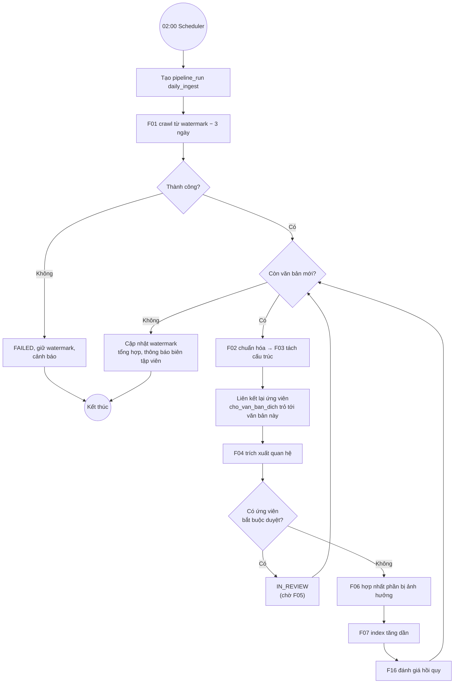
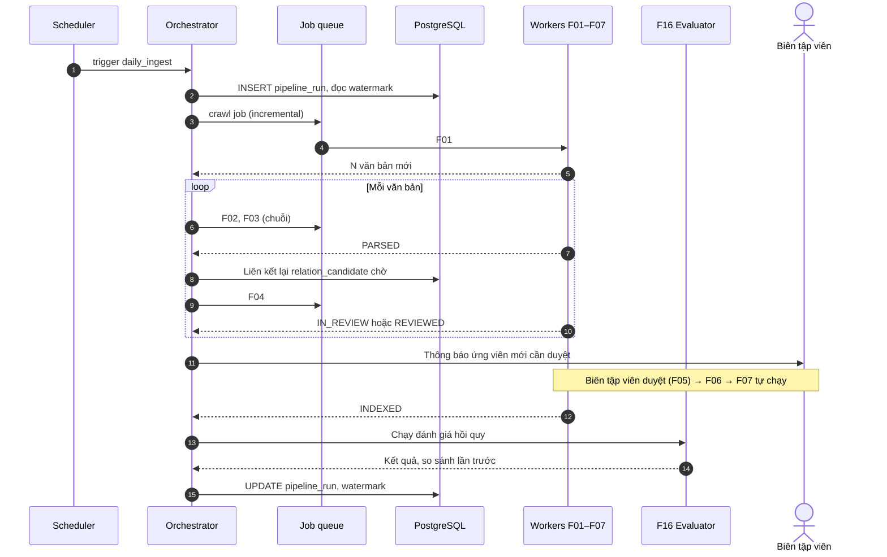

# F15 – Cập nhật liên tục (index tăng dần)

| Mục | Nội dung |
|---|---|
| Epic | C – Vận hành |
| Bước trong inception | 13. Cập nhật liên tục |
| Ưu tiên | MVP |
| Phụ thuộc | F01 → F07, F16 |
| KPI liên quan | Độ trễ cập nhật ≤ 2 ngày làm việc |

Điều phối pipeline theo lịch: thu thập văn bản mới hằng ngày, đẩy qua các bước, chỉ tính lại **phần bị ảnh hưởng**, làm mới trạng thái hiệu lực theo ngày và chạy đánh giá hồi quy sau mỗi lần cập nhật.

---

## 1. Business logic

### 1.1. Lịch chạy

| Lịch (giờ VN) | Tác vụ |
|---|---|
| 00:05 hằng ngày | **Làm mới trạng thái**: tính lại `VanBan.trang_thai` cho các văn bản có phiên bản bắt đầu / kết thúc hôm nay; đánh dấu cụm liên quan `dirty` |
| 02:00 hằng ngày | **Thu thập tăng dần** từ mốc `watermark` (F01 `mode = incremental`) → tự chạy F02 → F04 |
| 03:00 Chủ nhật | **Phân cụm lại toàn bộ** (F07 UC-07.2) |
| Sau mỗi lần có văn bản `INDEXED` mới | **Đánh giá hồi quy** (F16) |

> Tác vụ batch dùng LLM tự nhường khi có người dùng đang chat (F17 BR-17.7). Bản dev có thể chạy thủ công thay vì theo lịch.

### 1.2. Quy tắc tăng dần

| Mã | Quy tắc |
|---|---|
| BR-15.1 | `watermark` = ngày công bố lớn nhất đã thu thập thành công; mỗi lần chạy lấy từ `watermark − 3 ngày` (chồng lấn để không sót văn bản công bố trễ; trùng được loại bằng hash – F01 BR-01.5). |
| BR-15.2 | Văn bản mới đi qua F02 → F04 tự động; dừng ở `IN_REVIEW` chờ biên tập viên. Sau duyệt, F05 kích hoạt F06 **chỉ cho điều khoản đích bị ảnh hưởng**, F06 kích hoạt F07 **chỉ cho phiên bản stale và cụm dirty**. |
| BR-15.3 | **Liên kết lại ứng viên chờ**: văn bản mới `so_hieu = X` được `PARSED` → tìm mọi `relation_candidate` có `trang_thai = cho_van_ban_dich` và `dich_so_hieu = X`, liên kết lại ID đích, chuyển `cho_duyet`. |
| BR-15.4 | **Nạp văn bản cũ sau**: văn bản mới nạp là đích của các cạnh đã có (ví dụ nạp NĐ 123 sau NĐ 70) → được xử lý qua BR-15.3; F06 chạy cho văn bản đó sau khi duyệt. |
| BR-15.5 | **Bản đính chính / revision** (F01 BR-01.6): sau khi biên tập viên xác nhận → tách lại (F03), so sánh `content_hash` từng khoản: chỉ khoản đổi nội dung mới tạo lại phiên bản gốc và chạy lại F06/F07. |
| BR-15.6 | Mỗi bước là job độc lập, **idempotent**, retry tối đa 3 lần với backoff; thất bại cuối → `FAILED` + cảnh báo trên trang quản trị, không chặn các văn bản khác. |
| BR-15.7 | **Đo độ trễ cập nhật** = `indexed_at − published_at` (tính theo ngày làm việc). Văn bản quá 2 ngày làm việc chưa `INDEXED` → cảnh báo, kèm bước đang tắc (thường là `IN_REVIEW`). |
| BR-15.8 | Đánh giá hồi quy sau cập nhật: độ chính xác giảm > 5 điểm % hoặc tỷ lệ trích dẫn hết hiệu lực > 1% so với lần trước → cảnh báo quản trị viên (không tự rollback ở MVP). |

---

## 2. Use case description

### UC-15.1 – Chạy cập nhật hằng ngày

| Mục | Nội dung |
|---|---|
| Actor chính | Scheduler |
| Actor phụ | Biên tập viên (duyệt), Quản trị viên (nhận cảnh báo) |
| Tiền điều kiện | Lịch bật; các dịch vụ (Neo4j, PG, ES, LM Studio) hoạt động |
| Hậu điều kiện | Văn bản mới vào hệ thống (tới `IN_REVIEW` hoặc `INDEXED`); `watermark` cập nhật; `pipeline_run` ghi nhận |

**Luồng chính**

1. Scheduler tạo `pipeline_run` loại `daily_ingest`.
2. Tạo crawl job tăng dần từ `watermark − 3 ngày` (BR-15.1).
3. Mỗi văn bản mới chạy F02 → F03 → F04 thành chuỗi job.
4. Sau F03, chạy liên kết lại ứng viên chờ (BR-15.3).
5. Văn bản không có ứng viên bắt buộc duyệt → tiếp F06 → F07.
6. Cập nhật `watermark`, tổng hợp kết quả; thông báo biên tập viên số ứng viên mới cần duyệt.

**Ngoại lệ**: 2a. Nguồn lỗi → `pipeline_run` `FAILED`, watermark giữ nguyên, lần sau chạy lại. 3a. Một văn bản lỗi → BR-15.6.

### UC-15.2 – Làm mới trạng thái hiệu lực hằng ngày

Scheduler 00:05 → tìm `PhienBan` có `hieu_luc_tu = hôm nay` hoặc `hieu_luc_den = hôm nay` → tính lại trạng thái văn bản chứa chúng → đánh dấu cụm `dirty` → F07 tóm tắt lại.

### UC-15.3 – Quản trị viên theo dõi và chạy thủ công

Quản trị viên xem trang tình trạng (số văn bản theo trạng thái, văn bản trễ hạn, job lỗi), chạy lại job lỗi, bật / tắt lịch.

---

## 3. Activity diagram



---

## 4. Sequence diagram



---

## 5. API

| Method | Endpoint | Vai trò | Mô tả |
|---|---|---|---|
| GET | `/api/v1/admin/schedules` | quan_tri | Danh sách lịch |
| PUT | `/api/v1/admin/schedules/{id}` | quan_tri | Bật / tắt, đổi cron |
| POST | `/api/v1/admin/pipeline/runs` | quan_tri | Chạy thủ công một loại pipeline |
| GET | `/api/v1/admin/pipeline/runs` | quan_tri | Lịch sử chạy |
| GET | `/api/v1/admin/pipeline/runs/{id}` | quan_tri | Chi tiết các bước |
| POST | `/api/v1/admin/pipeline/jobs/{job_id}/retry` | quan_tri | Chạy lại job lỗi |
| GET | `/api/v1/admin/freshness` | quan_tri | Độ trễ cập nhật, văn bản trễ hạn |

**POST `/admin/pipeline/runs`**

```json
// Request
{"type": "daily_ingest", "params": {"from_date": "2026-11-10"}}
// 202
{"run_id": "8e44…", "status": "QUEUED"}
```

**GET `/admin/freshness`**

```json
{
  "watermark": "2026-11-17",
  "documents_by_status": {"FETCHED": 0, "NORMALIZED": 0, "PARSED": 0, "IN_REVIEW": 2, "INDEXED": 41, "FAILED": 1},
  "lag_working_days": {"p50": 1, "p95": 2, "max": 3},
  "overdue": [{"so_hieu": "18/2026/TT-BTC", "published_at": "2026-11-12", "status": "IN_REVIEW", "lag_working_days": 3}]
}
```

---

## 6. Schema (PostgreSQL)

```sql
CREATE TABLE schedule (
    id        TEXT PRIMARY KEY,         -- daily_ingest | daily_status_refresh | weekly_recluster
    cron      TEXT NOT NULL,            -- '0 2 * * *'
    timezone  TEXT NOT NULL DEFAULT 'Asia/Ho_Chi_Minh',
    enabled   BOOLEAN NOT NULL DEFAULT TRUE,
    last_run_at TIMESTAMPTZ
);

CREATE TABLE pipeline_run (
    id          UUID PRIMARY KEY,
    type        TEXT NOT NULL,
    trigger     TEXT NOT NULL CHECK (trigger IN ('schedule','manual','event')),
    params      JSONB NOT NULL DEFAULT '{}',
    status      TEXT NOT NULL CHECK (status IN ('QUEUED','RUNNING','DONE','PARTIAL','FAILED')),
    summary     JSONB NOT NULL DEFAULT '{}',
    created_at  TIMESTAMPTZ NOT NULL DEFAULT now(),
    finished_at TIMESTAMPTZ
);

CREATE TABLE pipeline_job (
    id                 UUID PRIMARY KEY,
    run_id             UUID REFERENCES pipeline_run(id),
    step               TEXT NOT NULL,   -- crawl | normalize | parse | relink | extract | consolidate | index | evaluate
    source_document_id UUID REFERENCES source_document(id),
    payload            JSONB NOT NULL DEFAULT '{}',
    status             TEXT NOT NULL CHECK (status IN ('QUEUED','RUNNING','DONE','FAILED','CANCELLED')),
    attempts           INT NOT NULL DEFAULT 0,
    error              TEXT,
    queued_at          TIMESTAMPTZ NOT NULL DEFAULT now(),
    started_at         TIMESTAMPTZ,
    finished_at        TIMESTAMPTZ
);
CREATE INDEX ON pipeline_job (status, step);

CREATE TABLE watermark (
    source_id   TEXT PRIMARY KEY REFERENCES crawl_source(id),
    value       DATE NOT NULL,
    updated_at  TIMESTAMPTZ NOT NULL DEFAULT now()
);

ALTER TABLE source_document ADD COLUMN indexed_at TIMESTAMPTZ;
```

> Hàng đợi job: dùng bảng `pipeline_job` với `SELECT … FOR UPDATE SKIP LOCKED` (đủ cho bản dev, không cần thêm Redis / Celery). Có thể thay bằng Celery / Arq khi mở rộng.

---

## 7. Tiêu chí chấp nhận

- [ ] Thêm một văn bản mới vào nguồn giả lập → lần chạy kế tiếp đưa văn bản tới `IN_REVIEW` không cần thao tác tay.
- [ ] Nạp NĐ 70/2025 trước NĐ 123/2020 → ứng viên `cho_van_ban_dich`; nạp NĐ 123 sau đó → ứng viên chuyển `cho_duyet` với đích đúng.
- [ ] Chạy daily_ingest 2 lần liền → lần 2 không tạo job mới.
- [ ] Ngày 01/01/2026 (giả lập đồng hồ) → trạng thái các điều khoản thuế khoán đổi theo NQ 198/2025.
