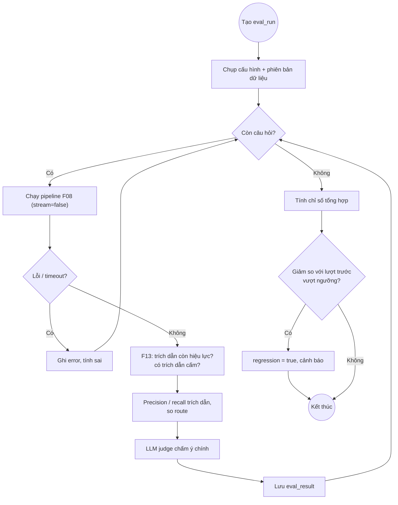
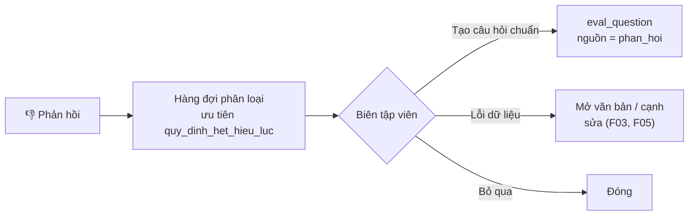
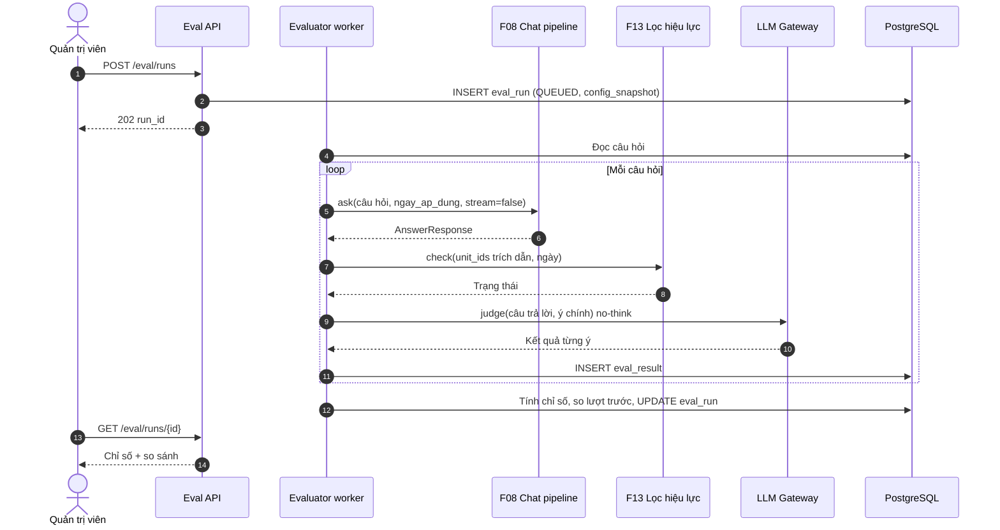

# F16 – Đánh giá chất lượng và phản hồi người dùng

| Mục | Nội dung |
|---|---|
| Epic | C – Vận hành |
| Bước trong inception | Mũi tên "phản hồi, bộ câu hỏi đánh giá" từ bước 12 về 13; mục 7 KPI |
| Ưu tiên | MVP (bộ câu hỏi chuẩn cần có từ cuối PoC để đo) |
| Phụ thuộc | F08, F13 |
| Người dùng | Chuyên gia / biên tập viên (soạn câu hỏi, chấm), Quản trị viên, Người dùng cuối (phản hồi) |

Đo các KPI của inception mục 7 một cách tự động và lặp lại được, thu phản hồi người dùng và biến phản hồi tiêu cực thành câu hỏi kiểm thử mới.

---

## 1. Business logic

### 1.1. Bộ câu hỏi chuẩn

| Mã | Quy tắc |
|---|---|
| BR-16.1 | Mỗi câu hỏi gồm: nội dung, `ngay_ap_dung`, `route` mong đợi, **ý chính bắt buộc** (danh sách phát biểu ngắn), **trích dẫn mong đợi** (`unit_ids`), **trích dẫn cấm** (điều khoản đã hết hiệu lực tại ngày áp dụng), nhóm chủ đề, nguồn (`chuyen_gia` / `phan_hoi`). |
| BR-16.2 | Bộ MVP tối thiểu **50 câu**, phủ cả 5 kiểu Q1–Q5 và cả hai lĩnh vực (hóa đơn điện tử, thuế hộ kinh doanh); ≥ 30% là câu hỏi theo thời điểm quá khứ hoặc về quy định đã bị bãi bỏ – đúng điểm yếu của RAG truyền thống. |
| BR-16.3 | Câu hỏi có phiên bản (`version`); sửa câu hỏi → phiên bản mới, kết quả cũ vẫn gắn phiên bản cũ. |

### 1.2. Chỉ số

| Chỉ số (KPI inception) | Cách đo tự động | Mục tiêu |
|---|---|---|
| Độ chính xác câu trả lời | LLM judge (Qwen3.5 9B, temperature 0, tắt thinking) chấm từng **ý chính bắt buộc**: có / không có trong câu trả lời. Câu đúng khi ≥ 80% ý chính có mặt **và** không chứa trích dẫn cấm. Chuyên gia chấm lại mẫu 20% để hiệu chỉnh | ≥ 85% |
| Tỷ lệ trích dẫn hết hiệu lực | Số câu trả lời có ≥ 1 trích dẫn `[Cx]` không còn hiệu lực tại ngày áp dụng (gọi F13) hoặc nằm trong trích dẫn cấm / tổng số câu | ≤ 1% |
| Độ chính xác trích dẫn | Precision = trích dẫn thuộc tập mong đợi (so ở cấp Điều trở xuống) / tổng trích dẫn | ≥ 95% |
| Thời gian phản hồi P95 | Từ `latency_ms.total` | ≤ 10 s |
| Độ chính xác cạnh sửa đổi / bãi bỏ | Lấy mẫu ngẫu nhiên 50 cạnh đã duyệt, chuyên gia kiểm tra lại; cộng với tỷ lệ `edit_approve`/`reject` sau duyệt | ≥ 99% |
| *(bổ sung)* Độ chính xác định tuyến | `route` thực tế = `route` mong đợi | ≥ 90% |
| *(bổ sung)* Recall trích dẫn | Trích dẫn mong đợi xuất hiện / tổng mong đợi | theo dõi |

| Mã | Quy tắc |
|---|---|
| BR-16.4 | Lượt đánh giá chạy pipeline F08 thật với `stream = false`, phiên riêng, cùng cấu hình production; lưu `config_snapshot` (model, tham số, phiên bản dữ liệu). |
| BR-16.5 | So sánh với lượt trước: độ chính xác giảm > 5 điểm % hoặc trích dẫn hết hiệu lực > 1% → `regression = true`, cảnh báo (F15 BR-15.8). |
| BR-16.6 | Kết quả LLM judge luôn hiển thị là "ước lượng tự động"; chuyên gia có thể ghi đè từng kết quả, ghi đè được ưu tiên khi tính chỉ số. |

### 1.3. Phản hồi người dùng

| Mã | Quy tắc |
|---|---|
| BR-16.7 | Mỗi câu trả lời có nút 👍 / 👎; 👎 yêu cầu chọn lý do: `sai_noi_dung`, `quy_dinh_het_hieu_luc`, `thieu_trich_dan`, `trich_dan_sai`, `kho_hieu`, `khac` + bình luận tùy chọn. Mỗi người dùng một phản hồi / câu trả lời (được sửa). |
| BR-16.8 | Phản hồi 👎 vào **hàng đợi phân loại** cho biên tập viên: (a) chuyển thành câu hỏi chuẩn (nguồn `phan_hoi`), (b) đánh dấu lỗi dữ liệu → mở văn bản / cạnh liên quan để sửa, (c) bỏ qua. |
| BR-16.9 | Lý do `quy_dinh_het_hieu_luc` được ưu tiên cao nhất trong hàng đợi (rủi ro chính của dự án). |

---

## 2. Use case description

### UC-16.1 – Chạy đánh giá bộ câu hỏi chuẩn

| Mục | Nội dung |
|---|---|
| Actor chính | Quản trị viên; F15 (tự động) |
| Tiền điều kiện | Bộ câu hỏi đang hoạt động ≥ 1 câu; LM Studio sẵn sàng |
| Hậu điều kiện | `eval_run` với chỉ số tổng hợp và kết quả từng câu |

**Luồng chính**

1. Actor tạo lượt đánh giá (toàn bộ hoặc theo nhóm / nhãn).
2. Hệ thống chụp cấu hình (BR-16.4).
3. Với mỗi câu: chạy pipeline hỏi đáp, ghi câu trả lời, route, trích dẫn, độ trễ.
4. Kiểm tra tự động: trích dẫn hết hiệu lực (F13), trích dẫn cấm, precision / recall, route.
5. LLM judge chấm ý chính.
6. Tính chỉ số, so sánh lượt trước (BR-16.5), lưu kết quả.

**Ngoại lệ**: 3a. Câu lỗi (timeout, LLM lỗi) → ghi `error`, tính là sai, tiếp tục.

### UC-16.2 – Chuyên gia chấm lại

Chuyên gia mở kết quả lượt đánh giá, lọc câu bị judge chấm sai hoặc mẫu ngẫu nhiên 20%, đánh dấu đúng / sai từng ý chính; hệ thống tính lại chỉ số với ghi đè (BR-16.6).

### UC-16.3 – Gửi phản hồi về câu trả lời

| Mục | Nội dung |
|---|---|
| Actor chính | Người dùng |
| Luồng chính | 1) Bấm 👍 hoặc 👎. 2) Nếu 👎: chọn lý do, nhập bình luận. 3) Hệ thống lưu `feedback`; 👎 vào hàng đợi phân loại (BR-16.8). |

### UC-16.4 – Phân loại phản hồi

Biên tập viên mở hàng đợi → xem câu hỏi, câu trả lời, trace (F08) → chọn (a) tạo câu hỏi chuẩn (form điền sẵn từ câu hỏi người dùng), (b) báo lỗi dữ liệu, (c) bỏ qua.

---

## 3. Activity diagram





---

## 4. Sequence diagram



---

## 5. API

| Method | Endpoint | Vai trò | Mô tả |
|---|---|---|---|
| GET | `/api/v1/eval/questions` | bien_tap_vien | Danh sách câu hỏi chuẩn (lọc nhóm, nguồn, `active`) |
| POST | `/api/v1/eval/questions` | bien_tap_vien | Thêm câu hỏi |
| PUT | `/api/v1/eval/questions/{id}` | bien_tap_vien | Sửa (tạo phiên bản mới) |
| DELETE | `/api/v1/eval/questions/{id}` | bien_tap_vien | Ngưng sử dụng (`active = false`) |
| POST | `/api/v1/eval/runs` | quan_tri | Tạo lượt đánh giá |
| GET | `/api/v1/eval/runs` | bien_tap_vien | Lịch sử lượt + chỉ số |
| GET | `/api/v1/eval/runs/{id}` | bien_tap_vien | Chỉ số, so sánh lượt trước |
| GET | `/api/v1/eval/runs/{id}/results` | bien_tap_vien | Kết quả từng câu |
| PATCH | `/api/v1/eval/results/{id}` | bien_tap_vien | Chuyên gia ghi đè chấm điểm |
| POST | `/api/v1/chat/messages/{id}/feedback` | nguoi_dung | Gửi / sửa phản hồi |
| GET | `/api/v1/feedback/queue` | bien_tap_vien | Hàng đợi phân loại |
| POST | `/api/v1/feedback/{id}/triage` | bien_tap_vien | Phân loại phản hồi |

**POST `/eval/questions`**

```json
{
  "cau_hoi": "Tại ngày 15/3/2025, quy định về ủy nhiệm lập hóa đơn là gì?",
  "ngay_ap_dung": "2025-03-15",
  "route_mong_doi": "LOCAL",
  "y_chinh": ["Người bán được ủy nhiệm cho bên thứ ba lập hóa đơn", "Việc ủy nhiệm phải lập thành văn bản"],
  "trich_dan_mong_doi": ["123/2020/NĐ-CP:Đ3", "78/2021/TT-BTC:Đ…"],
  "trich_dan_cam": ["32/2025/TT-BTC:Đ…"],
  "nhom": "hoa_don_dien_tu",
  "tags": ["thoi_diem_qua_khu"]
}
```

**GET `/eval/runs/{id}`**

```json
{
  "run_id": "41aa…",
  "status": "DONE",
  "questions": 52,
  "metrics": {
    "accuracy": 0.865, "expired_citation_rate": 0.0, "citation_precision": 0.962,
    "citation_recall": 0.81, "routing_accuracy": 0.923, "latency_p95_ms": 8700
  },
  "previous_run_id": "39f0…",
  "delta": {"accuracy": 0.012, "expired_citation_rate": 0.0},
  "regression": false,
  "judge_overridden": 11
}
```

**POST `/chat/messages/{id}/feedback`**

```json
{"rating": "down", "ly_do": "quy_dinh_het_hieu_luc", "binh_luan": "Thông tư 78 đã bị thay thế rồi"}
```

---

## 6. Schema (PostgreSQL)

```sql
CREATE TABLE eval_question (
    id                  BIGSERIAL PRIMARY KEY,
    group_id            BIGINT NOT NULL,         -- cùng câu hỏi qua các phiên bản
    version             INT NOT NULL,
    cau_hoi             TEXT NOT NULL,
    ngay_ap_dung        DATE NOT NULL,
    route_mong_doi      TEXT,
    y_chinh             JSONB NOT NULL,          -- ["...", "..."]
    trich_dan_mong_doi  TEXT[] NOT NULL,
    trich_dan_cam       TEXT[] NOT NULL DEFAULT '{}',
    nhom                TEXT,
    tags                TEXT[] NOT NULL DEFAULT '{}',
    nguon               TEXT NOT NULL CHECK (nguon IN ('chuyen_gia','phan_hoi')),
    active              BOOLEAN NOT NULL DEFAULT TRUE,
    created_by          TEXT NOT NULL,
    created_at          TIMESTAMPTZ NOT NULL DEFAULT now(),
    UNIQUE (group_id, version)
);

CREATE TABLE eval_run (
    id               UUID PRIMARY KEY,
    trigger          TEXT NOT NULL CHECK (trigger IN ('manual','post_update')),
    filter           JSONB NOT NULL DEFAULT '{}',
    config_snapshot  JSONB NOT NULL,
    status           TEXT NOT NULL CHECK (status IN ('QUEUED','RUNNING','DONE','FAILED')),
    metrics          JSONB,
    previous_run_id  UUID REFERENCES eval_run(id),
    regression       BOOLEAN,
    created_at       TIMESTAMPTZ NOT NULL DEFAULT now(),
    finished_at      TIMESTAMPTZ
);

CREATE TABLE eval_result (
    id                 BIGSERIAL PRIMARY KEY,
    run_id             UUID NOT NULL REFERENCES eval_run(id),
    question_id        BIGINT NOT NULL REFERENCES eval_question(id),
    answer             TEXT,
    route              TEXT,
    citations          JSONB,
    expired_citations  TEXT[] NOT NULL DEFAULT '{}',
    forbidden_hits     TEXT[] NOT NULL DEFAULT '{}',
    precision          REAL,
    recall             REAL,
    judge              JSONB,                    -- [{"y": "...", "co": true}]
    judge_correct      BOOLEAN,
    expert_correct     BOOLEAN,                  -- ghi đè, NULL nếu chưa chấm
    latency_ms         INT,
    error              TEXT
);

CREATE TABLE feedback (
    id           BIGSERIAL PRIMARY KEY,
    message_id   UUID NOT NULL REFERENCES chat_message(id),
    api_key_id   TEXT NOT NULL,
    rating       TEXT NOT NULL CHECK (rating IN ('up','down')),
    ly_do        TEXT CHECK (ly_do IN ('sai_noi_dung','quy_dinh_het_hieu_luc','thieu_trich_dan','trich_dan_sai','kho_hieu','khac')),
    binh_luan    TEXT,
    triage       TEXT CHECK (triage IN ('pending','to_eval','data_issue','ignored')) DEFAULT 'pending',
    triaged_by   TEXT,
    eval_question_id BIGINT REFERENCES eval_question(id),
    created_at   TIMESTAMPTZ NOT NULL DEFAULT now(),
    UNIQUE (message_id, api_key_id)
);
```

---

## 7. Tiêu chí chấp nhận

- [ ] Có bộ ≥ 50 câu hỏi chuẩn trước khi kết thúc giai đoạn MVP.
- [ ] Một lượt đánh giá báo đủ các chỉ số ở bảng 1.2 và so sánh với lượt trước.
- [ ] Chèn cố ý một câu trả lời trích TT 78/2021 cho ngày 2026 → `expired_citation_rate > 0` được phát hiện.
- [ ] Phản hồi 👎 chuyển được thành câu hỏi chuẩn trong ≤ 3 thao tác.
