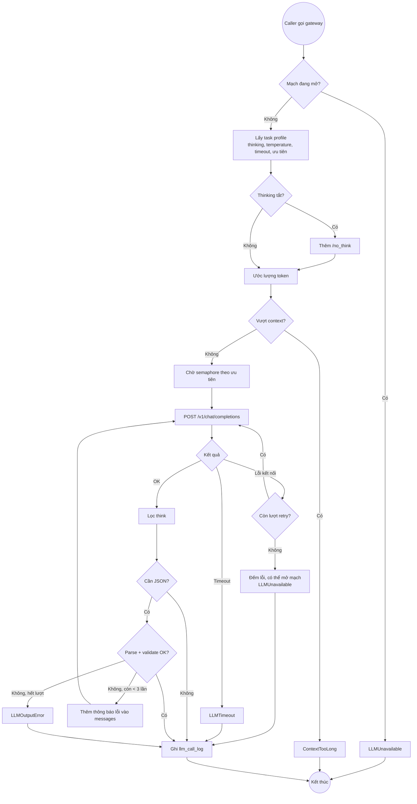
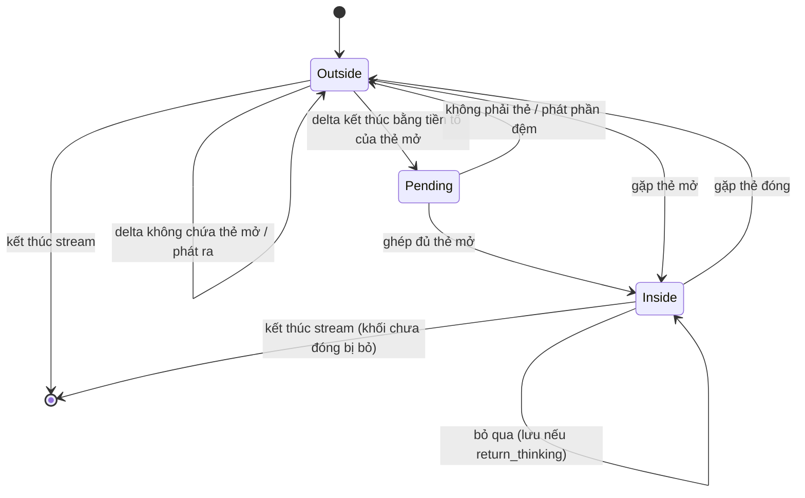
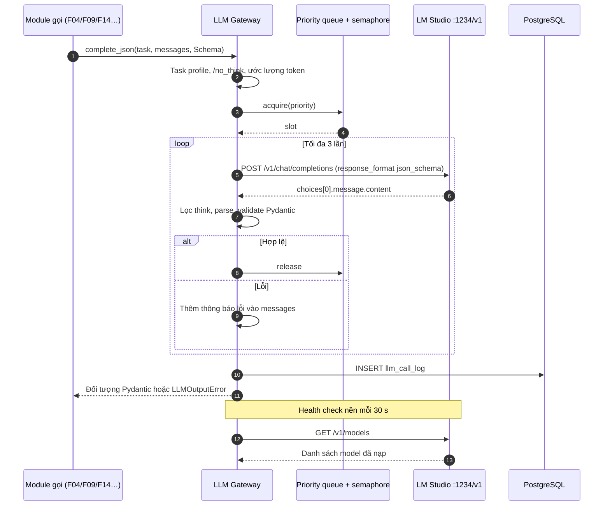

# F17 – LLM Gateway (kết nối LM Studio)

| Mục | Nội dung |
|---|---|
| Epic | C – Vận hành (hạ tầng dùng chung) |
| Tham chiếu inception | Mục 6.1 – Cấu hình LLM qua LM Studio |
| Ưu tiên | **PoC** (làm đầu tiên) |
| Phụ thuộc | LM Studio Local Server |
| Dùng bởi | F04, F07, F09, F12, F14, F16 |

Một module duy nhất bọc mọi lời gọi tới LM Studio (API chuẩn OpenAI): cấu hình theo từng loại tác vụ, bật / tắt thinking, lọc `<think>`, ép JSON theo schema, giới hạn đồng thời, ưu tiên chat hơn batch, đo đạc và kiểm tra sức khỏe.

---

## 1. Business logic

### 1.1. Hồ sơ tác vụ (task profile)

| Tác vụ | Dùng ở | Thinking | Temperature | Định dạng | Timeout | Ưu tiên |
|---|---|---|---|---|---|---|
| `chat_answer` | F14 | theo `CHAT_THINKING` (mặc định bật) | 0.1 | text, stream | 30 s | 1 (cao nhất) |
| `query_analysis` | F09 | tắt | 0 | JSON schema | 1.5 s | 1 |
| `global_map` | F12 | tắt | 0.1 | JSON schema | 15 s | 2 |
| `extract_relations` | F04 | tắt | 0.1 | JSON schema | 60 s | 3 |
| `classify_topics` | F04 | tắt | 0 | JSON schema | 30 s | 3 |
| `summarize_cluster` | F07 | tắt | 0.2 | JSON schema | 120 s | 3 |
| `judge` | F16 | tắt | 0 | JSON schema | 60 s | 3 |
| `embed` | F07, F09, F11, F12 | – | – | vector | 10 s | 1 (truy vấn) / 3 (lập chỉ mục) |

### 1.2. Quy tắc

| Mã | Quy tắc |
|---|---|
| BR-17.1 | Cấu hình qua biến môi trường của inception (`LLM_BASE_URL`, `LLM_API_KEY`, `LLM_MODEL`, `EMBEDDING_MODEL`, `LLM_TEMPERATURE`) + `CHAT_THINKING`, `LLM_MAX_CONCURRENCY`. Không mã nguồn nào khác được gọi OpenAI SDK trực tiếp. |
| BR-17.2 | **Tắt thinking**: thêm chỉ thị `/no_think` vào cuối tin nhắn người dùng (soft switch của dòng Qwen3). *Cần kiểm chứng với Qwen3.5 9B trên phiên bản LM Studio đang dùng; nếu LM Studio hỗ trợ tham số template `enable_thinking` thì ưu tiên dùng tham số đó.* |
| BR-17.3 | **Ép JSON**: gửi `response_format = {"type": "json_schema", "json_schema": …}` sinh từ model Pydantic; luôn validate lại bằng Pydantic. Lỗi parse / validate → gọi lại tối đa **3 lần**, lần sau kèm thông báo lỗi ("JSON trước thiếu trường `loai`…"). Hết lượt → ném `LLMOutputError`. |
| BR-17.4 | **Lọc `<think>`**: với kết quả không stream, xóa mọi khối `<think>…</think>` (kể cả khối chưa đóng ở cuối). Với stream, dùng máy trạng thái: bỏ token khi đang trong khối think, chỉ phát token ngoài khối; xử lý trường hợp thẻ bị chia qua nhiều delta. Nội dung think chỉ được trả kèm khi caller yêu cầu (`return_thinking=True`) để ghi trace. |
| BR-17.5 | **Giới hạn đồng thời**: semaphore `LLM_MAX_CONCURRENCY` (mặc định 1 – một GPU local) cho chat completion; embedding có semaphore riêng (mặc định 2). |
| BR-17.6 | **Hàng đợi ưu tiên**: yêu cầu chờ semaphore được xếp theo ưu tiên (bảng 1.1), cùng ưu tiên thì FIFO. |
| BR-17.7 | **Nhường cho người dùng**: khi có yêu cầu ưu tiên 1 đang chờ, các tác vụ ưu tiên 3 chưa bắt đầu sẽ đợi; batch worker kiểm tra cờ `interactive_busy` giữa các lô. |
| BR-17.8 | **Retry lỗi kết nối** (connection error, 5xx): 2 lần, backoff 1 s / 3 s. Không retry khi timeout của tác vụ tương tác (trả lỗi ngay để F08 dùng phương án dự phòng). |
| BR-17.9 | **Circuit breaker**: 5 lỗi kết nối liên tiếp trong 60 s → mở mạch 30 s, mọi lời gọi trả `LLMUnavailable` ngay; sau 30 s thử một yêu cầu kiểm tra. |
| BR-17.10 | **Health check**: `GET {LLM_BASE_URL}/models` mỗi 30 s; xác nhận cả `LLM_MODEL` và `EMBEDDING_MODEL` đang được nạp. Thiếu model → trạng thái `degraded`, hiển thị trên trang quản trị. |
| BR-17.11 | **Ghi log** mọi lời gọi: tác vụ, model, số token vào / ra, độ trễ, số lần thử, kết quả. Nội dung prompt / output chỉ lưu khi bật `LLM_LOG_CONTENT` (mặc định bật ở dev, vì dữ liệu ở local). |
| BR-17.12 | **Bảo mật**: LM Studio chỉ mở trong mạng nội bộ; nếu `LLM_BASE_URL` không phải địa chỉ private / localhost mà không dùng `https` → cảnh báo khi khởi động (inception mục 6.1 và rủi ro mục 8). |
| BR-17.13 | **Ước lượng token** trước khi gửi; vượt context của model (`LLM_CONTEXT_TOKENS`, mặc định 8 192) → ném `ContextTooLong` để caller cắt ngữ cảnh, không để LM Studio cắt ngầm. |

---

## 2. Use case description

### UC-17.1 – Gọi LLM có cấu trúc (JSON)

| Mục | Nội dung |
|---|---|
| Actor chính | Các module F04, F07, F09, F12, F16 |
| Tiền điều kiện | Gateway khởi tạo, mạch đóng |
| Hậu điều kiện | Trả đối tượng Pydantic hợp lệ, hoặc lỗi có kiểu rõ ràng; `llm_call_log` được ghi |

**Luồng chính**

1. Caller gọi `complete_json(task, messages, schema)`.
2. Gateway lấy hồ sơ tác vụ, chèn chỉ thị tắt thinking nếu cần (BR-17.2).
3. Ước lượng token (BR-17.13).
4. Chờ semaphore theo ưu tiên (BR-17.5 → BR-17.7).
5. Gửi `POST /v1/chat/completions` với `response_format`.
6. Lọc `<think>`, parse JSON, validate Pydantic.
7. Ghi log, trả kết quả.

**Ngoại lệ**: 6a. JSON lỗi → gọi lại kèm thông báo lỗi (BR-17.3). 5a. Lỗi kết nối → BR-17.8; mạch mở → `LLMUnavailable`. 5b. Timeout → `LLMTimeout`.

### UC-17.2 – Gọi LLM dạng stream (chat)

Như UC-17.1 nhưng `stream = true`; gateway phát từng delta đã lọc think (BR-17.4) qua async iterator; khi kết thúc trả kèm số token và độ trễ.

### UC-17.3 – Tạo embedding

Caller gọi `embed(texts, priority)`; gateway chia lô ≤ 32, gọi `POST /v1/embeddings`, kiểm tra số chiều khớp `EMBEDDING_DIM`.

### UC-17.4 – Quản trị viên kiểm tra tình trạng LLM

Xem trang quản trị: trạng thái health, model đang nạp, mạch, độ dài hàng đợi theo ưu tiên, độ trễ P50/P95 theo tác vụ, tỷ lệ JSON lỗi.

---

## 3. Activity diagram



### Máy trạng thái lọc `<think>` khi stream



---

## 4. Sequence diagram



---

## 5. API

### 5.1. Interface nội bộ (Python)

```python
class LLMGateway(Protocol):
    async def complete_json(self, task: TaskName, messages: list[dict],
                            schema: type[T], *, return_thinking: bool = False) -> T: ...

    async def complete_text(self, task: TaskName, messages: list[dict]) -> TextResult: ...

    def stream_text(self, task: TaskName, messages: list[dict],
                    *, return_thinking: bool = False) -> AsyncIterator[StreamDelta]: ...

    async def embed(self, texts: list[str], *, priority: Literal[1, 3] = 1) -> list[list[float]]: ...

    async def health(self) -> HealthStatus: ...

# Lỗi
class LLMUnavailable(Exception): ...
class LLMTimeout(Exception): ...
class LLMOutputError(Exception): ...     # JSON lỗi sau 3 lần
class ContextTooLong(Exception): ...
```

### 5.2. REST (quản trị)

| Method | Endpoint | Vai trò | Mô tả |
|---|---|---|---|
| GET | `/api/v1/admin/llm/health` | quan_tri | Trạng thái kết nối, model đã nạp, mạch |
| GET | `/api/v1/admin/llm/stats?from=&to=` | quan_tri | Độ trễ, token, tỷ lệ lỗi theo tác vụ |
| GET | `/api/v1/admin/llm/config` | quan_tri | Cấu hình hiệu lực (ẩn API key) |

**GET `/admin/llm/health`**

```json
{
  "status": "ok",
  "base_url": "http://192.168.1.20:1234/v1",
  "models_loaded": ["qwen3.5-9b", "bge-m3"],
  "llm_model_ok": true,
  "embedding_model_ok": true,
  "circuit": "closed",
  "queue": {"p1": 0, "p2": 0, "p3": 4},
  "last_check": "2026-11-18T09:15:30+07:00",
  "warnings": []
}
```

**GET `/admin/llm/stats`**

```json
{
  "tasks": {
    "chat_answer":       {"calls": 312, "p50_ms": 3900, "p95_ms": 7600, "avg_tokens_out": 280, "error_rate": 0.006},
    "query_analysis":    {"calls": 312, "p50_ms": 640,  "p95_ms": 1300, "json_retry_rate": 0.02},
    "extract_relations": {"calls": 85,  "p50_ms": 5200, "p95_ms": 14000, "json_retry_rate": 0.07}
  }
}
```

---

## 6. Schema

### 6.1. Biến môi trường (bổ sung cho inception 6.1)

```env
LLM_BASE_URL=http://<ip-máy-chủ>:1234/v1
LLM_API_KEY=lm-studio
LLM_MODEL=qwen3.5-9b
EMBEDDING_MODEL=bge-m3
EMBEDDING_DIM=1024
LLM_TEMPERATURE=0.1
LLM_CONTEXT_TOKENS=8192
LLM_MAX_CONCURRENCY=1
EMBED_MAX_CONCURRENCY=2
CHAT_THINKING=true
LLM_JSON_MAX_ATTEMPTS=3
LLM_LOG_CONTENT=true
TRACE_THINKING=false
```

### 6.2. PostgreSQL

```sql
CREATE TABLE llm_call_log (
    id            BIGSERIAL PRIMARY KEY,
    task          TEXT NOT NULL,
    model         TEXT NOT NULL,
    priority      SMALLINT NOT NULL,
    thinking      BOOLEAN NOT NULL,
    attempts      SMALLINT NOT NULL,
    tokens_in     INT,
    tokens_out    INT,
    queue_ms      INT,
    latency_ms    INT,
    outcome       TEXT NOT NULL CHECK (outcome IN ('ok','json_error','timeout','unavailable','context_too_long','error')),
    error         TEXT,
    prompt        JSONB,          -- chỉ khi LLM_LOG_CONTENT
    output        TEXT,
    caller_ref    TEXT,           -- ví dụ 'relation_candidate:1042', 'chat_message:b7e2…'
    created_at    TIMESTAMPTZ NOT NULL DEFAULT now()
);
CREATE INDEX ON llm_call_log (task, created_at);
```

---

## 7. Tiêu chí chấp nhận

- [ ] `curl {LLM_BASE_URL}/models` và `/admin/llm/health` cùng báo hai model đã nạp.
- [ ] Với thinking tắt, không có thẻ `<think>` trong output của `extract_relations`; với thinking bật, stream ra người dùng không chứa nội dung think (test với delta cắt ngang thẻ).
- [ ] Mock LM Studio trả JSON sai 2 lần rồi đúng → `complete_json` thành công, `attempts = 3`.
- [ ] Tắt LM Studio → sau 5 lỗi, mạch mở, lời gọi tiếp theo trả `LLMUnavailable` trong < 50 ms.
- [ ] Khi một batch F04 đang chạy, câu hỏi chat mới được phục vụ trước các lời gọi batch đang chờ.
