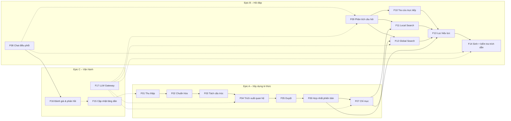
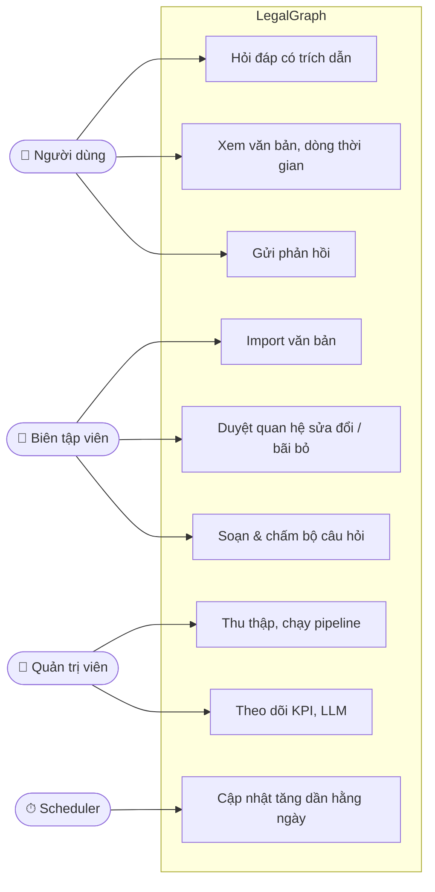

# LegalGraph – Danh sách feature

Bộ tài liệu đặc tả triển khai, dựa trên [inception.md](../inception.md). Mỗi feature có một file riêng theo cùng cấu trúc:

1. **Business logic** – các quy tắc nghiệp vụ đánh mã `BR-xx.y`
2. **Use case description** – actor, tiền / hậu điều kiện, luồng chính, luồng thay thế / ngoại lệ
3. **Activity diagram** (Mermaid)
4. **Sequence diagram** (Mermaid)
5. **API** – endpoint, vai trò, ví dụ request / response
6. **Schema** – Neo4j / PostgreSQL / Elasticsearch / Pydantic
7. **Tiêu chí chấp nhận**

Quy ước dùng chung (ID, hiệu lực, schema đồ thị đầy đủ, trạng thái pipeline, định dạng API, model dùng chung) nằm ở [00-common.md](00-common.md) – **đọc trước**.

---

## 1. Danh sách feature

| ID | Feature | Epic | Bước inception | Ưu tiên | Phụ thuộc |
|---|---|---|---|---|---|
| [F01](F01-thu-thap-van-ban.md) | Thu thập văn bản | A – Xây dựng tri thức | 1 | PoC | – |
| [F02](F02-chuan-hoa-ocr.md) | Chuyển đổi & chuẩn hóa (OCR) | A | 2 | PoC (OCR: MVP) | F01 |
| [F03](F03-tach-cau-truc.md) | Tách cấu trúc văn bản | A | 3 | PoC | F02 |
| [F04](F04-trich-xuat-quan-he.md) | Trích xuất quan hệ | A | 4 | PoC (LLM: MVP) | F03, F17 |
| [F05](F05-duyet-quan-he.md) | Duyệt quan hệ (biên tập viên) | A | 5 | PoC | F04 |
| [F06](F06-hop-nhat-phien-ban.md) | Hợp nhất phiên bản | A | 6 | PoC | F03, F05 |
| [F07](F07-lap-chi-muc.md) | Lập chỉ mục & tóm tắt cụm chủ đề | A | 7 | PoC (BM25) / MVP | F06, F17 |
| [F08](F08-hoi-dap-chat.md) | Hỏi đáp qua chat (điều phối) | B – Hỏi đáp | 8–12 | PoC / MVP | F09–F14, F17 |
| [F09](F09-phan-tich-cau-hoi.md) | Phân tích câu hỏi & định tuyến | B | 8, 9 | PoC / MVP | F03, F04, F17 |
| [F10](F10-tra-cuu-truc-tiep.md) | Tra cứu trực tiếp & duyệt đồ thị | B | 9 | **PoC** | F06, F13 |
| [F11](F11-local-search.md) | Local Search | B | 9 | MVP | F07, F13 |
| [F12](F12-global-search.md) | Global Search | B | 9 | MVP | F07, F13, F17 |
| [F13](F13-loc-hieu-luc.md) | Lọc theo hiệu lực tại ngày áp dụng | B | 10 | **PoC** | F06 |
| [F14](F14-sinh-tra-loi-kiem-tra-trich-dan.md) | Sinh câu trả lời & kiểm tra trích dẫn | B | 11, 12 | PoC / MVP | F13, F17 |
| [F15](F15-cap-nhat-tang-dan.md) | Cập nhật liên tục (index tăng dần) | C – Vận hành | 13 | MVP | F01–F07, F16 |
| [F16](F16-danh-gia-phan-hoi.md) | Đánh giá chất lượng & phản hồi | C | KPI mục 7 | MVP | F08, F13 |
| [F17](F17-llm-gateway.md) | LLM Gateway (LM Studio) | C – Hạ tầng | Mục 6.1 | **PoC – làm đầu tiên** | – |

---

## 2. Sơ đồ phụ thuộc

---

## 3. Actor và use case tổng quan

| Actor | Use case chính |
|---|---|
| Người dùng (kế toán, chủ hộ kinh doanh, pháp chế) | UC-08.1 Hỏi đáp · UC-08.2 Quản lý phiên · UC-10.3 Xem văn bản & dòng thời gian · UC-16.3 Gửi phản hồi |
| Biên tập viên dữ liệu / chuyên gia | UC-01.2 Import thủ công · UC-03.2 Sửa metadata · UC-05.1–05.4 Duyệt quan hệ · UC-16.2 Chấm lại · UC-16.4 Phân loại phản hồi |
| Quản trị viên | UC-01.1 Thu thập · UC-07.2 Phân cụm lại · UC-15.3 Theo dõi pipeline · UC-16.1 Chạy đánh giá · UC-17.4 Tình trạng LLM |
| Scheduler (hệ thống) | UC-15.1 Cập nhật hằng ngày · UC-15.2 Làm mới trạng thái hiệu lực |

---

## 4. Bao phủ câu hỏi mẫu Q1–Q5

| # | Câu hỏi | Route (F09) | Feature xử lý chính | Giai đoạn demo |
|---|---|---|---|---|
| Q1 | Khoản 10 Điều 3 NĐ 123/2020 hiện còn hiệu lực không? | `DIRECT` | F10 → F13 → F14 | PoC |
| Q2 | Hộ kinh doanh có bắt buộc dùng HĐĐT khởi tạo từ máy tính tiền không? | `LOCAL` | F11 → F13 → F14 | MVP |
| Q3 | Tất cả quy định hiện hành về HĐĐT cho hộ kinh doanh? | `GLOBAL` | F12 → F13 → F14 | MVP |
| Q4 | Tại ngày 15/3/2025, quy định về ủy nhiệm lập hóa đơn là gì? | `LOCAL` (ngày quá khứ) | F09 (ngày) → F11 → F13 → F14 | MVP |
| Q5 | NĐ 70/2025 đã sửa những điều nào của NĐ 123? | `GRAPH` | F10 (duyệt đồ thị) → F14 | PoC |

---

## 5. Thứ tự triển khai đề xuất

| Giai đoạn | Feature | Kết quả |
|---|---|---|
| **PoC** (3–4 tuần) | F17 → F01 → F02 (không OCR) → F03 → F04 (luật mẫu) → F05 (API + UI tối giản) → F06 (bãi bỏ, sửa cả khoản) → F13 → F10 → F14 → F08 (không stream) · F07 chỉ BM25 | Demo Q1, Q5 trên ~10–20 văn bản hóa đơn điện tử |
| **MVP** (6–8 tuần) | F02 OCR · F04 LLM + chủ đề / đối tượng · F06 cấp điểm + thay thế · F07 vector + Leiden · F09 LLM + hội thoại · F11 · F12 · F14 sinh lại · F08 stream · F15 · F16 (bộ ≥ 50 câu) | Demo Q1–Q5; đo KPI; thêm mảng thuế hộ kinh doanh |
| **Mở rộng** | Thêm lĩnh vực, tối ưu hiệu năng, tách hàng đợi job sang Celery / Arq, xác thực đầy đủ | Bản production |

---

## 6. Giả định và điểm cần xác nhận

Các quyết định dưới đây **không có trong inception** mà được đề xuất trong bộ tài liệu này; cần thống nhất trước khi triển khai:

| # | Giả định | Nằm ở | Lý do |
|---|---|---|---|
| 1 | Thêm **PostgreSQL** làm kho dữ liệu vận hành (job, ứng viên quan hệ, hội thoại, đánh giá, log) | 00-common §1 | Inception chưa có nơi lưu dữ liệu không thuộc đồ thị tri thức |
| 2 | Phiên bản gắn ở cấp **Khoản**; sửa Điểm tạo phiên bản mới của Khoản cha | 00-common §4.4, F06 | Đơn giản hóa hợp nhất mà vẫn kiểm tra được trích dẫn cấp điểm |
| 3 | Thêm node **`Cum`** cho cộng đồng Leiden, tách khỏi danh mục `ChuDe` | 00-common §4.1, F07 | Danh mục chủ đề do người kiểm soát, cụm do thuật toán sinh |
| 4 | Cạnh `HUONG_DAN`, `VIEN_DAN`, `AP_DUNG_CHO`, `THUOC_CHU_DE` **tự động duyệt**; chỉ `SUA_DOI` / `BAI_BO` / `THAY_THE` bắt buộc duyệt | F04 BR-04.13 | Ngân sách chuyên gia 2 giờ / tuần |
| 5 | Cho phép **duyệt hàng loạt** ứng viên luật mẫu có độ tin cậy ≥ 0.95 | F05 BR-05.6 | Như trên |
| 6 | Ngày mơ hồ: "tháng 3/2025" → 01/03/2025, "năm 2024" → 01/01/2024, kèm cảnh báo | F09 BR-09.4 | Cần chuyên gia xác nhận quy ước |
| 7 | Tắt thinking của Qwen3.5 bằng `/no_think` hoặc tham số template | F17 BR-17.2 | Cần kiểm chứng trên phiên bản LM Studio thực tế |
| 8 | Xác thực bản dev bằng `X-API-Key` gắn vai trò | 00-common §6 | Bản demo; chưa cần SSO |
| 9 | Context Qwen3.5 9B trên LM Studio đặt 8 192 token; ngữ cảnh truy xuất ≤ ~3 000 token | F11 BR-11.9, F17 | Cân bằng giữa bộ nhớ máy dev và chất lượng |
| 10 | Hàng đợi job dùng bảng PostgreSQL (`SKIP LOCKED`), chưa cần Redis / Celery | F15 §6 | Giảm thành phần cho bản dev |
