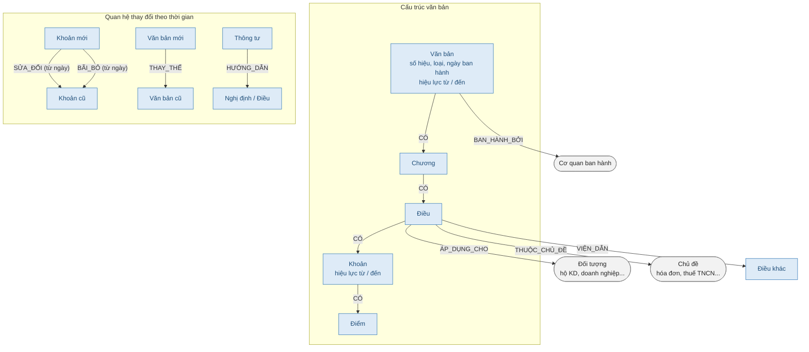
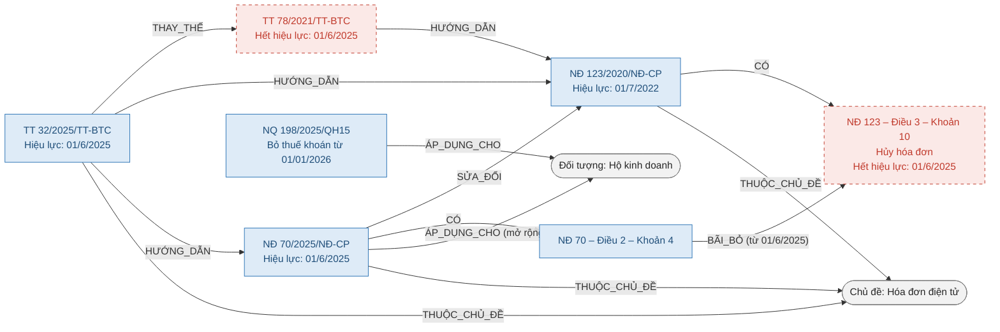
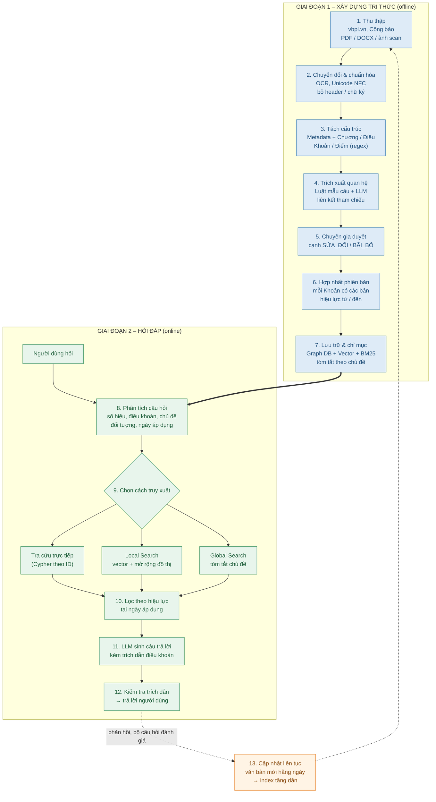
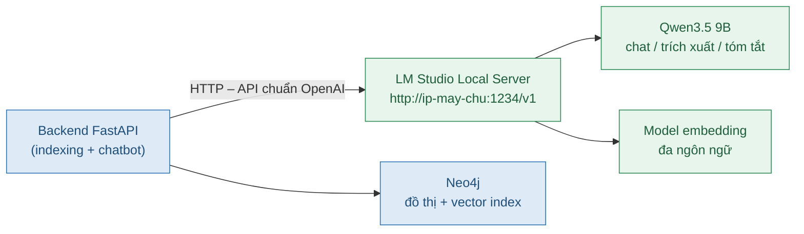

# Inception: Chatbot tra cứu văn bản pháp luật ứng dụng GraphRAG

| Mục | Nội dung |
|---|---|
| Tên dự án | LegalGraph – Chatbot tra cứu văn bản pháp luật Việt Nam |
| Phiên bản tài liệu | v0.1 (bản nháp inception) |
| Ngày | 18/11/2026 |
| Trạng thái | Đề xuất – chờ review |
| Công nghệ cốt lõi | GraphRAG (Knowledge Graph + Retrieval-Augmented Generation) |
| LLM | Qwen3.5 9B chạy local, cung cấp qua HTTP API của LM Studio |

---

## 1. Bối cảnh và vấn đề

Doanh nghiệp, kế toán và công ty luật phải tra cứu hằng ngày một khối lớn Luật, Nghị định, Thông tư. Các văn bản này **liên tục được sửa đổi, bổ sung, thay thế, hướng dẫn và bãi bỏ lẫn nhau**, thường ở cấp từng điều, khoản, điểm.

Ví dụ chỉ riêng mảng hóa đơn điện tử:

- **NĐ 123/2020/NĐ-CP** quy định về hóa đơn, chứng từ (hiệu lực 01/7/2022).
- **NĐ 70/2025/NĐ-CP** (hiệu lực 01/6/2025) sửa đổi, bổ sung NĐ 123, mở rộng đối tượng sang hộ kinh doanh, và bãi bỏ một số điều khoản (ví dụ khoản 10 Điều 3 NĐ 123 về hủy hóa đơn).
- **TT 78/2021/TT-BTC** hướng dẫn NĐ 123 và bị **TT 32/2025/TT-BTC** thay thế từ 01/6/2025.
- **NQ 198/2025/QH15** bỏ phương pháp thuế khoán với hộ kinh doanh từ 01/01/2026.

### Vấn đề của chatbot RAG truyền thống

RAG truyền thống tìm đoạn văn **giống câu hỏi nhất về mặt chữ nghĩa**. Với văn bản pháp luật, cách làm này dẫn đến:

1. **Trích dẫn quy định đã hết hiệu lực.** Đoạn văn bị bãi bỏ vẫn rất giống câu hỏi nên vẫn được tìm thấy và trả lời một cách tự tin.
2. **Không nối được chuỗi sửa đổi.** Văn bản sửa đổi thường chỉ ghi "sửa đổi điểm a khoản 4 Điều 9…", không lặp lại ngữ cảnh, nên khó được tìm thấy khi tìm theo độ giống văn bản.
3. **Không trả lời được câu hỏi tổng hợp**, ví dụ "Tất cả quy định hiện hành về hóa đơn điện tử cho hộ kinh doanh gồm những văn bản nào?".
4. **Không trả lời theo một thời điểm trong quá khứ**, ví dụ "Tại ngày 15/3/2025 quy định là gì?".

---

## 2. Mục tiêu

### 2.1. Mục tiêu nghiệp vụ

- Giảm thời gian tra cứu một quy định từ hàng chục phút xuống vài giây.
- Giảm rủi ro áp dụng nhầm quy định đã hết hiệu lực.
- Mọi câu trả lời đều **truy vết được** đến điều, khoản và văn bản gốc.

### 2.2. Mục tiêu kỹ thuật

- Xây dựng **đồ thị tri thức pháp luật có yếu tố thời gian** (mỗi điều khoản có các phiên bản kèm hiệu lực từ / đến).
- Chatbot hỗ trợ ba kiểu truy vấn: tra cứu trực tiếp, Local Search, Global Search.
- Cập nhật văn bản mới theo kiểu tăng dần, không phải index lại toàn bộ.

### 2.3. Ngoài phạm vi (giai đoạn đầu)

- Không đưa ra tư vấn pháp lý hay kết luận thay luật sư.
- Không xử lý án lệ và văn bản tư pháp ở giai đoạn MVP.
- Không hỗ trợ văn bản tiếng nước ngoài.

---

## 3. Người dùng và tình huống sử dụng

| Nhóm người dùng | Nhu cầu chính |
|---|---|
| Kế toán doanh nghiệp | Quy định hóa đơn, thuế còn hiệu lực; thay đổi mới nhất |
| Chủ hộ kinh doanh | Nghĩa vụ của mình theo quy định hiện hành, diễn đạt dễ hiểu |
| Chuyên viên pháp chế / luật sư | Chuỗi sửa đổi đầy đủ, trích dẫn chính xác, tra theo thời điểm |
| Biên tập viên dữ liệu (nội bộ) | Duyệt các quan hệ sửa đổi / bãi bỏ do hệ thống trích xuất |

### Câu hỏi mẫu

| # | Câu hỏi | Kiểu truy vấn |
|---|---|---|
| Q1 | "Khoản 10 Điều 3 Nghị định 123/2020 hiện còn hiệu lực không?" | Tra cứu trực tiếp + lọc hiệu lực |
| Q2 | "Hộ kinh doanh có bắt buộc dùng hóa đơn điện tử khởi tạo từ máy tính tiền không?" | Local Search |
| Q3 | "Tất cả quy định hiện hành về hóa đơn điện tử cho hộ kinh doanh?" | Global Search + lọc đồ thị |
| Q4 | "Tại ngày 15/3/2025, quy định về ủy nhiệm lập hóa đơn là gì?" | Tra cứu theo thời điểm |
| Q5 | "NĐ 70/2025 đã sửa những điều nào của NĐ 123?" | Duyệt đồ thị |

---

## 4. Thiết kế đồ thị tri thức

### 4.1. Schema tổng quát



### 4.2. Danh mục node

| Node | Thuộc tính chính | Ghi chú |
|---|---|---|
| `VanBan` | `so_hieu`, `loai`, `co_quan`, `ngay_ban_hanh`, `hieu_luc_tu`, `hieu_luc_den`, `trang_thai` | `trang_thai`: còn hiệu lực / hết hiệu lực một phần / hết hiệu lực |
| `Chuong`, `Dieu`, `Khoan`, `Diem` | `id`, `so`, `tieu_de` | `id` dạng `123/2020/NĐ-CP:Đ3:K10` |
| `PhienBan` | `noi_dung`, `hieu_luc_tu`, `hieu_luc_den`, `nguon_sua_doi`, `embedding` | Mỗi lần sửa đổi tạo một phiên bản mới |
| `CoQuan` | `ten` | Chính phủ, Bộ Tài chính, Quốc hội… |
| `DoiTuong` | `ten` | Hộ kinh doanh, doanh nghiệp, cá nhân… |
| `ChuDe` | `ten`, `tom_tat` | Có bản tóm tắt cộng đồng cho Global Search |

### 4.3. Danh mục quan hệ

| Quan hệ | Từ → Đến | Thuộc tính |
|---|---|---|
| `CO` | VanBan → Chuong → Dieu → Khoan → Diem | – |
| `CO_PHIEN_BAN` | Khoan / Dieu → PhienBan | – |
| `SUA_DOI` | Khoan (văn bản mới) → Khoan (văn bản cũ) | `tu_ngay` |
| `BAI_BO` | Khoan (văn bản mới) → Khoan / Dieu (văn bản cũ) | `tu_ngay` |
| `THAY_THE` | VanBan → VanBan | `tu_ngay` |
| `HUONG_DAN` | VanBan (Thông tư) → VanBan / Dieu | – |
| `VIEN_DAN` | Dieu → Dieu | – |
| `BAN_HANH_BOI` | VanBan → CoQuan | – |
| `AP_DUNG_CHO` | Dieu → DoiTuong | – |
| `THUOC_CHU_DE` | Dieu / VanBan → ChuDe | – |

### 4.4. Ví dụ thật: chuỗi văn bản hóa đơn điện tử

Node đỏ viền đứt là văn bản hoặc điều khoản đã hết hiệu lực.



---

## 5. Kiến trúc và quy trình xử lý



### 5.1. Giai đoạn 1: Xây dựng tri thức (offline)

| Bước | Mô tả | Cách thực hiện |
|---|---|---|
| 1. Thu thập | Lấy văn bản từ vbpl.vn, Công báo, kho nội bộ | Crawler / import thủ công; lưu bản gốc kèm hash |
| 2. Chuẩn hóa | OCR ảnh scan, chuẩn Unicode NFC, bỏ quốc hiệu, nơi nhận, chữ ký | PaddleOCR / Tesseract; script Python |
| 3. Tách cấu trúc | Metadata + Chương / Điều / Khoản / Điểm; gán ID cố định | **Regex / parser, không dùng LLM** |
| 4. Trích xuất quan hệ | Bắt mẫu câu "sửa đổi, bổ sung", "bãi bỏ", "thay thế", "hướng dẫn"; liên kết tham chiếu về ID | Luật mẫu câu trước, Qwen3.5 9B (qua LM Studio) cho câu phức tạp |
| 5. Chuyên gia duyệt | Duyệt mọi cạnh `SUA_DOI`, `BAI_BO`, `THAY_THE` | Giao diện duyệt; ưu tiên cạnh có độ tin cậy thấp |
| 6. Hợp nhất phiên bản | Áp sửa đổi theo thời gian để mỗi Khoản có các phiên bản kèm hiệu lực | Thuật toán consolidation theo `tu_ngay` |
| 7. Lưu trữ & chỉ mục | Graph DB, vector index, BM25, tóm tắt chủ đề | Neo4j + vector index; Leiden + LLM tóm tắt |

### 5.2. Giai đoạn 2: Hỏi đáp (online)

| Bước | Mô tả |
|---|---|
| 8. Phân tích câu hỏi | Rút ra số hiệu, điều khoản, chủ đề, đối tượng, **ngày áp dụng** (mặc định: hôm nay) |
| 9. Chọn cách truy xuất | Có số hiệu → tra trực tiếp; tình huống cụ thể → Local Search; câu hỏi tổng hợp → Global Search |
| 10. Lọc theo hiệu lực | Chỉ giữ phiên bản có hiệu lực tại ngày áp dụng. **Chốt chặn chống trích dẫn quy định cũ** |
| 11. Sinh câu trả lời | Qwen3.5 9B trả lời bằng tiếng Việt dễ hiểu, bắt buộc trích dẫn điều, khoản, văn bản |
| 12. Kiểm tra trích dẫn | Đối chiếu tự động: điều khoản được trích có tồn tại và còn hiệu lực không; nếu không đạt thì sinh lại hoặc báo không chắc chắn |
| 13. Cập nhật liên tục | Đưa văn bản mới vào theo kiểu tăng dần; tóm tắt lại các cụm chủ đề bị ảnh hưởng |

### 5.3. Ví dụ luồng xử lý một câu hỏi

> **Câu hỏi:** "Thủ tục hủy hóa đơn lập sai theo khoản 10 Điều 3 Nghị định 123 là gì?"

1. **Phân tích:** văn bản = `123/2020/NĐ-CP`, điều khoản = `Đ3:K10`, ngày áp dụng = hôm nay.
2. **Truy xuất:** tra trực tiếp node `123/2020/NĐ-CP:Đ3:K10`.
3. **Lọc hiệu lực:** phiên bản duy nhất hết hiệu lực từ 01/6/2025, theo cạnh `BAI_BO` từ `70/2025/NĐ-CP:Đ2:K4`.
4. **Mở rộng đồ thị:** tìm quy định hiện hành về xử lý hóa đơn sai sót (Điều 19 NĐ 123 sau khi được NĐ 70 sửa đổi).
5. **Trả lời:** "Quy định hủy hóa đơn tại khoản 10 Điều 3 NĐ 123 đã bị bãi bỏ từ 01/6/2025 (khoản 4 Điều 2 NĐ 70/2025). Hiện nay hóa đơn sai sót được xử lý theo Điều 19 NĐ 123 (đã sửa đổi)…", kèm trích dẫn.

**So sánh:** chatbot RAG truyền thống sẽ trả về nội dung khoản 10 Điều 3 và hướng dẫn thủ tục hủy hóa đơn, tức là một quy định đã hết hiệu lực.

### 5.4. Ví dụ truy vấn Cypher

Kiểm tra hiệu lực của một khoản tại một ngày:

```cypher
MATCH (k:Khoan {id: '123/2020/NĐ-CP:Đ3:K10'})-[:CO_PHIEN_BAN]->(pb:PhienBan)
WHERE pb.hieu_luc_tu <= date('2026-11-18')
  AND (pb.hieu_luc_den IS NULL OR pb.hieu_luc_den > date('2026-11-18'))
OPTIONAL MATCH (moi:Khoan)-[r:BAI_BO|SUA_DOI]->(k)
RETURN k.id, pb.noi_dung, type(r) AS thay_doi, moi.id AS boi, r.tu_ngay
```

Liệt kê các điều khoản của NĐ 123 đã bị NĐ 70 sửa đổi hoặc bãi bỏ:

```cypher
MATCH (:VanBan {so_hieu: '70/2025/NĐ-CP'})-[:CO*]->(moi)
      -[r:SUA_DOI|BAI_BO]->(cu)<-[:CO*]-(:VanBan {so_hieu: '123/2020/NĐ-CP'})
RETURN cu.id AS dieu_khoan_cu, type(r) AS loai, moi.id AS dieu_khoan_moi, r.tu_ngay
ORDER BY cu.id
```

---

## 6. Công nghệ đề xuất

| Thành phần | Lựa chọn | Ghi chú |
|---|---|---|
| **LLM** | **Qwen3.5 9B** (bản GGUF lượng tử hóa, khuyến nghị Q4_K_M) | Chạy local, dữ liệu không gửi ra ngoài |
| **Phục vụ LLM** | **LM Studio**, bật Local Server, cung cấp API qua HTTP | API tương thích OpenAI (`/v1/chat/completions`, `/v1/embeddings`) |
| Embedding | Model embedding đa ngôn ngữ chạy trên cùng LM Studio (ví dụ bge-m3) | Cần hỗ trợ tốt tiếng Việt |
| Kết nối LLM | OpenAI Python SDK / LangChain / LlamaIndex trỏ `base_url` về LM Studio | Không phụ thuộc nhà cung cấp cloud |
| OCR | PaddleOCR, Tesseract (gói tiếng Việt) | Chỉ cần cho văn bản scan |
| Tách cấu trúc | Python + regex | Văn bản pháp luật có cấu trúc chuẩn |
| Trích xuất quan hệ | Qwen3.5 9B qua LM Studio | Chỉ dùng cho câu phức tạp; luật mẫu câu xử lý phần lớn |
| Đồ thị | Neo4j | Hỗ trợ Cypher, vector index, GDS |
| Tìm kiếm | Neo4j vector index / Qdrant + BM25 (Elasticsearch) | Kết hợp ngữ nghĩa và từ khóa chính xác |
| Phân cụm & tóm tắt | Thuật toán Leiden (Neo4j GDS); tóm tắt cụm bằng Qwen3.5 9B | Cho Global Search |
| Backend | FastAPI | API hỏi đáp, API duyệt dữ liệu |
| Frontend | Web chat + giao diện duyệt cho biên tập viên | – |
| Đánh giá | Bộ câu hỏi chuẩn do chuyên gia soạn | Chạy sau mỗi lần cập nhật |

### 6.1. Cấu hình LLM qua LM Studio

**Mô hình triển khai:**



**Các bước cấu hình:**

1. Cài LM Studio, tìm và tải model `qwen3.5-9b` (bản GGUF, khuyến nghị Q4_K_M).
2. Vào tab **Developer**, bật **Start Server**. Cổng mặc định là `1234`.
3. Nếu backend chạy trên máy khác, bật tùy chọn **Serve on Local Network** để LM Studio lắng nghe trên IP mạng LAN.
4. Tải thêm một model embedding đa ngôn ngữ và nạp song song nếu bộ nhớ cho phép.
5. Kiểm tra: `curl http://<ip-máy-chủ>:1234/v1/models` phải trả về danh sách model đang nạp.

**Biến môi trường của backend:**

```env
LLM_BASE_URL=http://<ip-máy-chủ>:1234/v1
LLM_API_KEY=lm-studio            # mặc định LM Studio không kiểm tra key, đặt giá trị bất kỳ
LLM_MODEL=qwen3.5-9b             # đúng tên model hiển thị trong LM Studio
EMBEDDING_MODEL=<tên-model-embedding>
LLM_TEMPERATURE=0.1              # nhiệt độ thấp cho tác vụ pháp lý
```

**Ví dụ gọi từ Python:**

```python
import os
from openai import OpenAI

client = OpenAI(base_url=os.environ["LLM_BASE_URL"], api_key=os.environ["LLM_API_KEY"])

# Trích xuất quan hệ sửa đổi / bãi bỏ từ một câu trong văn bản
resp = client.chat.completions.create(
    model=os.environ["LLM_MODEL"],
    temperature=0.1,
    messages=[
        {"role": "system", "content": (
            "Bạn trích xuất quan hệ giữa các văn bản pháp luật. "
            "Chỉ trả về JSON: [{\"loai\": \"SUA_DOI|BAI_BO|THAY_THE|HUONG_DAN\", "
            "\"dieu_khoan_nguon\": ..., \"dieu_khoan_dich\": ..., \"tu_ngay\": ...}]"
        )},
        {"role": "user", "content": "Bãi bỏ khoản 10 Điều 3 Nghị định số 123/2020/NĐ-CP."},
    ],
)
print(resp.choices[0].message.content)

# Tạo embedding cho nội dung một phiên bản điều khoản
emb = client.embeddings.create(model=os.environ["EMBEDDING_MODEL"], input=["Nội dung khoản ..."])
```

**Lưu ý khi dùng Qwen3.5 9B:**

- Model bật chế độ suy nghĩ (thinking) theo mặc định. Với tác vụ trích xuất hàng loạt nên **tắt thinking** để giảm độ trễ và token; với câu trả lời chatbot có thể bật để tăng độ chính xác. Backend cần lọc bỏ phần `<think>…</think>` trước khi hiển thị.
- LM Studio ghi yêu cầu bộ nhớ hệ thống tối thiểu khoảng **7 GB** cho model này. Máy có VRAM nhỏ hơn kích thước file model sẽ phải chia một phần sang CPU/RAM, tốc độ sinh chữ giảm đáng kể.
- Yêu cầu model trả về **JSON** cho các bước trích xuất và kiểm tra hợp lệ bằng schema (Pydantic). Gặp JSON lỗi thì gọi lại.
- Theo mặc định, server LM Studio chạy **HTTP không mã hóa và không yêu cầu xác thực**. Chỉ mở trong mạng nội bộ; nếu cần truy cập từ ngoài, đặt sau reverse proxy (Nginx / Caddy) có HTTPS và xác thực.

---

## 7. Chỉ số đánh giá (KPI)

| Chỉ số | Định nghĩa | Mục tiêu MVP (đề xuất) |
|---|---|---|
| Độ chính xác câu trả lời | Tỷ lệ câu trả lời đúng trên bộ câu hỏi chuẩn | ≥ 85% |
| Tỷ lệ trích dẫn quy định hết hiệu lực | Câu trả lời viện dẫn điều khoản đã hết hiệu lực | ≤ 1% |
| Độ chính xác trích dẫn | Trích dẫn trỏ đúng điều khoản chứa thông tin | ≥ 95% |
| Độ chính xác cạnh sửa đổi / bãi bỏ | Sau khi chuyên gia duyệt | ≥ 99% |
| Thời gian phản hồi | Từ lúc hỏi đến lúc có câu trả lời (P95) | ≤ 10 giây |
| Độ trễ cập nhật | Từ khi văn bản được công bố đến khi có trong hệ thống | ≤ 2 ngày làm việc |

> Các mục tiêu trên là đề xuất ban đầu, cần thống nhất lại với các bên liên quan.

---

## 8. Rủi ro và hướng xử lý

| Rủi ro | Mức độ | Hướng xử lý |
|---|---|---|
| Trích xuất sai quan hệ sửa đổi / bãi bỏ dẫn đến trả lời sai | Cao | Luật mẫu câu trước, LLM sau; bắt buộc chuyên gia duyệt; bộ test hồi quy |
| Thời gian indexing dài do LLM chạy local | Trung bình | Tách cấu trúc bằng regex; chỉ dùng LLM cho câu phức tạp; tắt thinking khi trích xuất; chạy batch ngoài giờ |
| Qwen3.5 9B kém hơn model lớn ở câu suy luận phức tạp | Trung bình | Luật mẫu câu xử lý phần lớn; JSON schema + gọi lại khi lỗi; chuyên gia duyệt; có thể nâng cấp model lớn hơn trên cùng LM Studio |
| Phần cứng không đủ VRAM / RAM, phản hồi chậm | Trung bình | Dùng bản lượng tử hóa Q4; máy chủ riêng có GPU đủ VRAM cho môi trường production |
| Lộ endpoint LM Studio (HTTP, không xác thực) | Cao | Chỉ mở trong mạng nội bộ; reverse proxy HTTPS + xác thực khi cần truy cập ngoài |
| Văn bản scan chất lượng thấp, OCR sai | Trung bình | Ưu tiên nguồn văn bản số; kiểm tra chéo số hiệu và điều khoản |
| Văn bản mới ban hành liên tục | Trung bình | Pipeline tăng dần; theo dõi nguồn hằng ngày |
| Người dùng coi câu trả lời là tư vấn pháp lý | Cao | Hiển thị rõ nguồn và ngày hiệu lực; disclaimer; khuyến nghị tham vấn chuyên gia |
| Bản quyền / điều khoản sử dụng nguồn dữ liệu | Trung bình | Ưu tiên nguồn chính thống của Nhà nước; kiểm tra điều khoản sử dụng |

---

## 9. Lộ trình đề xuất

| Giai đoạn | Thời gian (ước tính) | Nội dung | Kết quả |
|---|---|---|---|
| 0. Inception | 1 tuần | Thống nhất phạm vi, KPI, nguồn dữ liệu | Tài liệu này được duyệt |
| 1. PoC | 3–4 tuần | Một chủ đề (hóa đơn điện tử, khoảng 10–20 văn bản); tách cấu trúc + đồ thị + tra cứu trực tiếp | Demo Q1, Q5 |
| 2. MVP | 6–8 tuần | Hợp nhất phiên bản, Local / Global Search, giao diện duyệt, bộ câu hỏi đánh giá | Demo Q1–Q5; đo KPI |
| 3. Mở rộng | Liên tục | Thêm lĩnh vực (thuế TNCN, lao động, doanh nghiệp…); cập nhật tự động | Bản production |

---

## 10. Câu hỏi mở

1. Nguồn dữ liệu chính thức là gì? Có được phép crawl tự động không? - https://vanban.chinhphu.vn và được phép crawl tự động
2. Phạm vi lĩnh vực của MVP: chỉ hóa đơn điện tử hay cả thuế hộ kinh doanh? - Cả hai
3. Ai là chuyên gia pháp lý duyệt dữ liệu, và mất bao nhiêu giờ mỗi tuần? - Chỉ là bản demo nên cho phép chạy tối đa 2h mỗi tuần và chạy trong 0.5 tuần
4. ~~LLM dùng cloud hay local?~~ Đã chốt: Qwen3.5 9B chạy local qua LM Studio. Còn mở: cấu hình máy chủ chạy LM Studio cho production (GPU, VRAM, RAM)? - Hiện tại chỉ tập trung cho bản dev
5. Có cần tích hợp với hệ thống nội bộ (ERP, phần mềm kế toán) không? - Không

---

## 11. Thuật ngữ

| Thuật ngữ | Giải thích |
|---|---|
| RAG | Retrieval-Augmented Generation: tìm tài liệu liên quan rồi đưa cho LLM để trả lời |
| GraphRAG | RAG dựa trên đồ thị tri thức: truy xuất theo thực thể và quan hệ thay vì chỉ theo độ giống văn bản |
| Knowledge Graph | Đồ thị tri thức gồm node (thực thể) và cạnh (quan hệ) |
| Local Search | Tìm thực thể liên quan rồi mở rộng sang các node lân cận trong đồ thị |
| Global Search | Trả lời câu hỏi tổng hợp dựa trên các bản tóm tắt cụm chủ đề |
| Hợp nhất phiên bản (consolidation) | Áp các sửa đổi theo thời gian để có nội dung điều khoản tại mỗi thời điểm |
| BM25 | Thuật toán tìm kiếm theo từ khóa, phù hợp với số hiệu và thuật ngữ chính xác |
| Cypher | Ngôn ngữ truy vấn của Neo4j |
