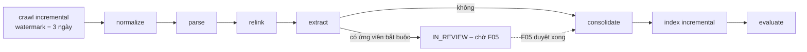

# M16 – Cập nhật tăng dần & scheduler · Implement plan

| Mục | Nội dung |
|---|---|
| Feature | [F15 – Cập nhật liên tục](../../features/F15-cap-nhat-tang-dan.md) |
| Giai đoạn | MVP – tuần 5–6 (song song M11 nếu có 2 người; phần hồi quy nối M17 sau) |
| Ước lượng | 4–5 ngày |
| Phụ thuộc | M02–M08 (handler từng bước), M00 (`pipeline_run`, `pipeline_job`, đồng hồ), M17 (đánh giá hồi quy – nối sau) |
| Module dùng kết quả | M10 đợt 2 (trang quản trị), M18 |
| Checklist | [checklist.md](checklist.md) |

---

## 1. Mục tiêu

Hệ thống tự cập nhật hằng ngày: thu thập văn bản mới từ watermark, đẩy qua F02 → F04, dừng ở `IN_REVIEW`; sau duyệt tự hợp nhất và lập chỉ mục **chỉ phần bị ảnh hưởng**; làm mới trạng thái hiệu lực mỗi ngày; phân cụm lại hằng tuần; đo độ trễ cập nhật (KPI ≤ 2 ngày làm việc).

## 2. Thiết kế

### 2.1. Cấu trúc file

```text
backend/app/ops/
├── models.py        # ORM schedule, watermark (pipeline_run / pipeline_job đã có từ M00)
├── scheduler.py     # vòng lặp trong worker: đọc schedule, croniter, tạo pipeline_run đúng giờ
├── pipelines/
│   ├── daily_ingest.py         # UC-15.1
│   ├── daily_status_refresh.py # UC-15.2
│   └── weekly_recluster.py     # F07 UC-07.2
├── relink.py        # BR-15.3, BR-15.4 – handler job "relink"
├── revisions.py     # BR-15.5 – bản đính chính
├── freshness.py     # BR-15.7 – độ trễ theo ngày làm việc
├── notify.py        # thông báo biên tập viên / quản trị (bản dev: bảng notification + trang quản trị)
└── router.py        # /admin/schedules, /admin/pipeline/*, /admin/freshness
```

### 2.2. Scheduler

| Quyết định | Chi tiết |
|---|---|
| Nơi chạy | Trong process worker (không thêm service). Nhiều worker → chỉ một giữ khóa `pg_try_advisory_lock(<hằng số scheduler>)` |
| Tính giờ | `croniter(cron, now_vn())`; so với `schedule.last_run_at`; trễ (worker tắt qua giờ chạy) → chạy bù **một** lần khi khởi động |
| Đồng hồ giả | Dùng `core/clock.now_vn()` → `APP_FAKE_TODAY` / `APP_FAKE_NOW` áp được cho test BR-15 (F15 §7 ca 01/01/2026) |
| Seed lịch | `daily_status_refresh` `5 0 * * *`, `daily_ingest` `0 2 * * *`, `weekly_recluster` `0 3 * * 0`; bản dev mặc định `enabled = false` (F15: "bản dev có thể chạy thủ công") |

### 2.3. Chuỗi job của `daily_ingest`



| Quy tắc | Cách làm |
|---|---|
| Watermark (BR-15.1) | `from_date = watermark − 3 ngày`; crawl `mode = incremental`; trùng loại bằng hash (M02); chỉ cập nhật watermark (= max `published_at` thành công) khi crawl `DONE` |
| Nối bước | Mỗi handler, khi xong, `enqueue` bước kế với cùng `run_id` (M02–M08 đã làm; M16 bảo đảm truyền `run_id`) |
| Idempotent (BR-15.6) | `dedupe_key = "<step>:<source_document_id>"` (M00); retry 3 lần backoff; `FAILED` không chặn văn bản khác |
| Chạy 2 lần liền (F15 §7) | Lần 2: crawl thấy mọi file trùng hash → không có văn bản mới → không enqueue gì; `pipeline_run.summary.new = 0` |
| Kết thúc run | `pipeline_run.status`: `DONE` khi mọi job của run `DONE` hoặc văn bản dừng ở `IN_REVIEW`; `PARTIAL` khi có job `FAILED`; tổng hợp `summary` (mới, trùng, chờ duyệt, lỗi) + thông báo biên tập viên số ứng viên cần duyệt |
| Đánh giá hồi quy | Sau `index` của run có văn bản mới `INDEXED` → `enqueue("evaluate", {"trigger": "post_update"})` (handler ở M17; trước khi có M17 thì bỏ qua) |

### 2.4. Liên kết lại ứng viên chờ (BR-15.3, BR-15.4)

Handler `relink` chạy sau `parse` của văn bản `X`:

1. `SELECT … FROM relation_candidate WHERE trang_thai = 'cho_van_ban_dich' AND dich_so_hieu = X`.
2. Mỗi ứng viên: chạy lại `legal/refs` trên tham chiếu chữ đã lưu với văn bản đích `X` → `dich_unit_id`; tồn tại (hoặc `BO_SUNG`) → `cho_duyet` + conf theo BR-04.11; không tồn tại → `dich_khong_ton_tai`.
3. Văn bản nguồn của các ứng viên này quay lại `IN_REVIEW` nếu đang `REVIEWED` / `INDEXED`.

### 2.5. Bản đính chính (BR-15.5)

Biên tập viên xác nhận bản revision (`POST /ingest/source-documents/{id}/confirm-revision` **(bổ sung)**) → tách lại → so `content_hash` từng owner với bản cũ → chỉ owner đổi nội dung: cập nhật PhienBan GOC + `enqueue("consolidate", {"unit_ids": …})`. Owner không đổi giữ nguyên embedding.

### 2.6. Làm mới trạng thái hằng ngày (UC-15.2)

`PhienBan` có `hieu_luc_tu = hôm nay` hoặc `hieu_luc_den = hôm nay` → tính lại `trang_thai` văn bản chứa (dùng `doc_status` M06) → `Cum.dirty = true` cho cụm chứa Điều liên quan → `enqueue("index", {"parts": ["communities"]})` (chỉ tóm tắt cụm dirty). Cũng xử lý `VanBan.hieu_luc_tu / hieu_luc_den = hôm nay`.

### 2.7. Độ trễ cập nhật (BR-15.7)

- `lag = ngày làm việc giữa published_at và indexed_at` (chưa `INDEXED` → tới hôm nay); ngày làm việc = thứ 2–6 trừ danh sách ngày nghỉ lễ cấu hình (`HOLIDAYS` trong `.env` hoặc bảng nhỏ).
- `/admin/freshness` theo F15 §5: `watermark`, `documents_by_status`, `lag_working_days {p50, p95, max}`, `overdue` (> 2 ngày làm việc) kèm bước đang tắc.

### 2.8. Schema & API

- Migration: `schedule`, `watermark` (F15 §6); `pipeline_run` / `pipeline_job` đã có; **(bổ sung)** `notification (id, audience, kind, payload, created_at, read_at)`.
- API F15 §5 + `POST …/confirm-revision`.

### 2.9. Nguồn giả lập để test

`FakeSourceAdapter` (cùng Protocol `SourceAdapter` của M02) đọc thư mục `tests/fixtures/fake_source/<ngày>/` – thêm file vào thư mục ngày mới mô phỏng "văn bản mới công bố".

## 3. Các bước triển khai

| Mã | Công việc | Chi tiết | BR | Ước lượng |
|---|---|---|---|---|
| M16-T1 | Migration + seed lịch | 2.8, 2.2 | – | 0.25 ngày |
| M16-T2 | Scheduler + advisory lock + chạy bù | 2.2 | – | 0.75 ngày |
| M16-T3 | `daily_ingest` + nối `run_id` + tổng hợp run | 2.3 | 15.1, 15.2, 15.6 | 1 ngày |
| M16-T4 | `relink` | 2.4 | 15.3, 15.4 | 0.5 ngày |
| M16-T5 | Bản đính chính | 2.5 | 15.5 | 0.5 ngày |
| M16-T6 | `daily_status_refresh` + `weekly_recluster` | 2.6 | – | 0.5 ngày |
| M16-T7 | `freshness` + thông báo + API | 2.7, 2.8 | 15.7 | 0.5 ngày |
| M16-T8 | `FakeSourceAdapter` + test kịch bản | 2.9 | – | 0.5 ngày |
| M16-T9 | Nối đánh giá hồi quy (sau M17) | 2.3 | 15.8 | 0.25 ngày |

## 4. Kế hoạch test

| Kịch bản (F15 §7) | Cách test |
|---|---|
| Văn bản mới ở nguồn giả lập → lần chạy kế tiếp tới `IN_REVIEW` không cần thao tác tay | Thêm file vào `fake_source/2026-11-19/`, `APP_FAKE_NOW=2026-11-20T02:00`, chạy scheduler 1 nhịp, chạy worker tới khi hết job |
| Nạp NĐ 70 trước NĐ 123 → `cho_van_ban_dich`; nạp NĐ 123 sau → `cho_duyet` đích đúng | Hai ngày giả lập liên tiếp |
| `daily_ingest` 2 lần liền → lần 2 không tạo job mới | Đếm `pipeline_job` trước / sau |
| 01/01/2026 (giả lập) → trạng thái điều khoản thuế khoán đổi theo NQ 198/2025 | `APP_FAKE_TODAY=2025-12-31` → `chua_co_hieu_luc` / bản cũ còn hiệu lực; chạy `daily_status_refresh` với `2026-01-01` → đổi |
| Bổ sung | Job lỗi 3 lần → `FAILED`, run `PARTIAL`, văn bản khác vẫn chạy; `POST /admin/pipeline/jobs/{id}/retry` chạy lại được |
| Bổ sung | Worker tắt lúc 02:00 → khởi động 02:30 → chạy bù đúng 1 lần |
| Bổ sung | Hai worker → chỉ một scheduler hoạt động |

## 5. Rủi ro & lưu ý

| Rủi ro | Xử lý |
|---|---|
| Văn bản tắc ở `IN_REVIEW` làm vượt KPI 2 ngày | `freshness.overdue` chỉ rõ bước tắc; thông báo biên tập viên ngay sau run |
| Crawl tăng dần bỏ sót văn bản công bố trễ | Chồng lấn 3 ngày (BR-15.1); chạy `seed` thủ công khi nghi ngờ |
| Batch LLM ban đêm chiếm LM Studio khi có người dùng | Nhường qua `interactive_busy` (M01) |

## 6. Bàn giao

- M17 cung cấp handler `evaluate`; M16-T9 nối vào cuối `daily_ingest`.
- M10 đợt 2 hiển thị `/admin/schedules`, `/admin/pipeline/*`, `/admin/freshness`, thông báo.
